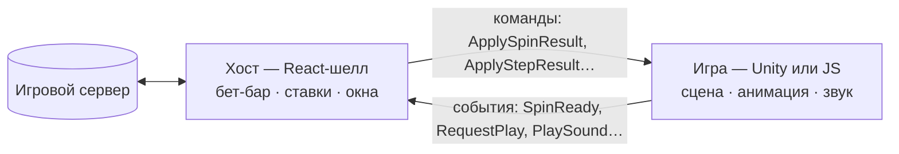

# WebBridge

**Мост между React-шеллом платформы и игрой.** Шелл держит ставку, баланс, бет-бар и сервер; игра —
сцену. WebBridge — контракт между ними и готовые мосты на стороне игры: для **Unity WebGL** и для
**веб-игр на любом JS-движке** (Phaser, Pixi, three.js, Canvas).



Хост решает, **что** произошло (ответ сервера), игра — **как** это показать и **когда** закончилось.
Выигрыш хост раскрывает только по событию конца хода от игры.

## С чего начать

| Я… | Читать |
|---|---|
| делаю игру на **Unity** | [Старт на Unity](docs/guides/getting-started-unity.md) → документ своего режима `unity.md` |
| делаю **веб-игру** (Phaser, Pixi, three.js…) | [Старт на JS](docs/guides/getting-started-js.md) → документ своего режима `js.md` |
| хочу понять, как всё устроено | [Архитектура](docs/concepts/architecture.md) → [Жизненный цикл раунда](docs/concepts/round-lifecycle.md) |
| добавляю **новый режим** | [Новый режим](docs/guides/adding-a-mode.md) |
| выпускаю версию | [Релизы](docs/guides/releasing.md) |

## Режимы

Каждый режим описан тремя файлами: **обзор** — контракт (механика, порядок сообщений, команды, события,
данные), **JS** и **Unity** — как встроить его на своей платформе.

| Режим | Что это | Обзор | JS | Unity |
|---|---|---|---|---|
| **crush** | лесенка коэффициентов, шаг или кэшаут; бонус-серия (Road, MegaGrab) | [контракт](docs/modes/crush/README.md) | [`CrushBridge`](docs/modes/crush/js.md) | [`RoadWebBridge`](docs/modes/crush/unity.md) |
| **twist** | слот тотемов, частичный кэшаут, фри-спины | [контракт](docs/modes/twist/README.md) | [`TwistBridge`](docs/modes/twist/js.md) | [нет моста — рецепт](docs/modes/twist/unity.md) |
| **slot-coin** | барабанный слот, весь раунд одним ответом | [контракт](docs/modes/slot-coin/README.md) | [`SlotCoinBridge`](docs/modes/slot-coin/js.md) | [нет моста — рецепт](docs/modes/slot-coin/unity.md) |
| **wheel** | общий раунд колеса, ставка на сектор | [контракт](docs/modes/wheel/README.md) | [`WheelBridge`](docs/modes/wheel/js.md) | [`WheelWebBridge`](docs/modes/wheel/unity.md) |
| **plinko** | шарик падает в слот с коэффициентом | [контракт](docs/modes/plinko/README.md) | [`PlinkoBridge`](docs/modes/plinko/js.md) | [`PlinkoWebBridge`](docs/modes/plinko/unity.md) |
| **plinko-aztec** | серия шаров, колесо фри-спинов, бонус-игра | [контракт](docs/modes/plinko-aztec/README.md) | [`PlinkoAztecBridge`](docs/modes/plinko-aztec/js.md) | [`PlinkoAztecWebBridge`](docs/modes/plinko-aztec/unity.md) |
| **jumper** | прыжки по ступеням с ускорителями, кэшаут | [контракт](docs/modes/jumper/README.md) | [`JumperBridge`](docs/modes/jumper/js.md) | [`JumperWebBridge`](docs/modes/jumper/unity.md) |
| **mine-slot** | слот, кирки ломают поле блоков, сундуки множат | [контракт](docs/modes/mine-slot/README.md) | [`MineSlotBridge`](docs/modes/mine-slot/js.md) | [`MineSlotWebBridge`](docs/modes/mine-slot/unity.md) |
| **fruit-love-fever** | линейный слот 5 × 3, фри-спины шагами, прилипающие вайлды | [контракт](docs/modes/fruit-love-fever/README.md) | [`FruitLoveFeverBridge`](docs/modes/fruit-love-fever/js.md) | [нет моста — рецепт](docs/modes/fruit-love-fever/unity.md) |

У каждого режима, где есть mock-хост, игру можно запустить без шелла и сервера:
[mock-режим](docs/concepts/mock-mode.md).

## Документация

**Концепции**
- [Архитектура](docs/concepts/architecture.md): участники, два провода (Unity и веб), имена режимов,
  версии
- [Жизненный цикл раунда](docs/concepts/round-lifecycle.md): старт и синхронизация, ход, кэшаут, бонус,
  перезагрузка
- [Общий протокол](docs/concepts/core-protocol.md): команды и события, общие для всех режимов
- [Mock-режим](docs/concepts/mock-mode.md): игра без шелла

**Гайды**
- [Старт на JS](docs/guides/getting-started-js.md) · [Старт на Unity](docs/guides/getting-started-unity.md)
- [Новый режим](docs/guides/adding-a-mode.md) · [Релизы](docs/guides/releasing.md)

**Справочник**
- [Ядро JS-моста](docs/reference/js-core.md): `BridgeBase`, `Signal`, web boot, vite-плагин, mock-хосты
- [Ядро Unity-моста](docs/reference/unity-core.md): `WebBridgeBase<T>`, `WebBridgeUtils`, layout, звук,
  переводы, читы, меню редактора

**Как писать документацию** — [гайд и шаблоны](docs/_templates/README.md).

## Пакеты

| Пакет | Папка | Что внутри |
|---|---|---|
| [`@omega/webbridge-protocol`](protocol/README.md) | `protocol/` | контракт: команды, события, payload'ы — единственный источник истины |
| [`@omega/webbridge-js`](js/webbridge/README.md) | `js/webbridge/` | мосты для веб-игр, mock-хосты, web boot, vite-плагин |
| [`com.pixi.webbridge`](unity/Assets/WebBridge/README.md) | `unity/Assets/WebBridge/` | UPM-пакет: мосты для Unity, mock, сервисы (layout, звук, переводы) |
| [демо-игры](js/examples/demo-games/README.md) | `js/examples/demo-games/` | игра на Canvas 2D для каждого режима — образец интеграции |

```bash
npm install            # один раз, в корне
npm run build          # собрать JS-мост
npm run typecheck      # протокол, мост, примеры
npm test               # тесты моста и демо-игр
```

## Связанные репозитории

- **RoadFrontent** — React-шелл, хост всех игр: модули режимов `src/modes/<id>`, адаптеры движков
  `src/engine/unity` и `src/engine/web`.
- **games-configurator** — админка: игры, сборки, раскладка, тексты, демо-игры, стенд тестировщика.
- [client-core](https://typebook.inoutgames.dev/modules) — клиент бэкенда платформы (формы `GameState`).
- [UI Kit](https://ui-kit.inoutgames.dev/?path=/docs/getting-started-overview--docs) — общие React-компоненты.
