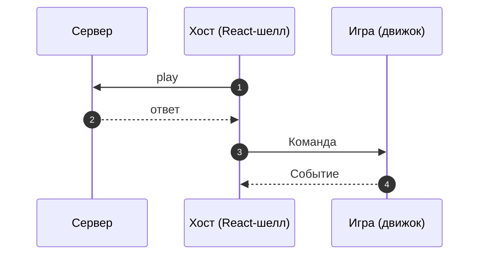

<!--
Шаблон обзора режима: docs/modes/<mode-id>/README.md.
Здесь — КОНТРАКТ режима, одинаковый для любой платформы. Ни C#, ни TS-кода интеграции:
он живёт в js.md и unity.md. Всё, что написано, сверено с кодом (protocol/src, мосты, моки)
и с фронтендом (RoadFrontent src/modes/<id>). Служебные HTML-комментарии удалить.
-->

# <Название режима>

> Одна фраза: что видит игрок и что делает движок.

|  |  |
|---|---|
| **Id режима** | протокол `ModeProtocols['<channel>']` · шелл `<mode-id>` · конфигуратор `<GameMode>` · бэкенд `gameMode=<name>` |
| **JS-мост** | [`<Name>Bridge`](js.md) · mock: `<Name>MockHost` |
| **Unity-мост** | [`<Name>WebBridge`](unity.md) · префаб `<Name>WebBridge.prefab` |
| **Демо** | `js/examples/demo-games/src/modes/<mode-id>` |
| **С версии** | protocol `x.y.z` · js `x.y.z` · Unity-пакет `x.y.z` |

## Механика

<!-- 1–3 абзаца на языке игры: поле, ход, выигрыш, бонус. Ровно столько, сколько нужно, чтобы
понять команды ниже. -->

## Раунд по шагам

<!-- Под диаграммой — нумерованный список: что происходит на каждом шаге и почему. -->

## Команды хоста → игра

| Команда | Когда приходит | Payload | Что делает игра |
|---|---|---|---|

<!-- Только команды режима. Общие (ApplyGameConfig, SetFastGame, …) — ссылкой на
../../concepts/core-protocol.md, если у режима нет особенностей; особенности — здесь. -->

## События игры → хост

| Событие | Когда слать | Что делает хост |
|---|---|---|

## Данные

<!-- Типы payload'ов как TypeScript-интерфейсы из protocol/src (с полями и смыслом каждого),
пример реального JSON (лучше записанного с dev-бэка), кодировки (строки досок, индексы клеток). -->

## Правила и инварианты

<!-- Нумерованный список того, что нельзя нарушать: «один SpinReady на ответ», «деньги — строкой»,
«поле не пересоздаётся между фри-спинами». Каждое правило — с причиной. -->

## Восстановление и ошибки

<!-- Перезагрузка посреди раунда, отказ сервера, пропавший ответ, повторная команда. -->

## Смотрите также

- [JS: как встроить](js.md) · [Unity: как встроить](unity.md)
- [Жизненный цикл раунда](../../concepts/round-lifecycle.md) · [Общий протокол](../../concepts/core-protocol.md)
- Исходники контракта: `protocol/src/…`
