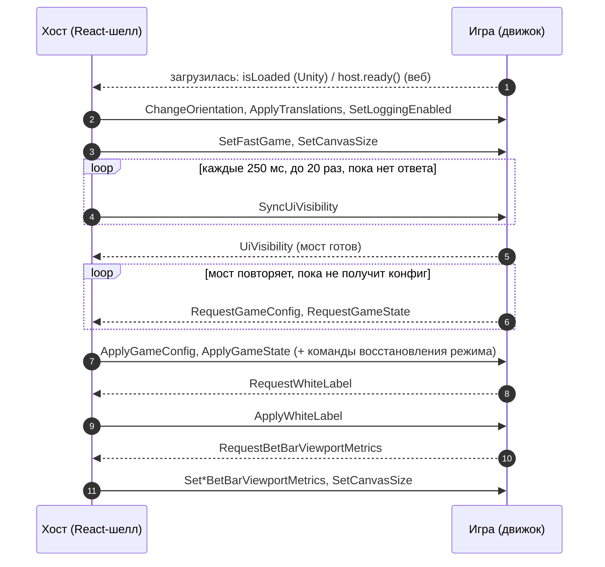

# Общий протокол

> Команды и события, которые понимает любой мост независимо от режима: синхронизация конфига и
> состояния, настройки игрока, раскладка интерфейса хоста, звуки, кнопки бет-бара, окна результата и
> шторка перехода. Режим добавляет к ним свой канал — он описан в `docs/modes/<id>/README.md`.

## Коротко

```ts
import type { CoreCommand, CoreEvent, ModeProtocols } from '@omega/webbridge-protocol';

// Хост → игра: { type, payload? }. Игра → хост: { type, …поля на верхнем уровне }.
const command: CoreCommand = { type: 'SetFastGame', payload: true };
const event: CoreEvent = { type: 'PlaySound', key: 'click', volume: 0.5 };

// Всё, что слышит игра режима crush: ядро плюс канал режима.
type CrushGameCommand = CoreCommand | ModeProtocols['crush']['commands'];
type CrushGameEvent = CoreEvent | ModeProtocols['crush']['events'];
```

В JS-игре ядро уже разобрано: `BridgeBase` принимает каждую `CoreCommand` и превращает её в сигнал, а
события шлёт методами ([ядро JS-моста](../reference/js-core.md)). В Unity то же делают `WebBridgeBase<T>`
и компоненты префаба `WebBridge` ([ядро Unity-моста](../reference/unity-core.md)).

## Где это в коде

| Файл | Что в нём |
|---|---|
| [`protocol/src/commands.ts`](../../protocol/src/commands.ts) | `CoreCommand` и команды режимов, союз `EngineCommand` |
| [`protocol/src/events.ts`](../../protocol/src/events.ts) | `CoreEvent`, `RoundEvent`, события режимов, `UnityOnlyEvent`, союз `EngineEvent` |
| [`protocol/src/payloads.ts`](../../protocol/src/payloads.ts) | формы данных: `UiVisibilityPayload`, `BetBarViewportMetricsPayload`, `CanvasSizePayload`, `WinWindowSignalPayload`… |
| [`protocol/src/modes.ts`](../../protocol/src/modes.ts) | `ModeProtocols`: канал каждого режима сверх ядра |
| [`protocol/src/unityWire.ts`](../../protocol/src/unityWire.ts) | имена провода Unity: объект `WebBridge`, событие `SendToReact`, префиксы строк |
| [`protocol/src/web.ts`](../../protocol/src/web.ts) | контракт веб-игры: `__WEB_GAME_BOOT__`, `WebHostBridge`, `WebGameBridge` |

Как ведёт себя хост, видно в RoadFrontent: `src/app/engine-router/engineEventRouter.ts` (кто отвечает на
событие), `src/game/session/coreEngineRequests.ts` (ответы на запросы), `src/engine/unity/unityProtocol.ts`
(провод Unity), `src/engine/web/useWebGameAdapter.tsx` (провод веб-игры).

## Старт: кто что шлёт



1. **Готовность движка.** Unity готов, когда загрузчик выставил `isLoaded`. Веб-игра зовёт `host.ready()`
   сама. Команды, отправленные веб-игре раньше `ready()`, хост копит в очереди и доставляет сразу после.
2. **Пуш настроек.** Сразу после загрузки хост сам шлёт ориентацию, переводы, флаг логов, fast game и
   размер холста. Дальше — на каждое изменение. Запрашивать их не нужно.
3. **Готовность моста.** Загрузка ещё не значит, что объекты сцены подписались. Хост переспрашивает
   `SyncUiVisibility`, и **первое** `UiVisibility` от игры — знак «мост готов». До него хост не шлёт
   команды восстановления сессии (ждёт до 10 с, потом шлёт вслепую).
4. **Конфиг и состояние.** Игра просит их сама, когда сцена готова принять данные, и повторяет запрос,
   пока не получит конфиг: JS-мост — до 10 раз с шагом 500 мс (`BridgeBase.beginInitialSync`). Ими же
   идёт восстановление после перезагрузки: отдельной команды «восстановить» нет.
5. **White-label** хост сам не пушит — только в ответ на `RequestWhiteLabel`.
6. **Метрики бет-бара.** Бар шлёт их при каждой перекладке. Движок, который мог пропустить их на старте,
   переспрашивает `RequestBetBarViewportMetrics`.

## Команды хоста → игра

Все команды — члены `CoreCommand` (`protocol/src/commands.ts`). Сигнал JS-моста — имя в `BridgeBase`.

### Сессия и синхронизация

| Команда | Payload | Когда шлёт хост | Что делает игра | Сигнал JS |
|---|---|---|---|---|
| `ApplyGameConfig` | `string` — JSON конфига режима | в ответ на `RequestGameConfig`; заново, когда конфиг сменился (сложность, бонус) | разбирает JSON по форме своего режима и перестраивает таблицы | мост режима: `gameConfigReceived` |
| `ApplyGameState` | `string` — JSON состояния сессии | в ответ на `RequestGameState`, при загрузке и переподключении; режимы шлют его и по ходу раунда | «привести сцену к этому»: нет раунда или живой раунд с позиции из состояния | мост режима: `gameStateReceived` |
| `SyncUiVisibility` | — | после загрузки, каждые 250 мс до первого `UiVisibility` (не больше 20 раз) | отвечает `UiVisibility` с текущей видимостью | — (мост отвечает сам) |

Форма JSON конфига и состояния — своя у каждого режима (см. «Данные» в `docs/modes/<id>/README.md`).
Payload нарочно строка: хост сериализует его один раз и по этой строке не шлёт одинаковый конфиг дважды.

### Настройки игрока и сборки

| Команда | Payload | Когда шлёт хост | Что делает игра | Сигнал JS |
|---|---|---|---|---|
| `SetFastGame` | `boolean` | после загрузки и на каждое переключение тумблера; в ответ на `RequestFastGame` | ускоряет анимации; одинаковое значение повторно не применяется | `fastGameChanged` |
| `ApplyWhiteLabel` | `boolean` (`true` — без брендинга) | только в ответ на `RequestWhiteLabel` | прячет или подменяет брендированные элементы | `whiteLabelReceived` |
| `ApplyTranslations` | `string` — JSON `Record<string, string>` | после загрузки, при смене языка и когда Tolgee догрузил ресурсы | заменяет тексты сцены | `translationsReceived` (уже разобранный объект) |
| `ChangeOrientation` | `Orientation` (`'portrait'` \| `'landscape'`) | после загрузки и при каждом повороте | перекладывает сцену | `orientationChanged` |
| `SetLoggingEnabled` | `boolean` | после загрузки и при переключении «Logs» в чит-панели стенда | включает логи моста | — (`BridgeLogger.isEnabled`) |
| `SetAssetsBasePath` | `string` | **не шлёт** с тех пор, как ни одна игра его не читает | ничего; JS-мост игнорирует | — |

Переводы — все ключи под префиксом игры (`i18n.keyPrefix` из конфигурации, по умолчанию `peperoad`),
ключ полный, с префиксом: `{"<префикс>.BUY": "<текст>", …}`. Ключа нет в языке игрока — приходит
английский текст.

### Раскладка: где интерфейс хоста закрывает холст

| Команда | Payload | Когда шлёт хост | Что делает игра | Сигнал JS |
|---|---|---|---|---|
| `SetDesktopBetBarViewportMetrics` | `string` — JSON `BetBarViewportMetricsPayload` | бар перекладывался, сменилась высота полосы Live wins, ответ на `RequestBetBarViewportMetrics` | держит игровое поле вне закрытой части холста | `desktopBetBarViewportMetricsReceived` |
| `SetMobileBetBarViewportMetrics` | `string` — JSON `BetBarViewportMetricsPayload` | то же для мобильного бара | то же | `mobileBetBarViewportMetricsReceived` |
| `SetCanvasSize` | `string` — JSON `CanvasSizePayload` | после загрузки, на каждый ресайз холста и окна, ответ на `RequestBetBarViewportMetrics` | переводит CSS-размеры хоста в свои координаты | `canvasSizeReceived` |

Метрики — доли холста 0..1, поэтому игра раскладывается под них в своих единицах, не зная DOM.
`SetCanvasSize` нужен, потому что игра свой размер в CSS-пикселях сама не узнает: буфер холста умножен на
`devicePixelRatio`, а его хост подбирает под устройство и меняет на ходу. Бар колеса шлёт свою команду
`SetWheelBetBarMetrics` (режим [wheel](../modes/wheel/README.md)).

### Кнопки бет-бара

| Команда | Payload | Когда шлёт хост | Что делает игра | Сигнал JS |
|---|---|---|---|---|
| `DisabledPlayPressed` | — | игрок нажал неактивную Play или игра прислала `RequestPlay`, когда Play держится | показывает отказ (тряска, подсказка); ставки нет | `disabledPlayPressed` |
| `CashoutPressed` | — | сервер выплатил полный кэшаут; в такте открытия окна результата, раньше payout-команды режима; при отказе payout не приходит | убирает со сцены то, что принадлежит живому раунду, пока его не накрыло окном | `cashoutPressed` |

Почему Play держится, знает только хост: идёт раунд, автоплей, бонус, открыта модалка, не хватает
баланса, ставка вне лимитов, игра сама спрятала или заморозила бар. Игре приходит только факт нажатия.
`CashoutPressed` — единственная фора до `RestartRound`, который приходит лишь после закрытия окна.

### Окна результата и шторка перехода

| Команда | Payload | Когда шлёт хост | Что делает игра | Сигнал JS |
|---|---|---|---|---|
| `WinWindowSignal` | `WinWindowSignalPayload` | сценарий окна результата дошёл до отметки, которую расставил админ в конфигураторе | реагирует на имена, которые знает; остальные пропускает | `winWindowSignal` |
| `WinWindowOpened` | — | окно результата появилось (по контракту) | гасит свой геймплейный UI | `winWindowOpened` |
| `WinWindowClosed` | — | окно полностью ушло (по контракту) | возвращает UI | `winWindowClosed` |
| `TransitionScreenOpenStarted` | — | шторка начала закрывать экран (вход в бонус, выход из него, восстановление бонуса) | готовится к смене локации | `transitionScreenOpenStarted` |
| `TransitionScreenOpenFinished` | — | шторка закрыла экран целиком | меняет локацию и доску **под шторкой** | `transitionScreenOpenFinished` |
| `TransitionScreenCloseStarted` | — | шторка начала уходить (через паузу из конфигурации шторки) | — | `transitionScreenCloseStarted` |
| `TransitionScreenCloseFinished` | — | шторка ушла, экран снова виден | запускает то, что должно быть видно игроку | `transitionScreenCloseFinished` |

> **`WinWindowOpened` / `WinWindowClosed` хост сейчас не шлёт.** Команды есть в протоколе, `BridgeBase` их
> принимает, но в RoadFrontent (master) отправителя нет. Не стоит строить на них логику, пока хост их не
> шлёт: узнавать об окне можно по `CashoutPressed`, `RestartRound` и отметкам `WinWindowSignal`.

«Open» у шторки — это шторка **закрывает** экран (открывается поверх сцены), «Close» — уходит. Шторкой
владеет хост: он сам закрывает её по таймеру после `TransitionScreenOpenFinished`. Подробно о бонусе —
в [жизненном цикле раунда](round-lifecycle.md).

## События игры → хост

Все события — члены `CoreEvent` (`protocol/src/events.ts`). Поля событий лежат на верхнем уровне, без
обёртки `payload` (кроме `UiVisibility`).

| Событие | Поля | Когда слать | Что делает хост | JS (`BridgeBase`) |
|---|---|---|---|---|
| `RequestGameConfig` | — | сцена готова принять данные; повторять, пока нет конфига | `ApplyGameConfig` | `requestGameConfig()` (на мосте режима) |
| `RequestGameState` | — | там же | перечитывает сессию с сервера → `ApplyGameState` и команды восстановления | `requestGameState()` |
| `RequestWhiteLabel` | — | на старте, если у игры есть брендинг | `ApplyWhiteLabel` | `requestWhiteLabel()` |
| `RequestFastGame` | — | код поднялся позже пуша и хочет значение | `SetFastGame` с текущим значением | `requestFastGame()` |
| `FastGameChanged` | `enabled: boolean` | игра сама переключила fast game (например, выключила на бонусе) | зеркалит в тумблер бара, обратно команду не шлёт | `notifyFastGameChanged(isEnabled)` |
| `RequestTranslations` | — | — | **не отвечает**: переводы и так приходят на загрузке и смене языка | нет метода |
| `RequestBetBarViewportMetrics` | — | движок мог пропустить метрики на старте | заново шлёт `Set*BetBarViewportMetrics` и `SetCanvasSize` | нет метода |
| `RequestPlay` | — | игрок сделал ход в самой сцене (тап по полю, своя кнопка) | отвечает как на Play бара: ход идёт обычной командой режима, а при неактивной Play — `DisabledPlayPressed` | `requestPlay()` |
| `UiVisibility` | `payload: UiVisibilityPayload` | игра прячет или показывает элементы хоста; в ответ на `SyncUiVisibility` | применяет видимость; первое такое событие — «мост готов» | `setUiVisibility(patch)` |
| `PlaySound` | `key`, `volume?` | разовый звук | играет звук из звуковой библиотеки хоста | `playSound(key, volume?)` |
| `PlayLoop` | `key`, `volume?` | зацикленный звук | играет по кругу | `playLoop(key, volume?)` |
| `StopLoop` | `key` | остановить свой цикл | останавливает | `stopLoop(key)` |
| `SetVolume` | `key`, `volume` | приглушить или вернуть громкость уже играющего звука | меняет громкость, если звук играет | нет метода |
| `PlayMusic` | `key`, `volume?` | — | **игнорирует**: фоновой и бонусной музыкой владеет хост | `playMusic(key, volume?)` |
| `OpenTransitionScreen` | — | — | устаревшее, оставлено для отладки: поднимает шторку перехода, хотя шторкой теперь владеет хост | нет метода |
| `CloseTransitionScreen` | — | — | **игнорирует**: шторку убирает сам хост | нет метода |

`RequestPlay` автоплей не переключает: пока автоплей идёт, ответ — тот же `DisabledPlayPressed`. Ставку
игра не делает и не решает, можно ли её делать.

Телеметрия кадров `UnityFrameSample` (`payload: UnityFrameSamplePayload`) — отдельный союз
`UnityOnlyEvent`: её умеет только Unity-сборка, веб-игра её не шлёт. Ни Unity-пакет, ни шелл (master) её
сейчас не используют.

## Запрос → ответ

| Игра спрашивает | Хост отвечает | Пушит ли хост сам |
|---|---|---|
| `RequestGameConfig` | `ApplyGameConfig` | да, когда конфиг меняется |
| `RequestGameState` | `ApplyGameState` + команды восстановления режима | на загрузке и переподключении |
| `RequestWhiteLabel` | `ApplyWhiteLabel` | нет |
| `RequestFastGame` | `SetFastGame` | да, после загрузки и на каждое переключение |
| `RequestBetBarViewportMetrics` | `SetDesktopBetBarViewportMetrics` / `SetMobileBetBarViewportMetrics` (последние, что прислал бар) и `SetCanvasSize` | да, на каждую перекладку |
| `RequestTranslations` | ничего | да, после загрузки и при смене языка |
| `RequestPlay` | команда хода своего режима (`ApplyStepResult`, `ApplySpinResult`, `ApplyDropResult`…) или `DisabledPlayPressed` | — |
| (хост) `SyncUiVisibility` | игра: `UiVisibility` | — |

Запросы режимов (`RequestStep`, `RequestBallsAmount`, `RequestBetPerBall`, `BonusPurchaseRequest`) — в
документах своих режимов.

## Данные

```ts
type Orientation = 'portrait' | 'landscape';

/** UiVisibility: что игра просит спрятать или заморозить. Поле не задано — хост его не меняет. */
interface UiVisibilityPayload {
  hideDesktopBetBar?: boolean;
  hideMobileBetBar?: boolean;
  hideMobileLastWin?: boolean;
  hideSettingsMenuButton?: boolean;
  hideLogo?: boolean;
  hideBottomBalancePanel?: boolean;
  desktopBetBarInteractable?: boolean;
  mobileBetBarInteractable?: boolean;
}

/** Точка в долях холста 0..1; y отсчитан от НИЖНЕГО края, как у Unity viewport. */
interface ViewportPoint { x: number; y: number }
interface ViewportRect {
  topLeft: ViewportPoint;
  topRight: ViewportPoint;
  bottomLeft: ViewportPoint;
  bottomRight: ViewportPoint;
}

/** Set*BetBarViewportMetrics: сколько холста закрывает интерфейс хоста. Всё — доли 0..1. */
interface BetBarViewportMetricsPayload {
  widthViewport: number;
  /** Снизу: от нижнего края холста до верхней кромки бара (с кнопкой бонуса). */
  heightEndViewport: number;
  /** Сверху: до нижней кромки полосы Live wins. Нет поля или 0 — сверху ничего. */
  heightStartViewport?: number;
  /** Снизу, без кнопки бонуса: до верхней кромки самих панелей бара. */
  heightEndWithoutBonusViewport?: number;
  bonusButtonRight?: ViewportPoint;
  betBarRight?: ViewportPoint;
  bonusProgressIndicator?: ViewportRect;
}

/** SetCanvasSize: размер холста в CSS-пикселях страницы — в единицах интерфейса хоста. */
interface CanvasSizePayload { widthPx: number; heightPx: number }

/** WinWindowSignal: отметка сценария окна результата. Смысл имени знает только игра. */
interface WinWindowSignalPayload {
  readonly window: string;          // ключ окна: 'cashout', 'bigWin', …
  readonly name: string;            // имя отметки, задал админ
  readonly value?: WinWindowSignalValue; // нет — важен сам момент
}
type WinWindowSignalValue =
  | { readonly type: 'int'; readonly value: number }
  | { readonly type: 'float'; readonly value: number }
  | { readonly type: 'bool'; readonly value: boolean }
  | { readonly type: 'string'; readonly value: string };

/** UnityFrameSample: телеметрия кадров, только Unity-сборка. */
interface UnityFrameSamplePayload {
  startTimeSeconds: number;
  sampleDurationMs: number;
  frameCount: number;
  averageFps: number;
  frameTimeP95Ms: number;
  maximumFrameMs: number;
  jankedFrameCount: number;
  longFrameCount: number;
  estimatedDroppedFrames: number;
  foregroundSequence: number;
}
```

Метрики и размер холста приходят строкой — JSON этих интерфейсов. `heightStartViewport` дописывает сам
хост поверх того, что прислал бар; `SetCanvasSize` округляет размеры до двух знаков после запятой.

`GameConfigPayload` в `payloads.ts` (`coefficients`, `bonusCounts`, `bonusModes`, лимиты ставок) — форма
конфига режима [crush](../modes/crush/README.md), а не общая. Остальные режимы описывают свой конфиг
сами.

## Звуки

1. **Ключ выбирает игра, звук — хост.** Треки и громкость задаются в games-configurator; игра шлёт только
   ключ. Неизвестный хосту ключ не играет.
2. **Звуки окон хоста игра не играет.** Ключи из `InternalSounds` шелла (кэшаут, мега-выигрыш, покупка
   бонуса, двери шторки) хост пропускает в `PlaySound` и `PlayLoop`: их играет само окно, второй запуск
   дал бы двойной звук.
3. **`PlayMusic` хост игнорирует.** Фоновую и бонусную музыку переключает сам хост вместе со шторкой.
4. **`SetVolume` меняет громкость любого играющего звука**, включая музыку хоста, но ничего не запускает:
   на молчащем ключе он ничего не делает. Так игра может приглушить трек на своей анимации.
5. **`StopLoop` без проверки владельца**: игра останавливает только то, что запускала сама.
6. **Громкость** — 0..1; хост обрезает значение до этого диапазона. Нет громкости — громкость по умолчанию.

## Видимость интерфейса и готовность моста

- `UiVisibility` — полное состояние видимости, которое держит игра. JS-мост сливает каждый
  `setUiVisibility(patch)` с прежним состоянием и шлёт результат целиком.
- Первое `UiVisibility` после загрузки хост считает подтверждением, что мост принимает команды. JS-мост
  отвечает на `SyncUiVisibility` сам, поэтому подтверждение уходит, даже если игра видимость не трогала
  (с пустым payload'ом).
- `hide*BetBar: true` или `*BetBarInteractable: false` делают Play неактивной: `RequestPlay` в это время
  получает `DisabledPlayPressed`.

## Два провода

Контракт один, а доставка разная. Unity общается строками через `SendMessage` и событие `SendToReact`.
Веб-игра живёт в том же `window`, поэтому команды и события ходят готовыми объектами.

| | Unity WebGL | Веб-игра (JS-бандл) |
|---|---|---|
| Хост → игра | `unityInstance.SendMessage('WebBridge', <метод>, <param>)` — объект `UNITY_BRIDGE_OBJECT` | `game.receive(command)` — объект `EngineCommand` |
| Игра → хост | строка в событие `SendToReact` (`UNITY_REACT_EVENT`) | `host.emit(event)` — объект `EngineEvent` |
| Готовность | `isLoaded` загрузчика | `host.ready()`; до неё команды копятся в очереди |
| Вход | сцена с GameObject `WebBridge` | `window.__WEB_GAME_BOOT__(host, container, options)` |
| Где маппинг в хосте | `src/engine/unity/unityProtocol.ts` | `src/engine/web/useWebGameAdapter.tsx` (маппинга нет) |

### Команды ядра на проводе Unity

| Команда | Метод Unity | `param` |
|---|---|---|
| `ApplyWhiteLabel`, `SetFastGame`, `SetLoggingEnabled` | то же имя | `1` / `0` |
| `ChangeOrientation` | `ChangeOrientation` | `1` — `portrait`, `0` — `landscape` |
| `ApplyGameConfig`, `ApplyGameState`, `ApplyTranslations`, `SetAssetsBasePath` | то же имя | строка как есть |
| `SetDesktopBetBarViewportMetrics`, `SetMobileBetBarViewportMetrics`, `SetCanvasSize` | то же имя | JSON-строка как есть |
| `SyncUiVisibility` | `SyncUiVisibility` | без параметра |
| `DisabledPlayPressed`, `CashoutPressed` | `OnDisabledPlayPressed`, `OnCashoutPressed` | `''` |
| `WinWindowOpened`, `WinWindowClosed` | `OnWinWindowOpened`, `OnWinWindowClosed` | `''` |
| `WinWindowSignal` | `OnWinWindowSignal` | JSON `{window, name, valueType?, value?}`: значение разложено на тип и текст (`UNITY_SIGNAL_VALUE_FIELDS`) |
| `TransitionScreen{Open,Close}{Started,Finished}` | `OnTransitionScreen…` (то же имя с `On`) | `''` |

Правило имён: метод обычно совпадает с `type`; уведомления UI-слоя получают приставку `On`. Команды
режимов следуют тем же правилам с парой исключений (`UpdateCoeffs` — числа через запятую,
`ApplyBonusStepResult` — в метод `ApplyStepResult`); они перечислены в `unity.md` своего режима.

### События ядра на проводе Unity

| Событие | Строка в `SendToReact` |
|---|---|
| `RequestGameConfig`, `RequestGameState`, `RequestWhiteLabel`, `RequestFastGame`, `RequestBetBarViewportMetrics`, `RequestPlay`, `RequestTranslations`, `OpenTransitionScreen` | имя как есть |
| `FastGameChanged` | `FastGame_1` / `FastGame_0` |
| `PlaySound`, `PlayMusic`, `PlayLoop` | `PlaySound_<key>`, `PlayMusic_<key>`, `PlayLoop_<key>`; громкость — суффиксом `\|<0..1>`: `PlaySound_click\|0.5` |
| `SetVolume` | `SetVolume_<key>\|<0..1>` — без громкости хост строку отбрасывает |
| `StopLoop` | `StopLoop_<key>` |
| `UiVisibility` | `UiVisibility_<json>` |

Громкость хост ищет по последнему `|`, поэтому `|` в ключе звука допустим только без громкости.
Нераспознанную строку хост молча отбрасывает: так сейчас уходят в никуда `RequestTranslations` и
`CloseTransitionScreen` от Unity (оба хост и так не обрабатывает).

> **Шелл констант `unityWire.ts` не импортирует** — держит свою копию в `unityProtocol.ts`, поэтому новая
> строка провода правится в обоих местах. Что каждая строка, которую шлёт Unity-пакет, есть в
> `UNITY_PLAIN_MESSAGES` / `UNITY_PREFIXED_MESSAGES`, проверяет `js/webbridge/test/unityWire.test.ts` по
> исходникам C#. `OpenTransitionScreen` и `CloseTransitionScreen` шлёт игровой код, а не пакет, — тест их
> не видит.

### Веб-игра

Команды и события — те же объекты, что в `commands.ts` и `events.ts`, без сериализации. Строками
остаются только payload'ы, которые контракт объявил строками (`ApplyGameConfig`, `ApplyGameState`,
`ApplyTranslations`, метрики, `SetCanvasSize`, `ApplySpinResult`…): их JS-мост разбирает `JSON.parse`.

```ts
// web.ts: что бандл отдаёт хосту
interface WebHostBridge {
  emit(event: EngineEvent): void;  // игра → хост
  ready(): void;                    // игра готова к командам
  setProgress(value: number): void; // прогресс загрузки 0..1 для лоадера хоста
}
interface WebGameBridge {
  receive(command: EngineCommand): void; // хост → игра
  destroy?(): void;                      // перед размонтированием
}
interface WebBootOptions {
  devicePixelRatio?: number; // потолок DPR бэкстора холста: cssSize × min(window.devicePixelRatio, это)
}
type WebBootFn = (host: WebHostBridge, container: HTMLElement, options?: WebBootOptions) => WebGameBridge;
```

Бандл выставляет `window.__WEB_GAME_BOOT__`, хост зовёт её с контейнером `#web-game-root`
(`WEB_GAME_CONTAINER_ID`). Самозагружающийся бандл может вместо фабрики сам положить игру в
`window.__WEB_GAME__`. Как собрать такой бандл — в [старте на JS](../guides/getting-started-js.md).

## Версии и совместимость

1. **Только добавление.** Новая команда, событие или поле добавляются; выпущенные игры и шеллы живут со
   старыми версиями. Удаление — только сменой мажорной версии.
2. **Переименование оставляет псевдоним** с `@deprecated` до мажорной версии:
   - [`legacyPhaserNames.ts`](../../protocol/src/legacyPhaserNames.ts) — контракт веб-игры до 1.12.0:
     `PhaserHostBridge`, `PhaserGameBridge`, `PhaserBootOptions`, `PhaserBootFn`, `PHASER_CONTAINER_ID`
     (`'phaser-root'`), глобалы `__PHASER_HOST__`, `__PHASER_BOOT__`, `__PHASER_GAME__`. Шелл ставит хост
     под обоими именами и читает фабрику под обоими (новое имя первым).
   - [`legacySlotNames.ts`](../../protocol/src/legacySlotNames.ts) — режим `slot` до 1.17.0: `SlotCommand`,
     `SlotSpinResult`, `SlotAction`, `SlotCoin`, `SlotCoinsCollectionAction`, `SLOT_ACTIONS`; канал
     `ModeProtocols.slot` — синоним `ModeProtocols.slotCoin`.
3. **Состав каналов проверяет компилятор.** `protocol/typetests` (`npm run typecheck -w protocol`) ловит
   незаметную смену канала режима и не пропускает команду чужого режима.
4. **Ссылка на версию точная.** Пакет выходит tarball'ом в GitHub Releases с тегом `protocol-v<x.y.z>`;
   зависимость указывается URL'ом tarball'а, диапазонов нет. Как выпускать — в
   [релизах](../guides/releasing.md).

Когда появлялось общее:

| Версия протокола | Что добавилось в ядро |
|---|---|
| 1.5.0 | `DisabledPlayPressed` |
| 1.6.0 | `WinWindowSignal` |
| 1.7.0 | `CashoutPressed` |
| 1.11.0 | `heightStartViewport` и форма `BetBarViewportMetricsPayload` |
| 1.12.0 | `__WEB_GAME_BOOT__` / `WebHostBridge` / `WebGameBridge` вместо Phaser-имён |
| 1.14.0 | `SetCanvasSize` |
| 1.15.0 | `RequestPlay` |
| 1.17.0 | `slot` → `slot-coin` (псевдонимы оставлены) |

Остальное ядро — с первой версии пакета. Последний выпущенный протокол — `protocol-v1.18.0` (канал
`mineSlot`).

## Правила и инварианты

1. **Одно событие — один потребитель в хосте.** События раздаёт `app/engine-router`; общее отвечает ядро
   шелла, остальное — модуль режима. Порядок между двумя подписчиками не определён, поэтому второго нет.
2. **Конфиг и состояние игра просит сама и повторяет запрос.** Хост может ответить не сразу: сокет к
   серверу поднимается секунды.
3. **`UiVisibility` — подтверждение готовности.** Игра, которая не отвечает на `SyncUiVisibility`, получит
   команды восстановления с опозданием в 10 с.
4. **Деньги и JSON — строками.** Payload'ы, объявленные `string`, не парсятся хостом повторно и сравниваются
   как строки; игра разбирает их сама.
5. **Ставку делает только хост.** `RequestPlay` — просьба, а не ставка; лимиты, баланс и блокировку кнопки
   знает хост.
6. **Результат не раньше движка.** Событие конца хода режима (`SpinReady`, `DropFinished`, `RoundShown`)
   хост ждёт без таймаута: не прислала — бар залочен навсегда. См.
   [жизненный цикл раунда](round-lifecycle.md).

## Смотрите также

- [Архитектура](architecture.md) · [Жизненный цикл раунда](round-lifecycle.md) · [Mock-режим](mock-mode.md)
- [Ядро JS-моста](../reference/js-core.md) · [Ядро Unity-моста](../reference/unity-core.md)
- [Старт на JS](../guides/getting-started-js.md) · [Старт на Unity](../guides/getting-started-unity.md)
- Исходники: `protocol/src/commands.ts`, `events.ts`, `payloads.ts`, `unityWire.ts`, `web.ts`
