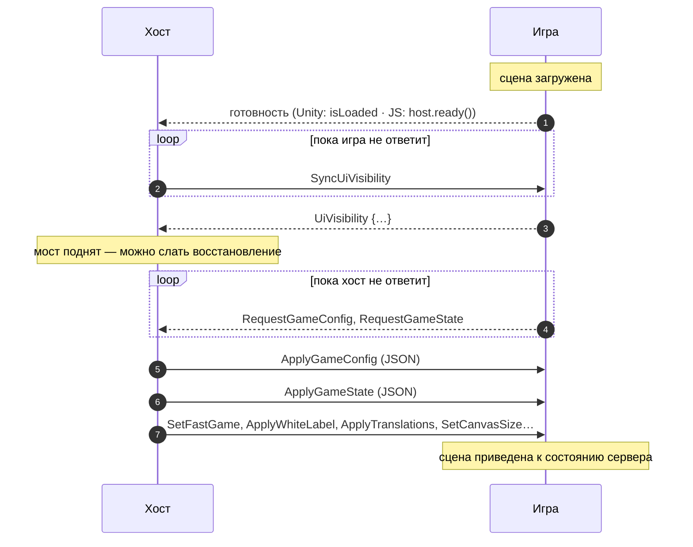
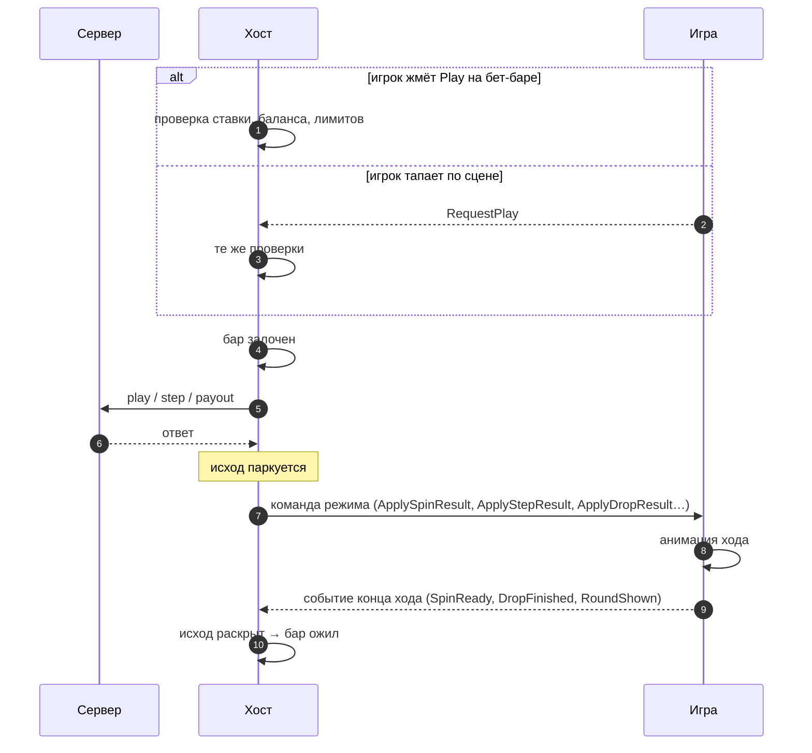
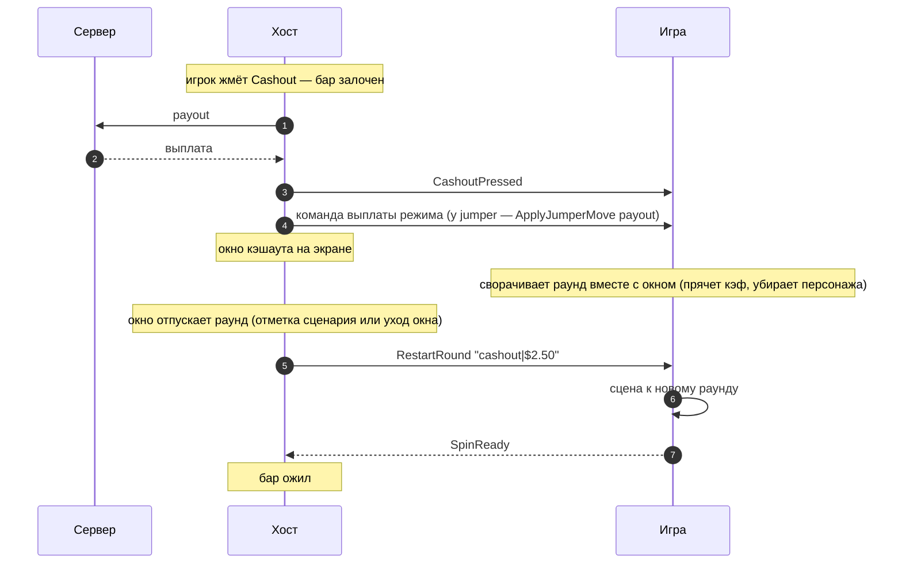

# Жизненный цикл раунда

> Что происходит между хостом и игрой от загрузки страницы до следующей ставки. Общая часть для всех
> режимов. Особенности каждого режима — в его обзоре (`docs/modes/<id>/README.md`).

## 1. Старт: игра поднялась, хост её синхронизировал

1. **Готовность.** Unity сообщает о ней загрузчиком (`isLoaded`), веб-игра — вызовом `host.ready()`. До
   этого хост показывает свой лоадер и команд не шлёт.
2. **Мост поднят.** Хост повторяет `SyncUiVisibility`, пока игра не пришлёт первое `UiVisibility`. Только
   после него хост отправляет восстановление сессии и старт купленного бонуса: команды, пришедшие раньше,
   Unity бы потеряла. В Unity `UiVisibility` шлёт `LayoutWebBridge` (без него на сцене шелл не начнёт
   восстановление), в JS — вызов `bridge.setUiVisibility(…)`.
3. **Конфиг и состояние.** Игра сама просит `RequestGameConfig` и `RequestGameState` и повторяет просьбу,
   пока не получит ответ: это делает стартовая синхронизация моста (`BeginInitialWebSyncAfterSceneLoad` в
   Unity, `beginInitialSync` в JS). Отдельной команды «восстанови игру» нет: `ApplyGameConfig` +
   `ApplyGameState` и есть восстановление после перезагрузки.
4. **Общие настройки.** Быстрая игра, white label, переводы, размер холста, метрики бет-бара приходят
   сами или в ответ на `Request*` ([общий протокол](core-protocol.md)).

`ApplyGameState` с раундом в процессе (`status: "in-game"`) значит «игрок перезагрузил страницу посреди
раунда». Игра должна поставить сцену в это состояние без анимации хода, который уже был.

## 2. Ход: хост ставит, игра играет, игра говорит «доиграно»

**Ставку делает хост.** Игра ставок не делает и не решает, можно ли их делать. Игрок может нажать Play,
когда бар неактивен (идёт раунд, не хватает баланса, ставка вне лимитов). Тогда хост ничего не ставит и
шлёт игре `DisabledPlayPressed`: игра может показать «нельзя», например тряхнуть кнопку.

**Темп задаёт игра.** Сервер отвечает, пока игра ещё не начала анимацию. Хост не применяет ответ сразу,
а паркует его. Выигрыш, баланс выплаты и разблокировка бара ждут события конца хода, иначе исход стал бы
виден раньше, чем игрок его увидит на сцене. Лок бара снимает то же событие, а не завершение запроса.

| Режим | Команда хода | Событие конца хода | Особенности |
|---|---|---|---|
| [crush](../modes/crush/README.md) | `ApplyStepResult` | `SpinReady` | после кэшаута/проигрыша — `RestartRound`, затем снова `SpinReady` |
| [twist](../modes/twist/README.md) | `ApplySpinResult` | `SpinReady` | серия фри-спинов купленного бонуса — `ApplyBonusStepResult` |
| [slot-coin](../modes/slot-coin/README.md) | `ApplySpinResult` | `SpinReady` | весь раунд, бонусные доски тоже, — один ответ |
| [wheel](../modes/wheel/README.md) | `ApplyRound` | `RoundShown` | общий раунд по фазам: бар следует фазе раунда, `RoundShown` раскрывает выплату и открывает окно |
| [plinko](../modes/plinko/README.md) | `ApplyDropResult` | `DropFinished` | — |
| [plinko-aztec](../modes/plinko-aztec/README.md) | `ApplyDropResult` | `DropFinished` | серия шаров; бонус — `ApplyBonusStepResult` |
| [jumper](../modes/jumper/README.md) | `ApplyJumperMove` | `SpinReady` | на открытие раунда `SpinReady` нет: хост сам шлёт первый прыжок |
| [mine-slot](../modes/mine-slot/README.md) | `ApplySpinResult` | `SpinReady` | ответ с фри-спинами — один `SpinReady` на всё |

**Таймаута нет.** Если событие конца хода не пришло, бар остаётся залоченным. Это сделано намеренно:
разблокировать бар раньше — значит пустить ставку поверх недоигранной анимации. Пропавшее событие —
ошибка сборки игры, её чинят в игре. Исключение одно: сервер отказал до хода (игра хода не начинала),
и тогда хост снимает лок сам.

**Автоплей** ведёт хост. Пока он идёт, бар залочен целиком, кроме кнопки остановки. Игра узнаёт об
автоплее командой `SetAutoplay` (в режимах, где она есть) и ничего не решает: следующий ход приходит
обычной командой после события конца предыдущего.

## 3. Конец раунда: окно результата и рестарт

У режимов с выплатой по кнопке (crush, twist, jumper) раунд заканчивается кэшаутом или проигрышем:

- `CashoutPressed` уходит **после** того, как сервер заплатил, в том же тике, что открывается окно: сцена
  сворачивает раунд одновременно с окном. Если сервер отказал, команды нет и живой раунд остаётся на
  экране.
- `RestartRound` уходит, когда окно **отпускает** раунд: на отметке сценария «release» или когда окно
  ушло с экрана. Если окна нет (порог не достигнут или окно выключено), `RestartRound` уходит сразу, и
  выигрыш рисует сама игра. Payload — `<причина>|<сумма>`: `cashout|$2.50`, `win|…`, `lose|`, `bonus|…`.
- Бар оживает на `SpinReady` перезапущенной сцены, а не на закрытии окна.
- `WinWindowSignal` — именованная отметка сценария окна. Имена расставляет админ в конфигураторе, их смысл
  знает игра.
- `WinWindowOpened` / `WinWindowClosed` есть в протоколе и в мостах, но текущий шелл их не отправляет.

Детали по режимам (проигрыш, автокэшаут, бонусный выигрыш) — в их обзорах. Слоты (slot-coin, mine-slot)
и plinko выплачивают выигрыш вместе с ходом: `RestartRound` у них нет.

## 4. Бонус

Купленную или выигранную серию движок обычно играет сам. Хост отдаёт серию одной командой и слушает
события прогресса:

| Шаг | Хост → игра | Игра → хост |
|---|---|---|
| Покупка из магазина хоста | (запрос к серверу) | — |
| Покупка из игры (crush) | `ApplyBonusPurchaseResult` | `BonusPurchaseRequest` |
| Переход | `TransitionScreen*Started/Finished` | `OpenTransitionScreen`, `CloseTransitionScreen` |
| Старт серии | `StartBonus` | `BonusActive` |
| Прогресс (для восстановления после F5) | — | `BonusProgressSave`, `BonusProgressClear` |
| Конец | — | `BonusEnded`, `BonusCleared` |

Какие из них есть у режима, указано в его обзоре. Пауза между фри-спинами — настройка движка, не хоста.
Mine Slot и slot-coin бонусных событий не шлют: фри-спины приходят в том же ответе, что и спин.

## 5. Перезагрузка и сбои

| Ситуация | Что видит игра |
|---|---|
| F5 посреди раунда | старт заново: `ApplyGameConfig` + `ApplyGameState` с `status: "in-game"` — поставить сцену в состояние раунда |
| F5 посреди бонуса | то же, затем `StartBonus` с сохранённым прогрессом (из `BonusProgressSave`) |
| Отказ сервера на ход | ничего: хост показывает ошибку и снимает лок сам |
| Обрыв соединения | ничего от моста: хост блокирует бар и переподключается; после — снова синхронизация |
| Перезагрузка движка хостом | весь цикл с шага 1: мост поднимается заново |

## Смотрите также

- [Архитектура](architecture.md) · [Общий протокол](core-protocol.md) · [Mock-режим](mock-mode.md)
- Шелл: RoadFrontent `CLAUDE.md`, раздел «Темп раунда задаёт движок»
