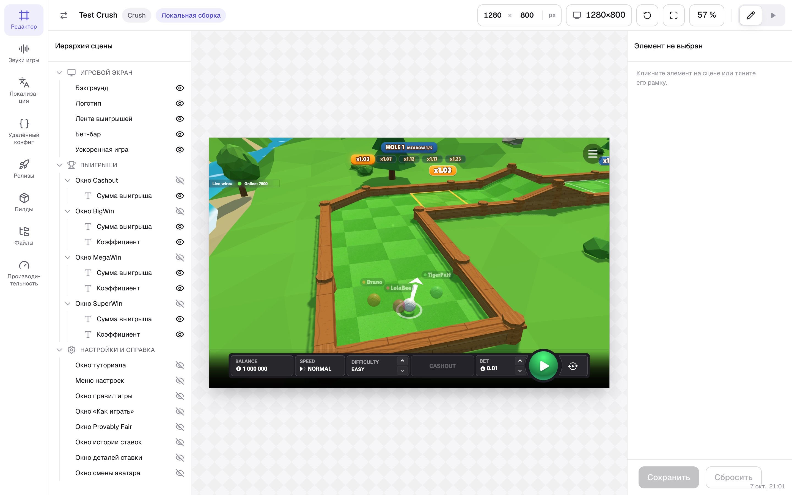
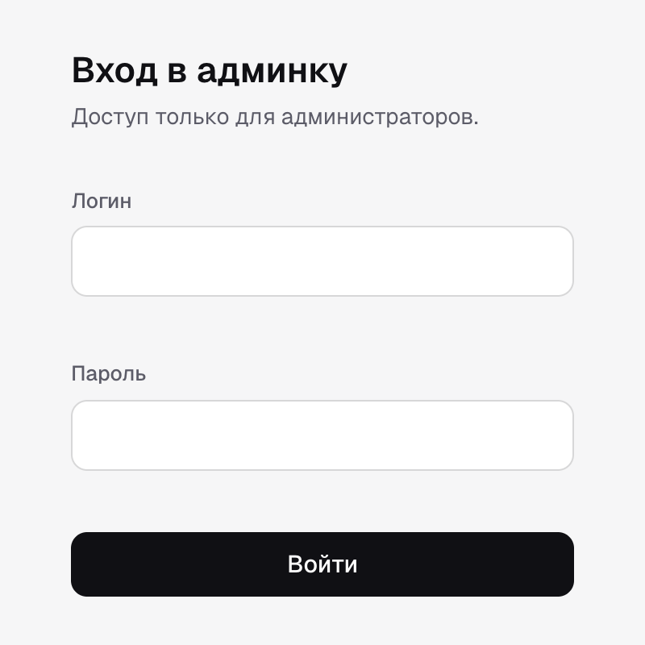
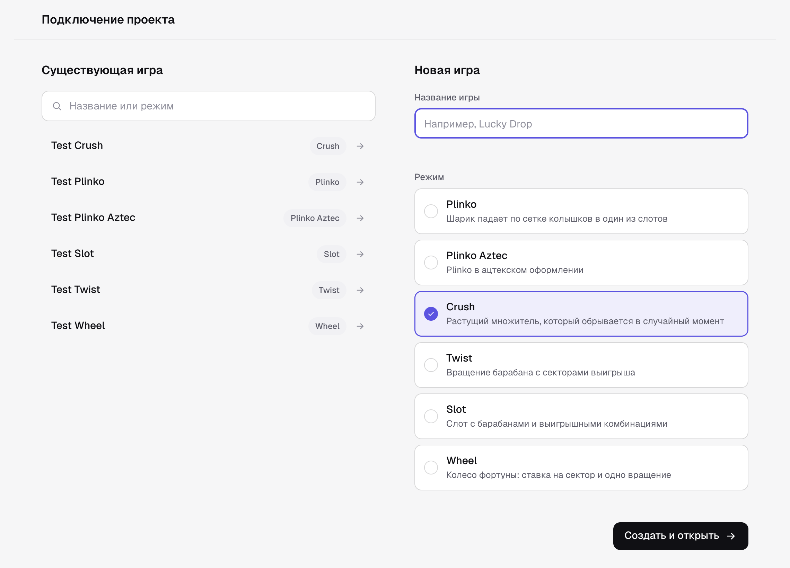
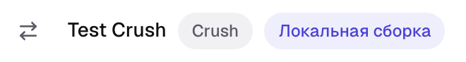

# Старт на JS

> От пустого Vite-проекта до веб-игры, которую запускает шелл: пакеты, точка входа, мост режима, игра
> с mock-хостом без шелла, связь с конфигуратором, сборка `game.js` и проверка в шелле и на стенде.

Пример ниже — минимальная игра режима [crush](../modes/crush/README.md) на Canvas 2D: лесенка
коэффициентов и фишка, которая прыгает на клетку за каждый выигранный шаг. Код компилируется и
собирается с `@omega/webbridge-js` 1.15.0. Движок любой: Phaser, Pixi, three.js встают на место Canvas
без изменений в мосте.

Образец целого проекта — демо-игры [`js/examples/demo-games`](../../js/examples/demo-games/README.md):
по игре на каждый режим, общая загрузка `kit/demoBoot.ts`, страница разработки `dev/main.ts`.

## Что получится

```
my-game/
  index.html        страница разработки: игра против mock-хоста (?mock=1)
  vite.config.ts    localBuildServer для шелла + сборка game.js
  webbridge.json    связь проекта с игрой в конфигураторе (появится на шаге 6)
  src/
    boot.ts         вход бандла: registerWebBoot(gameBoot)
    gameBoot.ts     createWebBoot: мост режима, игра, ready()
    CrushGame.ts    сцена: подписки на мост, анимация, notifySpinReady()
    dev.ts          страница разработки: MockHost и MockPanel
```

Понадобится Node 22+, npm, Chrome на компьютере и аккаунт в админке
(`https://games.omega.keitarocab.link`).

## 1. Поставить пакеты

```bash
npm create vite@latest my-game -- --template vanilla-ts
cd my-game
npm install \
  https://github.com/Flux32/WebBridge/releases/download/js-v1.16.0/omega-webbridge-js-1.16.0.tgz \
  https://github.com/Flux32/WebBridge/releases/download/protocol-v1.18.0/omega-webbridge-protocol-1.18.0.tgz
```

В `package.json` окажутся точные ссылки на tarball'ы — semver-диапазонов нет:

```json
{
  "dependencies": {
    "@omega/webbridge-js": "https://github.com/Flux32/WebBridge/releases/download/js-v1.16.0/omega-webbridge-js-1.16.0.tgz",
    "@omega/webbridge-protocol": "https://github.com/Flux32/WebBridge/releases/download/protocol-v1.18.0/omega-webbridge-protocol-1.18.0.tgz"
  }
}
```

1. **Протокол — той же версии, на которой собран мост.** `js-v1.16.0` зависит от `protocol-v1.18.0`.
   Другая версия поставит вторую копию протокола, и типы команд разъедутся.
2. **Протокол ставится явно**, потому что игра импортирует из него типы payload'ов
   (`StepResultPayload`, `GameConfigPayload`…).
3. **Список выпусков** — [GitHub Releases](https://github.com/Flux32/WebBridge/releases): теги `js-v*` и
   `protocol-v*`.

Шаблон `vanilla-ts` уже собирает с `"moduleResolution": "bundler"` — так пакет и рассчитан: его основная
точка входа читается только бандлером.

## 2. Выбрать мост режима

Режим игры — тот же, что у игры в конфигураторе. Он определяет мост, mock-хост и команды раунда.

| Режим | Мост | Mock-хост | Как встроить |
|---|---|---|---|
| `crush` | `CrushBridge` | `MockHost` + `MockPanel` | [modes/crush/js.md](../modes/crush/js.md) |
| `twist` | `TwistBridge` | — | [modes/twist/js.md](../modes/twist/js.md) |
| `slot-coin` | `SlotCoinBridge` | `SlotCoinMockHost` | [modes/slot-coin/js.md](../modes/slot-coin/js.md) |
| `wheel` | `WheelBridge` | — | [modes/wheel/js.md](../modes/wheel/js.md) |
| `plinko` | `PlinkoBridge` | `PlinkoMockHost` | [modes/plinko/js.md](../modes/plinko/js.md) |
| `plinko-aztec` | `PlinkoAztecBridge` | `PlinkoAztecMockHost` | [modes/plinko-aztec/js.md](../modes/plinko-aztec/js.md) |
| `jumper` | `JumperBridge` | `JumperMockHost` | [modes/jumper/js.md](../modes/jumper/js.md) |
| `mine-slot` | `MineSlotBridge` | `MineSlotMockHost` | [modes/mine-slot/js.md](../modes/mine-slot/js.md) |
| `fruit-love-fever` | `FruitLoveFeverBridge` | `FruitLoveFeverMockHost` | [modes/fruit-love-fever/js.md](../modes/fruit-love-fever/js.md) |

Дальше всё одинаково для любого режима: меняются только мост, его сигналы и событие конца хода.

## 3. Точка входа

Фабрика игры — одна на шелл и на страницу разработки:

```ts
// src/gameBoot.ts
import { createWebBoot, CrushBridge } from '@omega/webbridge-js';
import { CrushGame } from './CrushGame';

/** The game's `__WEB_GAME_BOOT__`: the shell and the dev page's mock host boot it the same way. */
export const gameBoot = createWebBoot({
  createBridge: (transport) => new CrushBridge(transport),
  createGame: (bridge, container, options, host) => {
    const pixelRatio = Math.min(window.devicePixelRatio, options.devicePixelRatio ?? window.devicePixelRatio);
    const game = new CrushGame(bridge, container, pixelRatio);
    // After the boot call returns: a mock host attaches to the returned game first, then hears ready().
    queueMicrotask(() => {
      host.ready();
      bridge.setUiVisibility({
        hideDesktopBetBar: false,
        hideMobileBetBar: false,
        desktopBetBarInteractable: true,
        mobileBetBarInteractable: true,
      });
      bridge.start();
    });
    return game;
  },
  destroyGame: (game) => game.destroy(),
});
```

```ts
// src/boot.ts — вход бандла, его шелл грузит как game.js
import { registerWebBoot } from '@omega/webbridge-js';
import { gameBoot } from './gameBoot';

registerWebBoot(gameBoot);
```

Что здесь важно:

1. **`host.ready()` — когда игра готова к командам.** До него шелл держит лоадер и копит команды. У
   настоящей игры это момент, когда загружены ассеты первого экрана; прогресс до него —
   `host.setProgress(0..1)`.
2. **Не синхронно внутри `createGame`.** Mock-хост привязывается к игре уже после возврата фабрики и
   отдаёт конфиг именно на `ready()`.
3. **`setUiVisibility`** показывает бет-бары и заодно подтверждает шеллу, что мост жив.
4. **`bridge.start()`** запускает стартовую синхронизацию: мост просит конфиг и состояние, пока хост не
   ответит.
5. **DPR ограничивает хост** (`options.devicePixelRatio`): на телефоне с DPR 3 полный бэкстор — это в
   9 раз больше пикселей и просадка FPS.

`registerWebBoot` кладёт фабрику в `window.__WEB_GAME_BOOT__` и в прежнее `__PHASER_BOOT__` для старых
шеллов. Подробно о фабрике — в [ядре JS-моста](../reference/js-core.md#загрузка-игры-в-шелл).

## 4. Игра

Сцена подписывается на сигналы моста, проигрывает команды по очереди и сообщает «ход доигран»
только после анимации. На этом событии шелл раскрывает выигрыш и оживляет бет-бар.

```ts
// src/CrushGame.ts
import type { CrushBridge } from '@omega/webbridge-js';
import type { StepResultPayload } from '@omega/webbridge-protocol';

const HOP_MS = 450;
const RESET_MS = 300;
const CELL_COLOR = '#2a3150';
const MARKER_COLOR = '#ff7a59';
const LOSS_COLOR = '#c0392b';

/** A crush scene on Canvas 2D: a row of ladder cells and a marker that hops one cell per won step. */
export class CrushGame {
  private readonly canvas = document.createElement('canvas');
  private readonly context: CanvasRenderingContext2D;
  private readonly unsubscribers: (() => void)[];
  private ladder: readonly number[] = [];
  private step = -1;
  private moves: Promise<void> = Promise.resolve();
  private isDestroyed = false;

  public constructor(
    private readonly bridge: CrushBridge,
    private readonly container: HTMLElement,
    private readonly pixelRatio: number,
  ) {
    const context = this.canvas.getContext('2d');
    if (context === null) throw new Error('[game] Canvas 2D is unavailable');
    this.context = context;
    this.canvas.style.cssText = 'display:block;width:100%;height:100%;touch-action:none';
    container.appendChild(this.canvas);

    this.unsubscribers = [
      bridge.gameConfigReceived.add((config) => this.setLadder(config.coefficients)),
      bridge.coefficientsReceived.add((ladder) => this.setLadder(ladder)),
      bridge.stepResultReceived.add((result) => this.enqueue(() => this.playStep(result))),
      bridge.restartRequested.add(() => this.enqueue(() => this.reset())),
      bridge.disabledPlayPressed.add(() => this.draw(LOSS_COLOR)),
    ];
    this.canvas.addEventListener('pointerdown', this.onTap);
    window.addEventListener('resize', this.resize);
    this.resize();
  }

  public destroy(): void {
    this.isDestroyed = true;
    this.unsubscribers.forEach((unsubscribe) => unsubscribe());
    this.canvas.removeEventListener('pointerdown', this.onTap);
    window.removeEventListener('resize', this.resize);
    this.canvas.remove();
  }

  /** The host's commands play one after another: a step never starts on top of the previous one. */
  private enqueue(move: () => Promise<void>): void {
    this.moves = this.moves.then(move);
  }

  private async playStep(result: StepResultPayload): Promise<void> {
    if (!result.isWinMain) {
      await this.animate(HOP_MS, () => this.draw(LOSS_COLOR));
      await this.reset();
      return;
    }
    this.step += 1;
    await this.animate(HOP_MS, (progress) => this.draw(MARKER_COLOR, progress));
    // The host unlocks the bet bar on this event: only after the hop has played.
    if (!this.isDestroyed) this.bridge.notifySpinReady();
  }

  /** A lost step, a cash out or a won round: back to the bottom, then the bar may take a new bet. */
  private async reset(): Promise<void> {
    this.step = -1;
    await this.animate(RESET_MS, () => this.draw(MARKER_COLOR));
    if (!this.isDestroyed) this.bridge.notifySpinReady();
  }

  private animate(durationMs: number, frame: (progress: number) => void): Promise<void> {
    const duration = this.bridge.isFastGameEnabled ? durationMs / 2 : durationMs;
    return new Promise((resolve) => {
      const startedAt = performance.now();
      const tick = (now: number): void => {
        if (this.isDestroyed) return resolve();
        const progress = Math.min(1, (now - startedAt) / duration);
        frame(progress);
        if (progress < 1) requestAnimationFrame(tick);
        else resolve();
      };
      requestAnimationFrame(tick);
    });
  }

  private setLadder(ladder: readonly number[]): void {
    this.ladder = ladder;
    this.draw(MARKER_COLOR);
  }

  private draw(markerColor: string, hopProgress = 1): void {
    const { width, height } = this.canvas;
    const cell = width / Math.max(1, this.ladder.length);
    this.context.clearRect(0, 0, width, height);
    this.ladder.forEach((coefficient, index) => {
      this.context.fillStyle = CELL_COLOR;
      this.context.fillRect(index * cell + 2, height / 2 - cell / 2, cell - 4, cell);
      this.context.fillStyle = '#c9d1e0';
      this.context.font = `${Math.round(cell / 4)}px system-ui`;
      this.context.fillText(`x${coefficient}`, index * cell + 8, height / 2);
    });
    if (this.step < 0) return;
    const x = (this.step - 1 + hopProgress) * cell + cell / 2;
    this.context.fillStyle = markerColor;
    this.context.beginPath();
    this.context.arc(x, height / 2 - cell, cell / 4, 0, Math.PI * 2);
    this.context.fill();
  }

  private readonly resize = (): void => {
    this.canvas.width = Math.round(this.container.clientWidth * this.pixelRatio);
    this.canvas.height = Math.round(this.container.clientHeight * this.pixelRatio);
    this.draw(MARKER_COLOR);
  };

  /** A tap is the player's move: the host answers as for its own Play button. */
  private readonly onTap = (): void => {
    this.bridge.requestPlay();
  };
}
```

Правила, на которых держится раунд (подробно — в [жизненном цикле](../concepts/round-lifecycle.md)):

1. **Один ответ хоста — одно событие конца хода**, и только после анимации. Синхронно внутри
   обработчика команды его не слать: шелл раскроет выигрыш раньше, чем игрок его увидит.
2. **Не прислали событие — бар залочен навсегда.** Таймаута у шелла нет; это ошибка игры.
3. **Команды — по очереди.** Новая команда может прийти, пока играет прошлая; очередь не даёт им
   наложиться.
4. **Ставку делает хост.** Тап по сцене — `requestPlay()`, а не ход: хост ответит командой хода или
   `DisabledPlayPressed`.
5. **Отписка в `destroy`.** Шелл уничтожает игру при перезагрузке движка; забытая подписка держит сцену
   в памяти.

Что значат команды crush (`ApplyStepResult`, `RestartRound`, `UpdateCoeffs`, бонус) — в
[контракте режима](../modes/crush/README.md); API моста — в [modes/crush/js.md](../modes/crush/js.md).

## 5. Играть без шелла: mock-хост

Страница разработки поднимает ту же фабрику, но вместо шелла — mock-хост из пакета. Он отвечает на
запросы игры и сам сдаёт ходы.

```ts
// src/dev.ts
import { isMockEnabled, MockHost, MockPanel } from '@omega/webbridge-js';
import { gameBoot } from './gameBoot';

const container = document.getElementById('game');
if (container === null) throw new Error('[dev] index.html lacks #game');

if (isMockEnabled()) {
  const host = new MockHost();
  host.attach(gameBoot(host, container));
  host.bindKeys();
  new MockPanel(host).mount();
} else {
  container.textContent = 'Open with ?mock=1, or load /game.js from the shell (?localBuild=).';
}
```

```html
<!-- index.html -->
<!doctype html>
<html lang="en">
  <head>
    <meta charset="UTF-8" />
    <meta name="viewport" content="width=device-width, initial-scale=1, viewport-fit=cover" />
    <title>My game</title>
    <style>html, body { margin: 0; height: 100%; background: #0b0d1a; } #game { position: fixed; inset: 0; }</style>
  </head>
  <body>
    <div id="game"></div>
    <script type="module" src="/src/dev.ts"></script>
  </body>
</html>
```

Запустить (`vite.config.ts` — на следующем шаге) и открыть `http://localhost:5180/?mock=1`:

| Клавиша | Что делает |
|---|---|
| Пробел | шаг: выигрыш или проигрыш с шансом `loseChance` |
| C | кэшаут: `CashoutPressed`, затем `RestartRound` |
| R | оборвать раунд: `RestartRound` |

Кнопка «M» в углу открывает панель: сложность, шанс проигрыша, те же три действия. Тап по сцене —
`RequestPlay`: mock отвечает шагом или, пока прошлый шаг не доигран, `DisabledPlayPressed`. Забудете
`notifySpinReady()` — mock залипнет так же, как шелл.

Без `?mock=1` страница ничего не запускает: при нём мост не ведёт стартовую синхронизацию, и только так
mock-хост — единственный собеседник игры. Подробно — в [mock-режиме](../concepts/mock-mode.md).

## 6. Связать с конфигуратором

Плагин `localBuildServer` запускает игру прямо с dev-сервера внутри настоящего шелла в редакторе
раскладки. Собирать и загружать билд не нужно: код берётся с вашего компьютера, а конфигурация,
раскладка и бэкенд — со стенда. Сохранили файл — редактор перезагрузился с новым кодом.



### Подключить плагин и описать сборку

```ts
// vite.config.ts
import { localBuildServer } from '@omega/webbridge-js/vite';
import { defineConfig } from 'vite';

const ENTRY = 'src/boot.ts';

export default defineConfig({
  plugins: [localBuildServer({ entry: `/${ENTRY}`, mode: 'crush' })],
  server: { port: 5180 },
  build: {
    lib: { entry: ENTRY, name: 'Game', formats: ['iife'], fileName: () => 'game.js' },
    rollupOptions: { output: { inlineDynamicImports: true } },
  },
});
```

| Опция | Что это |
|---|---|
| `entry` | файл, который зовёт `registerWebBoot`, от корня проекта. Обязательна |
| `mode` | режим игры: админка подставит его, когда проект заводит новую игру |
| `configuratorUrl` | адрес админки; по умолчанию боевая. Для локальной — ровно тот адрес, по которому её открывают, например `http://127.0.0.1:3000` |

Порт задать явно и не менять: плагин включает `strictPort`, и полные адреса ассетов строятся по нему.
Все опции — в [ядре JS-моста](../reference/js-core.md#localbuildserveroptions).

### Запустить dev-сервер

```bash
npm run dev
```

Плагин откроет админку в браузере и напечатает её адрес — на случай, если браузер не открылся:

```text
  WebBridge admin: https://games.omega.keitarocab.link/admin/connect?localBuild=http%3A%2F%2Flocalhost%3A5180&mode=crush
```

### Войти и выбрать игру

Если вход ещё не выполнен, админка покажет форму входа и после неё вернёт на страницу подключения.



Дальше админка спросит, с какой игрой связать проект. Это делается **один раз на проект**.



- **Существующая игра** — выбрать в списке слева; поиск понимает название и режим.
- **Новая игра** — ввести название справа (режим уже выбран по опции `mode`) и нажать
  «Создать и открыть».
- Компаний несколько — сверху появится выбор компании; игра заведётся в выбранной.

### Закоммитить `webbridge.json`

Админка передаёт выбор dev-серверу, и тот пишет в корень проекта:

```json
{
  "gameId": "test-crush"
}
```

Его стоит закоммитить: тогда у всей команды проект открывает одну и ту же игру, и экран подключения
больше никто не увидит. Каждый следующий `npm run dev` открывает сразу редактор этой игры.

### Работать в редакторе



- **«Локальная сборка»** — код игры идёт с dev-сервера, а не из загруженного билда.
- **⇄** слева от названия — сменить игру проекта: ведёт обратно на экран подключения.
- Правка в коде перезагружает страницу в редакторе.

Без автооткрытия: `server.open: false` в `vite.config.ts` (ссылка в консоли останется). Вручную: к
ссылке на редактор или стенд добавить `&localBuild=http://localhost:5180`.

```text
 dev-сервер игры (Vite + localBuildServer)          админка (конфигуратор)
 ─────────────────────────────────────────          ─────────────────────────
 печатает и открывает ссылку на админку  ────────▶  /admin/connect?localBuild=…
 POST /__webbridge/project  ◀── выбранная игра ───  экран «Подключение проекта»
   → пишет webbridge.json
                                                     редактор раскладки
                                                       └─ iframe: шелл стенда
 /game.js (модуль Vite)  ◀── ?localBuild=… ──────────────── грузит игру отсюда
```

- Связь с игрой dev-сервер принимает только с origin админки из `configuratorUrl`.
- Код игры он отдаёт по CORS только страницам стендов и `localhost`.
- Шелл берёт локальную сборку только с `localhost`, `127.0.0.1` или `[::1]`, и только на стенде: в
  релизном пакете шелла этой возможности нет.

## 7. Собрать `game.js`

```bash
npm run build      # tsc && vite build → dist/game.js
```

`build` из `vite.config.ts` выше собирает **один файл в формате IIFE**:

1. **IIFE, а не ES-модуль.** Билд из конфигуратора шелл подключает обычным `<script>`, не модулем:
   `import` на верхнем уровне в нём не исполнится. Модулем шелл грузит только локальную сборку.
2. **Один файл** (`inlineDynamicImports`): шелл грузит только `<папка билда>/game.js`, соседние чанки
   никто не запросит.
3. **Ассеты.** Импортированные ассеты Vite в lib-режиме встраивает в бандл (data URL) при любом размере,
   поэтому они прямо увеличивают `game.js`: следите за его весом, это время до первой ставки.

Билд в конфигуратор:

1. Упаковать папку с `game.js` в ZIP (`game.js` может лежать на любом уровне архива; допускается
   предсжатый `game.js.gz`).
2. В редакторе игры открыть рабочую область **«Билды»** и загрузить архив (до 500 МБ).
3. Нажать **«Сделать активным»**: активный билд берут сцена редактора и релиз.

Конфигуратор сам поймёт, что это веб-игра (в архиве `game.js`, а не `Build/*.loader.js`), и запишет это
в конфигурацию релиза — шелл поднимет веб-движок.

## 8. Проверить в шелле

| Где | Как открыть | Что проверяет |
|---|---|---|
| Страница разработки | `http://localhost:5180/?mock=1` | сцену и ритм раунда против mock-хоста |
| Редактор раскладки | `npm run dev` (откроется сам) | игру в настоящем шелле со стендовым бэкендом, раскладку бара под игру |
| Стенд плейтеста | `/admin/games/<gameId>/playtest?localBuild=http://localhost:5180` | игру во весь экран: размеры экрана, язык, валюта, чит-таблица RNG, тумблер «Logs» |
| Загруженный билд | тот же стенд без `localBuild` | то, что уйдёт в релиз |

Чек-лист:

- [ ] Лоадер шелла уходит — игра позвала `host.ready()`.
- [ ] Бет-бар виден и активен — дошло `UiVisibility`.
- [ ] Лесенка из конфига сервера, а не заглушка — дошло `ApplyGameConfig`.
- [ ] После каждого хода бар оживает **после** анимации, а не сразу — `SpinReady` шлётся вовремя.
- [ ] Тап по сцене делает ход; во время хода — отказ (`DisabledPlayPressed`).
- [ ] Перезагрузка посреди раунда возвращает сцену на ту же ступень — `ApplyGameState` разобран.
- [ ] Fast game из бара ускоряет анимации.
- [ ] С тумблером «Logs» в консоли видны строки `[WebBridge] …`, без ошибок.

## Частые ошибки

| Симптом | Причина | Как исправить |
|---|---|---|
| Шелл: `Web game bundle loaded but registered neither a boot function nor a game` | `entry` или вход сборки — не тот файл, что зовёт `registerWebBoot` | указать `src/boot.ts` в `localBuildServer({ entry })` и в `build.lib.entry` |
| Загруженный билд не стартует, в консоли `Unexpected token 'export'` или `'import'` | `game.js` собран ES-модулем, а шелл подключает билд обычным скриптом | `formats: ['iife']` и `inlineDynamicImports: true` |
| Лоадер шелла не уходит | игра не позвала `host.ready()` | позвать, когда игра готова к командам |
| На странице `?mock=1` игра не получила конфиг | `host.ready()` позван синхронно в `createGame`, до `attach` | звать тиком позже (`queueMicrotask`, `setTimeout`) |
| Бар залочен после хода | событие конца хода не пришло или пришло не на каждый ответ | `notifySpinReady()` после каждой анимации хода и рестарта |
| Восстановление после перезагрузки опаздывает на ~10 с | шелл не получил `UiVisibility` | не перекрывать `SyncUiVisibility`; звать `setUiVisibility` на старте |
| «Проект по адресу … не запомнил игру. Дев-сервер игры не ответил» | dev-сервер не запущен, плагин не подключён, пакет старее 1.12.0 или Chrome не получил доступ к локальной сети | проверить по порядку, разрешить доступ, «Повторить» |
| «Дев-сервер игры отказал (HTTP 403)» | админка открыта не по адресу `configuratorUrl` (`localhost` и `127.0.0.1` — разные) | открыть админку по ссылке из консоли |
| Dev-сервер не стартует: порт занят | `strictPort` | освободить порт или сменить `server.port`; связь хранится в `webbridge.json` и от порта не зависит |
| Картинки и шрифты не грузятся в редакторе | ассет адресован от корня страницы | адресовать от модуля: `import` или `new URL('…', import.meta.url)` |
| Не открывается с телефона | так задумано: шелл берёт локальную сборку только с этой машины | проверять на телефоне загруженный билд |
| Шелл пишет `Web game bundle does not report its DPR cap` | шелл ищет потолок DPR в `window.__WEB_GAME__.__adaptiveResolution`, а `createWebBoot` его не публикует | предупреждение, не ошибка; DPR берите из `options.devicePixelRatio` |

## Смотрите также

- [Ядро JS-моста](../reference/js-core.md) · [Общий протокол](../concepts/core-protocol.md) ·
  [Жизненный цикл раунда](../concepts/round-lifecycle.md) · [Mock-режим](../concepts/mock-mode.md)
- [Новый режим](adding-a-mode.md) · [Релизы](releasing.md) · [Старт на Unity](getting-started-unity.md)
- Образец: `js/examples/demo-games` (`src/kit/demoBoot.ts`, `src/dev/main.ts`, `src/modes/<mode>/`)
