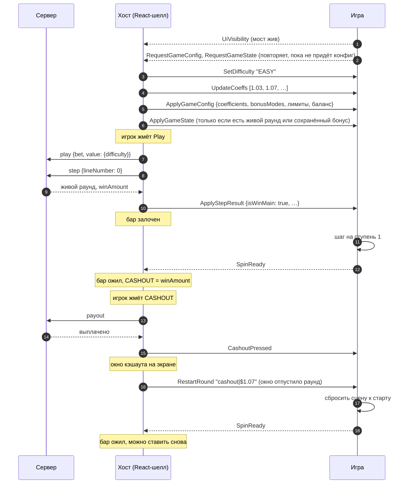
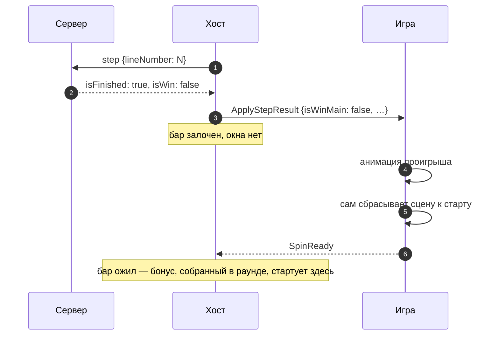
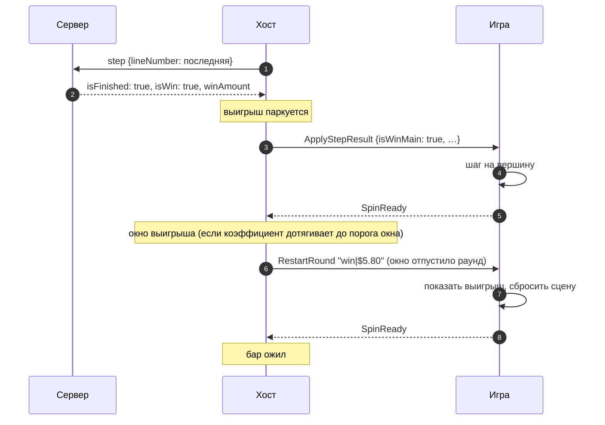
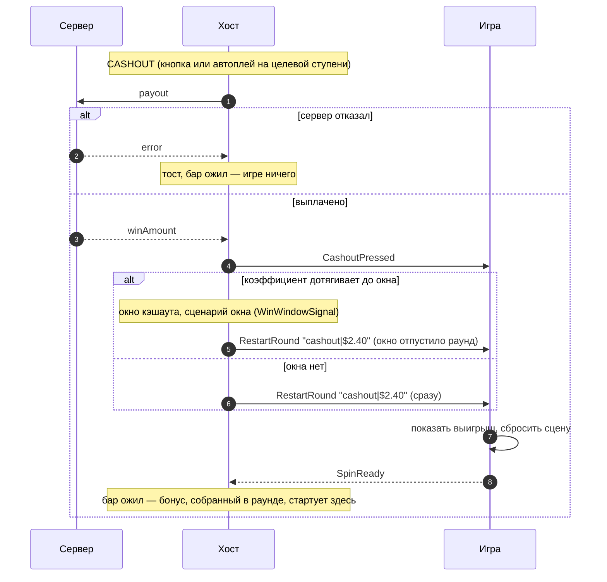
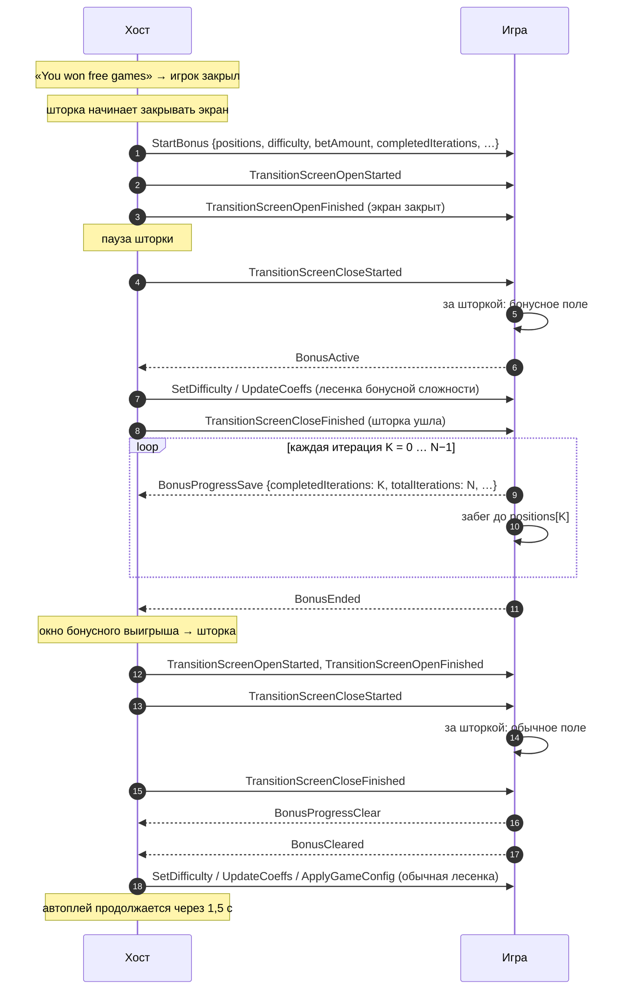

# Crush

> Лесенка коэффициентов: игрок шаг за шагом поднимается по ступеням и забирает выигрыш кэшаутом, пока его
> не накрыло. Сервер решает исход каждого шага, игра его проигрывает и отвечает `SpinReady`, когда шаг
> доигран.

|  |  |
|---|---|
| **Id режима** | протокол `ModeProtocols['crush']` · шелл `road` · конфигуратор `crush` · бэкенд `gameMode=chicken-road-two`, с бонусом `peperoad` |
| **JS-мост** | [`CrushBridge`](js.md) · mock: `MockHost` + `MockPanel` |
| **Unity-мост** | [`RoadWebBridge`](unity.md) · префаб `RoadWebBridge.prefab` · namespace `Modules.Road` |
| **Демо** | `js/examples/demo-games/src/modes/crush` (порт 5192, `?mock=1`) |
| **Игры на режиме** | MegaBlock (Unity, `MegaBlockRemake`), MegaGrab, PepeRoad, AngryMoney |
| **С версии** | protocol `1.0.0` · js `1.0.0` · Unity-пакет `1.0.0`; `SetDifficulty` — с protocol `1.10.0`, `CashoutPressed` стал общей командой в `1.7.0` |
| **Исходник контракта** | [`protocol/src/commands.ts`](../../../protocol/src/commands.ts) (`CrushCommand`), [`events.ts`](../../../protocol/src/events.ts) (`CrushEvent`), [`payloads.ts`](../../../protocol/src/payloads.ts) |

Это самый старый режим: на нём выросли общий протокол, `SpinReady` и бонусные события. Поэтому часть его
команд другие режимы переиспользуют (`SetAutoplay`, `RestartRound`, `StartBonus` — у twist и jumper).

## Механика

Перед игроком — лесенка из ступеней, у каждой свой коэффициент. Лесенку выбирает **сложность**: `EASY`,
`MEDIUM`, `HARD` или `DAREDEVIL` — чем выше, тем короче шанс пройти ступень и круче коэффициенты.
Первое нажатие Play делает ставку и сразу шаг на первую ступень. Каждое следующее нажатие — шаг дальше.
Пережил шаг — выигрыш растёт до `ставка × коэффициент ступени`, и его можно забрать **кэшаутом**. Не
пережил — раунд проигран, ставка сгорела. Дошёл до последней ступени — раунд выигран сам.

На некоторых шагах выпадают **бонусные монеты**. Набрал нужное число монет за раунд — получаешь **бонус**:
серию бесплатных забегов по лесенке, которую игра играет сама. Бонус можно и **купить** — в магазине хоста
или из интерфейса самой игры.

Игра не знает ни ставки, ни шансов: ей приходит только «шаг пережит / не пережит» и лесенка. Номер ступени
игра считает сама.

## Раунд по шагам

Старт сцены и обычный раунд с кэшаутом:



1. Синхронизация идёт только после первого `UiVisibility`: хост считает мост живым по нему, а не по
   загрузке движка. Команда, отправленная раньше, в Unity теряется без ошибки.
2. Сложность приходит **раньше** лесенки того же прохода синхронизации — к приходу коэффициентов игра уже
   знает, для какой сложности они.
3. Первое нажатие Play — это два запроса: `play` (ставка) и `step` на линию 0. Игра получает только
   результат шага — открытие раунда ей не показывают.
4. Пока игра не прислала `SpinReady`, бет-бар залочен. Ответ сервера пришёл раньше анимации, но хост
   ждёт игру: показать выигрыш раньше — значит раскрыть исход до того, как игрок его увидел.
5. `CashoutPressed` приходит, когда сервер **уже выплатил**, в одном тике с открытием окна. Это сигнал
   свернуть живой раунд на сцене вместе с окном. Сумма приходит позже — в `RestartRound`, когда окно
   отпустило раунд.

Подробнее про общий цикл — [жизненный цикл раунда](../../concepts/round-lifecycle.md).

### Проигрыш



На проигрыш хост **не шлёт** `RestartRound`: окна у проигрыша нет, закрывать нечего. Игра сама доигрывает
падение, сама собирает сцену заново и одним `SpinReady` сообщает «доиграно и готово к новой ставке». Это
главная ловушка режима: игра, которая ждёт `RestartRound("lose|")`, зависает с залоченным баром.

### Выигрыш на последней ступени



Первый `SpinReady` здесь бар **не** открывает: он раскрывает припаркованный выигрыш. Бар откроет второй
`SpinReady` — уже сброшенной сцены. Если окна нет (выключено или коэффициент ниже порога), хост шлёт
`RestartRound("win|…")` сразу на первом `SpinReady`, и игра рисует выигрыш сама.

Сервер ставит `isWin: true` ещё и тогда, когда в раунде собран бонус, даже если сама лесенка проиграна. Хост
отделяет выигрыш лесенки от бонусного: если на лесенку не приходится ничего, окна и `RestartRound` нет —
раунд ведёт себя как проигрыш, а бонус стартует на `SpinReady`.

## Команды хоста → игра

| Команда | Когда приходит | Payload | Что делает игра |
|---|---|---|---|
| `SetDifficulty` | при каждом проходе синхронизации конфига, если сложность сменилась: после готовности моста, при смене сложности игроком, на входе в бонус и выходе из него, по `RequestGameConfig` | `CrushDifficulty`: `"EASY"` · `"MEDIUM"` · `"HARD"` · `"DAREDEVIL"` | запоминает сложность; лесенка под неё придёт следом |
| `UpdateCoeffs` | сразу после `SetDifficulty` того же прохода, если лесенка сменилась | `number[]` — коэффициенты ступеней по порядку | перестраивает лесенку |
| `ApplyGameConfig` | после `UpdateCoeffs` того же прохода, если конфиг сменился; при восстановлении | JSON-строка [`GameConfigPayload`](#gameconfigpayload) | берёт лесенку, режимы бонуса для магазина, лимиты ставки, баланс |
| `ApplyGameState` | при восстановлении: на старте, по `RequestGameState`, после реконнекта — только если на сервере живой раунд или у хоста сохранён бонус | JSON-строка: сырое состояние раунда сервера + `bonusGame` хоста ([пример](#состояние-раунда-applygamestate)) | ставит игрока на ступень `lineNumber`, не проигрывая шаги |
| `ApplyStepResult` | ответ сервера на `step` | [`StepResultPayload`](#stepresultpayload) | проигрывает шаг: прыжок, падение или вершину; затем `SpinReady` |
| `CashoutPressed` | сервер выплатил кэшаут; в одном тике с открытием окна (или с `RestartRound`, если окна нет) | — | сворачивает то, что принадлежит живому раунду (коэффициент, кран), пока сцену не накрыло окном |
| `RestartRound` | окно кэшаута / выигрыша отпустило раунд; сразу, если окна нет; `""` — раунд умер на сервере, пока вкладка спала | строка [`"<причина>\|<сумма>"`](#restartround) | показывает выигрыш (для `win`/`cashout`), сбрасывает сцену; затем `SpinReady` |
| `SetAutoplay` | автоплей включён, выключен, поставлен на паузу (в том числе на время бонуса) и снят с паузы | `boolean` | по желанию: меняет подачу (темп, свой UI). Ходы автоплея приходят обычными `ApplyStepResult` |
| `StartBonus` | хост показал «You won free games» и закрыл экран шторкой перехода | [`RoadStartBonusPayload`](#roadstartbonuspayload) | играет серию бесплатных забегов сам, шлёт бонусные события |
| `ApplyBonusPurchaseResult` | покупка бонуса **не** прошла | [`BonusPurchaseResultPayload`](#bonuspurchaserequestpayload-и-bonuspurchaseresultpayload), всегда `isPurchased: false` | снимает своё ожидание покупки, если оно было |

Общие команды — `SetFastGame`, `ApplyWhiteLabel`, `ApplyTranslations`, `DisabledPlayPressed`,
`TransitionScreen*`, `WinWindowSignal` и прочие — в [общем протоколе](../../concepts/core-protocol.md). У
crush к ним две особенности:

- **`TransitionScreenOpenStarted/OpenFinished/CloseStarted/CloseFinished`** задают такт бонуса: шторка
  закрывает экран (`Open*`), за ней игра меняет обычное поле на бонусное и обратно, шторка уходит
  (`Close*`). Шторкой владеет хост: он закрывает её перед `StartBonus` и после `BonusEnded`, а открывает
  сам через заданную паузу.
- **`CashoutPressed`** формально общая (её приёмник — база моста), но именно в crush она появилась и
  описана выше.

## События игры → хост

| Событие | Когда слать | Что делает хост |
|---|---|---|
| `SpinReady` | шаг доигран (блок сел, игрок на ступени, вершина взята); сцена сброшена после проигрыша или после `RestartRound`; при желании — один раз, когда игра впервые готова к ставке | раскрывает припаркованный выигрыш или открывает бет-бар; после проигрыша и рестарта — запускает бонус, собранный в раунде |
| `BonusActive` | серия бонуса началась на экране — обычно за закрытой шторкой | включает бонусный UI хоста: сложность бонуса, ставка серии; лесенку бонусной сложности шлёт следующим проходом синхронизации |
| `BonusProgressSave` | в начале каждой итерации серии (`completedIterations = K` в начале итерации K) | сохраняет прогресс в `localStorage` — он переживает F5; обновляет счётчик «Free games left» |
| `BonusEnded` | последняя итерация доиграна | показывает окно бонусного выигрыша, затем закрывает экран шторкой |
| `BonusProgressClear` | бонус окончательно позади — за шторкой или когда она ушла | стирает сохранённый прогресс и счётчик |
| `BonusCleared` | сразу после `BonusProgressClear` | сбрасывает бонусное состояние, валюту бонуса, разрешает следующее восстановление серии, пересылает игре обычную лесенку (`SetDifficulty` + `UpdateCoeffs` + `ApplyGameConfig`) |
| `BonusPurchaseRequest` | игрок купил бонус в интерфейсе самой игры (не в магазине хоста) | проверяет и проводит покупку как из магазина; отказ — `ApplyBonusPurchaseResult` + тост |

Общие события — `UiVisibility`, `RequestGameConfig`, `RequestGameState`, `RequestPlay`, звуки и прочие — в
[общем протоколе](../../concepts/core-protocol.md). Для crush важно:

- **`UiVisibility`** — первый из них хост принимает за «мост жив». До него игра не получит ни лесенки, ни
  восстановления (восстановление уйдёт вслепую через 10 с).
- **`RequestPlay`** — ход из самой сцены (тап по полю) хост делает так же, как нажатие Play. Пока Play
  недоступен, в ответ приходит `DisabledPlayPressed`.

## Сложность и лесенка

Проход синхронизации хоста шлёт три команды одна за другой и каждую — только если она изменилась с прошлого
раза:

```
SetDifficulty "HARD"   →   UpdateCoeffs [1.23, 1.55, …]   →   ApplyGameConfig {"coefficients":[1.23, 1.55, …], …}
```

Проход запускается, когда мост стал готов, игрок сменил сложность, сменились лимиты ставки или баланс,
начался или закончился бонус, и по запросу игры (`RequestGameConfig`). Запрос игры делает проход
**принудительным**: все три команды уходят, даже если ничего не изменилось.

1. **Сложность в игре = сложность бонуса, пока идёт бонус**, иначе выбранная игроком. Иначе бар хоста
   показывал бы лесенку бонуса, а игра крутила бы обычную.
2. **Сложность едет именем бэкенда**, а не индексом: набор закрыт (`CRUSH_DIFFICULTIES`), порядок enum'а на
   стороне игры проводу безразличен. Другое имя (`"hard"`, `"1"`) — ошибка хоста, игра его отбрасывает.
3. **Одна и та же лесенка приходит дважды** — в `UpdateCoeffs` и в `ApplyGameConfig.coefficients`. Игре
   достаточно одного источника; Unity-мост сам гасит повтор.
4. **Лесенка без конфига.** Пока у хоста нет конфига сервера, `UpdateCoeffs` несёт запасную лесенку из
   23 ступеней (`1.03 … 19.44`), а `ApplyGameConfig` не уходит.
5. **Коэффициенты могут прийти строками.** Протокол называет их `number[]`, но хост пересылает таблицу
   сервера как есть, а сервер шлёт десятичные строки (`"1.03"`). Веб-игре — привести к числу; Unity-мост
   разбирает CSV сам.
6. **Посреди раунда сложность не меняется.** Пока раунд жив, бар хоста держит сложность раунда (и после
   восстановления тоже); новая лесенка относится к следующему раунду.

## Шаг

`ApplyStepResult` несёт только исход — не номер ступени и не сумму:

| Поле | Смысл |
|---|---|
| `isWinMain` | `true` — шаг пережит (или взята вершина), `false` — накрыло |
| `coinsTriggered` | на этом шаге выпала бонусная монета |
| `coinsCollected` | все монеты раунда к этому шагу — сервер повторяет список целиком на каждом шаге |
| `bonusGame` | есть, когда в раунде собраны все монеты: позиции и итог бонусной серии. С этого шага сервер повторяет его на каждом следующем шаге |

1. **Номер ступени считает игра.** Каждый `ApplyStepResult` — шаг на одну ступень вперёд, и проигранный
   тоже: блок падает на ту ступень, куда игрок прыгал. Коэффициент игра читает из лесенки по своему индексу.
2. **Вершина — это шаг на последнюю ступень лесенки** с `isWinMain: true`. Отдельной команды нет; за ним
   придёт `RestartRound("win|…")`.
3. **Шаг без исхода хост не шлёт.** Если по ответу сервера нельзя понять, пережит ли шаг, хост пишет
   предупреждение в консоль и не отправляет ничего — бар остаётся залочен до следующего действия.
4. **Отказ сервера до хода** (ошибка ставки, лимит, обрыв канала до ответа): хост показывает тост и открывает
   бар сам — игра ничего не получает, `SpinReady` не нужен.

## Кэшаут



1. `CashoutPressed` — единственный момент убрать со сцены живой раунд **до** окна: `RestartRound` придёт,
   только когда окно отпустит раунд (шаг сценария «отпустить раунд» или уход окна с экрана).
2. Отказ сервера на payout оставляет раунд живым: игра не получает ни `CashoutPressed`, ни `RestartRound`.
3. Автоплей кэшаутит тем же путём, когда доходит до целевой ступени.

## Автоплей

Автоплеем целиком владеет хост: он сам жмёт Play, сам ждёт `SpinReady`, сам кэшаутит на целевой ступени.
Игра получает обычные `ApplyStepResult` / `CashoutPressed` / `RestartRound` и вдобавок `SetAutoplay`:

| Когда | `SetAutoplay` |
|---|---|
| игрок запустил автоплей | `true` |
| игрок остановил, кончились игры | `false` |
| пауза: вкладка скрыта, начался бонус | `false` |
| снятие паузы; после бонуса — когда шторка ушла и прошло ещё 1,5 с | `true` |

1. **Игре `SetAutoplay` не обязателен.** Ни один ход не зависит от него; это повод сменить подачу
   (ускорить, спрятать свою кнопку Play).
2. **Пока идёт автоплей, бар залочен целиком**, кроме кнопки остановки. Покупку бонуса хост в это время
   отклоняет — и из магазина, и `BonusPurchaseRequest` из игры (`ApplyBonusPurchaseResult` с
   `isPurchased: false` и тост «Stop autoplay to buy a bonus»).

## Бонус

Бонус приходит тремя путями, а играется одним: хост показывает «You won free games», закрывает экран
шторкой и шлёт `StartBonus`. Дальше серию ведёт игра.

| Путь | Что запускает | Когда хост шлёт `StartBonus` |
|---|---|---|
| **Собран в раунде** | `bonusGame.bonusPositions` в ответе на шаг | после конца раунда: на `SpinReady` после проигрыша, после рестарта по кэшауту или выигрышу |
| **Куплен в магазине хоста** | игрок выбрал сложность на карточке магазина | сразу после покупки |
| **Куплен в игре** | игра прислала `BonusPurchaseRequest` | сразу после покупки |
| **Восстановлен после F5** | в `localStorage` хоста лежит прогресс с несыгранными итерациями | между раундами, после восстановления сцены |

Покупка — это `play` с ценой бонуса и сразу `step {lineNumber: 0}`: первый шаг приносит позиции серии.
Успешную покупку игра узнаёт только по `StartBonus`: `ApplyBonusPurchaseResult` с `isPurchased: true`
хост не шлёт.

### Серия



1. **`StartBonus` приходит, когда шторка только начинает закрывать экран.** Менять поле на бонусное —
   не раньше `TransitionScreenOpenFinished`, лучше на `TransitionScreenCloseStarted`, а первый забег
   начинать, когда шторка ушла (`TransitionScreenCloseFinished`). Иначе игрок увидит подмену.
2. **Сколько итераций — столько позиций**: `positions.length`. `positions[K]` — ступень, до которой
   доходит забег итерации K.
3. **`StartBonus` один на свежую серию и на восстановленную.** У свежей `completedIterations = 0`,
   `accumulated* = 0`; у восстановленной — курсор сохранённого прогресса, и игра доигрывает
   `positions.slice(completedIterations)`.
4. **Прогресс шлётся в начале итерации**, а не в конце: `completedIterations` доходит до `totalIterations`,
   когда стартует последняя итерация. Счётчик хоста показывает 0 до `BonusEnded`.
5. **Порядок конца — `BonusEnded`, затем `BonusProgressClear`, затем `BonusCleared`.** Хост прячет бонусный
   UI уже на `BonusEnded`, а `BonusCleared` возвращает обычную лесенку и разрешает следующее восстановление
   серии в этой сессии.
6. **Темп серии — у игры.** Хост не шлёт команд между итерациями; паузы между забегами — конфиг игры.
7. **Шаги обычного раунда во время бонуса не приходят**: бар залочен, автоплей на паузе.

## Данные

### `StepResultPayload`

```ts
/** Результат шага, который движок проигрывает (падение блока / проигрыш / выигрыш). */
interface StepResultPayload {
  isWinMain: boolean;
  coinsTriggered: boolean;
  coinsCollected: number[];
  bonusGame?: unknown;
}
```

`bonusGame` в протоколе не типизирован; хост собирает его так:

| Поле `bonusGame` | Тип | Смысл |
|---|---|---|
| `bonusPositions` | `number[]` | ступени итераций серии |
| `bonusTotalCoefficient` | `number` | итоговый коэффициент серии |
| `bonusTotalWin` | `string` | итог серии строкой валюты показа (`"$4.6"`); нет поля — сервер итога не прислал |
| `betAmount` | `number` | ставка, от которой считается серия (в валюте кошелька) |

Шаг пережит, монет нет:

```json
{ "isWinMain": true, "coinsTriggered": false, "coinsCollected": [] }
```

Шаг проигран, а бонус уже собран:

```json
{
  "isWinMain": false,
  "coinsTriggered": false,
  "coinsCollected": [1, 3, 5],
  "bonusGame": { "bonusPositions": [2, 3, 4], "bonusTotalCoefficient": 4.6, "bonusTotalWin": "$4.6", "betAmount": 1 }
}
```

### `GameConfigPayload`

```ts
/** Игровая конфигурация раунда (коэффициенты, бонус-режимы, лимиты ставок). */
interface GameConfigPayload {
  coefficients: number[];                                       // лесенка сложности в игре
  bonusCounts: Record<string, number>;                          // итераций в бонусе по сложности
  bonusModes: Record<string, { price: string; count: number }>; // магазин: цена (множитель ставки) и итерации
  currency?: string;      // символ валюты показа: "$" (крипто-кошелёк показывается в USD)
  minBetAmount?: number;  // лимиты бет-бара
  maxBetAmount?: number;
  balance?: number;       // баланс в валюте показа; нет поля — баланс ещё не пришёл
}
```

Ключи `bonusCounts` и `bonusModes` — имена сложностей верхним регистром (`"EASY"`). Хост собирает их из
разных полей конфига сервера (`bonusModes`, `bonusBuyMultiplierMap`, `buyBonus`, `bonusConfig`,
`bonusCounts`, `bonusCountsMap`), игре приходит одна форма.

```json
{
  "coefficients": [1.03, 1.07, 1.12, 1.17, 1.23],
  "bonusCounts": { "EASY": 10, "MEDIUM": 8 },
  "bonusModes": { "EASY": { "price": "100", "count": 10 }, "MEDIUM": { "price": "200", "count": 8 } },
  "currency": "$",
  "minBetAmount": 0.1,
  "maxBetAmount": 100,
  "balance": 1000
}
```

### Состояние раунда (`ApplyGameState`)

Сырое состояние раунда сервера — хост его не переводит — плюс `bonusGame`, который хост собирает сам:

| Поле | Смысл |
|---|---|
| `lineNumber` | последняя пройденная линия сервера, с нуля; после `play` без шага — `-1`. Как перевести её в ступень сцены — арифметика игры |
| `difficulty` | сложность раунда (`"EASY"` …); `ApplyGameConfig` перед этим состоянием несёт лесенку именно этой сложности |
| `isFinished`, `isWin`, `status` | общие поля платформы: живой раунд — `isFinished: false` |
| `winAmount`, `bet {amount, currency}` | сумма кэшаута сейчас и ставка раунда |
| `coinsCollected`, `coinsTriggered`, `isWinMain` | как в шаге |
| `bonusGame` | серверный `bonusGame`, а если у хоста сохранён прогресс бонуса — он же, дополненный курсором: `bonusPositions`, `completedIterations`, `accumulatedCoefficient`, `accumulatedWin`, `betAmount`, `bonusCurrency`, `currentStep`, `bonusCoefficients`, `difficulty` |

```json
{
  "difficulty": "EASY",
  "lineNumber": 2,
  "winAmount": 1.12,
  "coinsCollected": [],
  "coinsTriggered": false,
  "bet": { "amount": 1, "currency": "USD" },
  "isFinished": false,
  "bonusGame": null
}
```

Сохранённый бонус восстанавливается и без живого раунда: тогда в состоянии только `bonusGame`, а сама
серия придёт следом командой `StartBonus`.

### `RoadStartBonusPayload`

```ts
/** Бонус road: лесенка по позициям (покупка / сбор в игре / restore). */
interface RoadStartBonusPayload {
  modeId: string;                 // = difficulty: имя режима бонуса
  difficulty: string;             // сложность бонуса ("EASY")
  positions: number[];            // ступени итераций, все — и сыгранные тоже
  bonusCoefficients?: string;     // лесенка бонусной сложности CSV: "1.03,1.07,…"
  betAmount: number;              // ставка одного забега в валюте кошелька — в ней игра возвращает прогресс
  currency: string;               // валюта кошелька; Unity получает её кодом показа (DEMO → "D")
  displayBet?: string;            // ставка в валюте показа ("$0.05"); road-хост сейчас не шлёт — бери betAmount
  bonusTotalCoefficient: number;  // итоговый коэффициент серии; у восстановленной — накопленный
  bonusTotalWin: string;          // итог серии строкой показа; "" — итога нет (собранная, восстановленная), "0" — нулевой (купленная без итога)
  completedIterations: number;    // курсор: сколько итераций уже сыграно
  accumulatedCoefficient: number;
  accumulatedWin: number;
  currentStep: number;
}
```

`StartBonusPayload` в протоколе — объединение режимов (`RoadStartBonusPayload | TwistStartBonusPayload |
JumperStartBonusPayload`); crush всегда получает `RoadStartBonusPayload`.

```json
{
  "modeId": "EASY", "difficulty": "EASY",
  "positions": [2, 3, 4], "bonusCoefficients": "1.03,1.07,1.12,1.17,1.23",
  "betAmount": 1, "currency": "USD",
  "bonusTotalCoefficient": 4.6, "bonusTotalWin": "$4.6",
  "completedIterations": 0, "accumulatedCoefficient": 0, "accumulatedWin": 0, "currentStep": 0
}
```

### Прогресс бонуса (`BonusProgressSave`)

Тело события — JSON-строка (`raw`). Протокол её форму не фиксирует; хост проверяет запись схемой и
отбрасывает ту, что не проходит (с ошибкой в консоли), сохраняя прежний прогресс.

| Поле | Тип | Обязательно |
|---|---|---|
| `completedIterations` | целое ≥ 0, не больше `totalIterations` | да |
| `totalIterations` | целое > 0 | да |
| `positions` | `number[]` (целые) | нет |
| `accumulatedCoefficient`, `accumulatedWin`, `betAmount` | `number` | нет |
| `currency`, `difficulty` | `string` | нет |
| `currentStep` | целое | нет |
| `bonusCoefficients` | `string` или `null` | нет |

Сложность хост запоминает один раз — с первой записи серии; дальше правда — сохранённая.

### `BonusPurchaseRequestPayload` и `BonusPurchaseResultPayload`

```ts
/** Запрос движком покупки бонуса (bet-action). */
interface BonusPurchaseRequestPayload {
  betAmount?: unknown;   // ПОЛНАЯ цена бонуса (ставка × множитель), > 0
  currency?: unknown;
  difficulty?: unknown;  // сложность бонуса строкой, любой регистр: "easy" → "EASY"
  bonusType?: unknown;   // тип бонуса бэкенда; нет — "default"
}

/** Ответ на запрос покупки бонуса от движка. */
interface BonusPurchaseResultPayload {
  modeId: string;        // сложность, которую назвала покупка
  isPurchased: boolean;  // хост шлёт только false
  error?: string;        // текст сбора; нет — отказ ещё до запроса к серверу
}
```

### `RestartRound`

Строка `"<причина>|<сумма>"`:

| Payload | Когда |
|---|---|
| `"cashout\|$2.40"` | кэшаут выплачен, окно отпустило раунд (или окна нет) |
| `"win\|$5.80"` | вершина взята, окно отпустило раунд (или окна нет) |
| `""` | раунд, который показывала игра, умер на сервере (проигран, пока вкладка спала): просто сбросить сцену без выигрыша |

Сумма — строка показа с символом валюты: `"$2.40"`, бывает с разделителем тысяч. Игра разбирает из неё
число сама. Причину `lose` хост **не шлёт** никогда (см. [Проигрыш](#проигрыш)); `RestartReason.Lose` в
Unity-мосте остался от старого протокола.

## Правила и инварианты

1. **Один `SpinReady` на каждый `ApplyStepResult` и на каждый `RestartRound`.** Хост открывает бар
   только по нему; таймаута нет. Не прислал — бар залочен навсегда, и это ошибка игры, а не повод для
   таймера в хосте.
2. **`SpinReady` — только после анимации.** Ранний `SpinReady` раскрывает исход раньше, чем его увидел
   игрок, и пускает ставку поверх недоигранного шага. `SpinReady`, пришедший, пока ответ на следующий ход
   ещё в пути, хост отбрасывает как устаревший.
3. **После проигрыша игра сбрасывается сама**, без `RestartRound`.
4. **Команды хоста играются по очереди.** `RestartRound` может прийти, пока предыдущий прыжок ещё в
   воздухе; его надо дождаться, а не рвать сцену.
5. **Сложность — до лесенки.** Обработка `UpdateCoeffs` может читать текущую сложность: она уже пришла.
6. **Выигрыш показывать тот, что прислал хост.** Сумма кэшаута и итог серии приходят готовыми строками
   валюты показа (`RestartRound`, `bonusTotalWin`), уже сконвертированными. Свой счёт игра ведёт только
   для прогресса серии (`accumulatedCoefficient`, `accumulatedWin` в `BonusProgressSave`).
7. **Бонусная серия не прерывается обычными шагами**, а `BonusCleared` идёт после `BonusProgressClear`:
   иначе следующая серия этой сессии не восстановится после F5.
8. **Мост не знает игры.** Мост переводит команды в события своей платформы; никаких игровых ссылок в
   нём нет — зависимость идёт от игры к мосту.

## Восстановление и ошибки

**Перезагрузка посреди раунда.** На старте хост читает состояние сессии с сервера и, если раунд жив или
сохранён бонус, шлёт `ApplyGameConfig` (лесенка сложности раунда) и `ApplyGameState` (ступень `lineNumber`)
— именно в этом порядке: игрока нельзя поставить на лесенку, пока она не построена. Отдельной команды
«восстановить» нет. Игра ставит игрока на ступень без анимации шагов и ждёт следующего хода.

**Перезагрузка посреди бонуса.** Прогресс серии живёт в `localStorage` хоста. После восстановления сцены
и закрытия стартового экрана хост показывает «You won free games» с оставшимся числом игр, закрывает
шторку и шлёт `StartBonus` с курсором. Если в этот момент идёт раунд или открыто окно, серия ждёт конца
раунда. Одна серия восстанавливается один раз за сессию — до `BonusCleared`.

**Запрос игры.** `RequestGameState` ведёт тот же путь, что старт: хост перечитывает сессию и шлёт
восстановление. `RequestGameConfig` — принудительный проход синхронизации конфига (и запрос конфига у
сервера, если канал жив). Пока у хоста сохранён бонус, бонусная сложность при этом не сбрасывается.

**Реконнект.** После обрыва канала хост перечитывает сессию. Если раунд, который показывала игра, на
сервере уже закрыт, хост сначала шлёт `RestartRound("")`, а потом восстановление.

**Потерянный ответ на шаг.** Если канал оборвался, пока шёл `step`, хост показывает тост и открывает бар;
игре ничего не приходит. Автоплей после реконнекта решает по прочитанному состоянию, шагать дальше или
кэшаутить.

**Окно не открылось.** Если веб-игра бросила исключение на `CashoutPressed`, хост считает кэшаут
проваленным уже после выплаты: показывает тост и не открывает окно. Unity-игру это не касается —
`SendMessage` исключений в хост не пробрасывает.

## Смотрите также

- [JS: как встроить](js.md) · [Unity: как встроить](unity.md)
- [Жизненный цикл раунда](../../concepts/round-lifecycle.md) · [Общий протокол](../../concepts/core-protocol.md) ·
  [Архитектура](../../concepts/architecture.md)
- Исходники контракта: `protocol/src/commands.ts` (`CrushCommand`, `CRUSH_DIFFICULTIES`),
  `protocol/src/events.ts` (`CrushEvent`, `isBonusEngineEvent`), `protocol/src/payloads.ts`
- Хост: `RoadFrontent/src/modes/road/` (раунд, кэшаут, бонус), `src/game/session/` (синхронизация конфига,
  восстановление, парковка выигрыша), `src/features/bonus-series/engineBonusEvents.ts`
