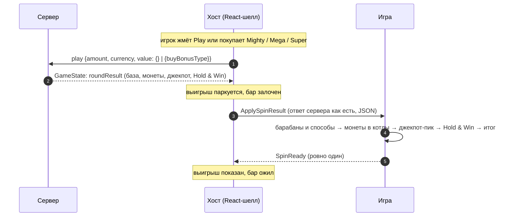

# Dragon Pots

> Слот 5 × 3 на 243 способа. Монеты с барабанов летят в три котла, а сработавшие котлы запускают
> джекпот-пик и Hold & Win. Раунд атомарный: хост присылает ответ сервера целиком, игра проигрывает всё
> по порядку и один раз отвечает `SpinReady`.

|  |  |
|---|---|
| **Id режима** | протокол `ModeProtocols['dragonPots']` · шелл `dragon-pots` · конфигуратор `dragon-pots` · бэкенд `gameMode=dragon-pots` |
| **JS-мост** | [`DragonPotsBridge`](js.md) · mock: `DragonPotsMockHost` |
| **Unity-мост** | [нет — рецепт](unity.md) |
| **Демо** | `js/examples/demo-games/src/modes/dragon-pots` (порт 5199, `?mock=1`) |
| **С версии** | protocol `1.20.0` · js `1.18.0` |
| **Исходник контракта** | [`protocol/src/dragonPots.ts`](../../../protocol/src/dragonPots.ts) |

## Механика

Барабаны 5 × 3, **243 способа**, выигрыш слева направо. Символ платит, если стоит на первом барабане и
на каждом следующем подряд: от 3 до 5 барабанов (`matches`). Число способов (`ways`) — произведение его
клеток по барабанам. Вайлд (`Wi`) заменяет любой платящий символ. Клетка `M` — монета котла, она не
платит никогда.

Над барабанами три котла: **Red**, **Green** и **Blue**. Каждая выпавшая монета (`roundResult.coins`) летит
в котёл своего цвета. Какие котлы сработали, решает сервер и называет исход в `bonusTypeName`. Наполнение
котла — визуал клиента, его в ответе нет. Монета может упасть в котёл, который не сработал: в записанном
ответе Mighty выпали синяя и красная монеты, а сработал только синий котёл.

| `bonusTypeName` | `bonusTypeIndex` | Котлы | Что запускается |
|---|---|---|---|
| `""` | `null` | — | ничего: монет нет, **или бонус куплен** |
| `Lose` | 7 | — | монеты выпали, котёл не сработал |
| `Mighty` | 0 | Blue | Hold & Win 3x5 |
| `Mega` | 1 | Green | Hold & Win 4x5 |
| `Super` | 2 | Blue + Green | Hold & Win 5x5 |
| `Jackpot` | 3 | Red | джекпот-пик |
| `Ultra` | 4 | Red + Blue | джекпот-пик + Hold & Win 3x5 |
| `Supreme` | 5 | Red + Green | джекпот-пик + Hold & Win 4x5 |
| `Ultimate` | 6 | Red + Blue + Green | джекпот-пик + Hold & Win 5x5 |

`Ultra` на stage-бэке ещё не выпадал; индекс 4 взят по порядку оригинальной игры.

**Джекпот-пик.** Игрок открывает скрытые плитки, пока какой-то уровень не выпадет трижды. Этот уровень и
выигран. Уровни: MINI ×20, MINOR ×50, MAJOR ×250, GRAND ×2000 (в ставках) и UPGRADE. Запросов на пики
нет: вся последовательность приходит в ответе (`jackpotResult.scenario`).

**Hold & Win.** Отдельная доска 3x5, 4x5 или 5x5 с начальными монетами (6 / 8 / 10). Каждый респин даёт до
трёх попыток. Если в попытке упали монеты, спин закончен и попытки сбрасываются. Три пустые попытки
подряд (или полная доска) заканчивают Hold & Win. **Упавшая монета собирает стоимость всех монет, уже
лежащих на доске** ([пример](#hold--win-holdandwinresult)).

Бонус можно купить в магазине хоста: Mighty за 30 ставок, Mega за 55, Super за 80. Это сразу Hold & Win
без котлов и без джекпота.

## Раунд по шагам



1. Ставку, баланс, лимиты и покупку решает хост. Для покупки он сам считает полную цену
   ([цены](#цена-и-выплаты)).
2. Сервер отвечает на `play` **всем раундом сразу**. Шагов нет, `step` у режима не существует.
3. Хост пересылает ответ **без изменений** командой `ApplySpinResult` и держит выигрыш у себя. Показать его
   раньше — значит раскрыть исход до анимации.
4. Игра играет раунд строго в таком порядке:
   1. барабаны встают на `mainGameResult.matrix`, способы из `winsHighlight` подсвечиваются;
   2. монеты из `coins` летят в свои котлы, сработавшие котлы лопаются;
   3. джекпот-пик, если `isJackpot`: плитки `scenario` открываются по порядку;
   4. Hold & Win, если есть `holdAndWinResult`: начальные монеты, затем попытка за попыткой;
   5. итог раунда — верхний `winAmount`.
5. После итога игра шлёт **одно** событие `SpinReady`, в том числе для купленного бонуса. На нём хост
   показывает выигрыш и снимает блокировку бет-бара.

## Команды хоста → игра

| Команда | Когда приходит | Payload | Что делает игра |
|---|---|---|---|
| `ApplySpinResult` | ответ сервера на `play` — обычный спин или покупка | JSON-строка [`DragonPotsSpinResult`](#dragonpotsspinresult) | проигрывает раунд целиком и шлёт `SpinReady` |
| `ApplyGameConfig` | на старте сцены (в ответ на `RequestGameConfig`) и при смене валюты | JSON-строка конфига платформы ([пример](#конфиг-get-game-config)) | берёт валюту и лимиты, если показывает их сама |
| `ApplyGameState` | на старте сцены (в ответ на `RequestGameState`) | всегда `{}` | ничего: восстанавливать нечего |

Остальное — общие команды: `SetFastGame`, `ApplyWhiteLabel`, `ApplyTranslations`, `DisabledPlayPressed`
и прочие ([общий протокол](../../concepts/core-protocol.md)). Других команд у режима нет: покупка меняет
только запрос хоста к серверу, `StartBonus` и `ApplyBonusStepResult` сюда не приходят.

## События игры → хост

| Событие | Когда слать | Что делает хост |
|---|---|---|
| `SpinReady` | один раз, когда доиграны база, котлы, джекпот, Hold & Win и показан итог | показывает выигрыш, снимает лок бета, запускает следующий автоспин |
| `RequestGameConfig`, `RequestGameState` | на старте сцены, повторяя до ответа | отвечает `ApplyGameConfig` / `ApplyGameState` |
| `RequestPlay` | игрок тапнул по сцене вместо кнопки Play | делает спин как с кнопки, а если Play сейчас неактивна — шлёт `DisabledPlayPressed` |

`RequestStep` и события бонуса (`BonusActive`, `BonusEnded`…) режим не шлёт: фичи — часть того же ответа.

## Данные

### `DragonPotsSpinResult`

Ответ сервера на `play` — `GameState` платформы, раунд лежит в `roundResult`:

```ts
interface DragonPotsSpinResult {
  status: 'win' | 'lose';
  bet: { amount: string; currency: string; decimalPlaces: number };
  betAmount: string;        // что списано: ставка или полная цена покупки
  coeff: number | string;   // против betAmount; на stage — число, на prod — строка
  currency: string;
  isFinished: boolean;      // всегда true
  isWin: boolean;
  winAmount: string;        // ВЫИГРЫШ РАУНДА: округлён вниз до decimalPlaces, единственный для показа
  roundResult: DragonPotsRoundResult;
}

interface DragonPotsRoundResult {
  totalCoeff: number;       // main.coeff + jackpot.coeff + holdAndWin.coeff, против betAmount
  winAmount: string;        // НЕ округлён ("4.765"), может быть на цент больше верхнего — не показывать
  totalWinAmount: string;   // то же
  mainGameResult: DragonPotsMainGameResult;
  isJackpot: boolean;
  jackpotResult?: DragonPotsJackpotResult;          // только при isJackpot: true
  holdAndWinResult?: DragonPotsHoldAndWinResult;    // только с Hold & Win — выпавшим или купленным
  bonusTypeIndex: number | null;
  bonusTypeName: '' | 'Mighty' | 'Mega' | 'Super' | 'Jackpot' | 'Ultra' | 'Supreme' | 'Ultimate' | 'Lose';
  coins: { reelIndex: number; rowIndex: number; color: 'Red' | 'Green' | 'Blue'; isGold: boolean }[];
}

interface DragonPotsMainGameResult {
  matrix: string[][];       // matrix[row][reel], 3 ряда по 5, ряд 0 сверху
  wins: DragonPotsWin[];    // по символу: matches, ways, coeff (за способ), payout = coeff × ways, paths
  winsHighlight: (Omit<DragonPotsWin, 'paths'> & { path: DragonPotsCell[] })[];  // объединение клеток выигрыша
  coeff: number;            // выплата базы в ставках (0 у покупки)
  winAmount: string;
}
```

Полные типы — в [`protocol/src/dragonPots.ts`](../../../protocol/src/dragonPots.ts). Настоящий ответ
stage-бэка: джекпот-пик, ставка 0.10.

```json
{
  "status": "win",
  "bet": { "amount": "0.10", "currency": "USD", "decimalPlaces": 2 },
  "betAmount": "0.10",
  "coeff": 20,
  "currency": "USD",
  "isFinished": true,
  "isWin": true,
  "winAmount": "2.00",
  "roundResult": {
    "totalCoeff": 20,
    "winAmount": "2",
    "totalWinAmount": "2",
    "mainGameResult": {
      "matrix": [
        ["Dr", "Dr", "J", "M", "3C"],
        ["9", "10", "Fl", "K", "3C"],
        ["Fl", "M", "Fl", "J", "9"]
      ],
      "wins": [],
      "winsHighlight": [],
      "coeff": 0,
      "winAmount": "0"
    },
    "isJackpot": true,
    "jackpotResult": { "scenario": [1, 1, 2, 5, 2, 1], "coeff": 20, "winAmount": "2", "isDouble": false },
    "bonusTypeIndex": 3,
    "bonusTypeName": "Jackpot",
    "coins": [
      { "reelIndex": 3, "rowIndex": 0, "color": "Blue", "isGold": false },
      { "reelIndex": 1, "rowIndex": 2, "color": "Red", "isGold": false }
    ]
  }
}
```

### Символы и способы

| Код | Символ | Код | Символ |
|---|---|---|---|
| `9` `10` `J` `Q` `K` `A` | младшие | `Dr` | дракон |
| `Fl` | цветок | `Ln` | фонарь |
| `3C` | монеты (платящий символ, не монета котла) | `Fi` | рыба |
| `Wi` | вайлд | `M` | монета котла: цвет — в `coins` |

Таблицу выплат держит сервер. На stage записаны `Dr` × 3 — 0.4, `J` × 3 — 0.25, `10` × 5 — 0.5 за способ.
Каждая запись `wins` — один символ: `paths` перечисляет все способы (клетка на барабан, первый барабан —
внешний цикл), `winsHighlight[].path` — объединение их клеток в порядке первого появления. Подсвечивать
нужно `path`, а платить игре ничего не надо: сумма уже в `mainGameResult.winAmount`.

Каждой монете из `coins` соответствует клетка `M` матрицы, и наоборот. Клетки в `coins` и `paths` —
`{reelIndex, rowIndex}`, а сама матрица — **`[row][reel]`**.

Константы протокола: `DRAGON_POTS_REELS`, `DRAGON_POTS_SYMBOLS`, `DRAGON_POTS_POT_COLORS`,
`DRAGON_POTS_BONUS_TYPES` (котлы, доска и джекпот за каждым именем), `DRAGON_POTS_BONUS_BUYS`,
`DRAGON_POTS_BOARD_SIZES`, `DRAGON_POTS_JACKPOT_TIERS`, `DRAGON_POTS_JACKPOT_MATCH`.

### Джекпот-пик (`jackpotResult`)

| Плитка | Уровень | `coeff`, ставок |
|---|---|---|
| 1 | MINI | 20 |
| 2 | MINOR | 50 |
| 3 | MAJOR | 250 |
| 4 | GRAND | 2000 |
| 5 | UPGRADE | — |

`scenario` — порядок открытия плиток. Он кончается третьей плиткой выигранного уровня, и до неё никакой
уровень трёх раз не набирает: `[1,1,2,5,2,1]` и `[5,1,4,1,4,3,3,1]` — оба MINI ×20. Одна плитка UPGRADE
ничего не удваивает: в оригинальной игре удвоение даёт тройка UPGRADE, и тогда `isDouble: true`. На stage
такого ответа ещё не было. Показывать как правду `coeff`, `winAmount` и `isDouble`, а `scenario` — как
порядок плиток.

### Hold & Win (`holdAndWinResult`)

```ts
interface DragonPotsHoldAndWinResult {
  boardSize: '3x5' | '4x5' | '5x5';   // ряды x колонки
  coeff: number;                      // против betAmount
  winAmount: string;
  finalCoinsCount: number;
  initial: { currentCoeff: number; coins: DragonPotsHoldAndWinCoin[] };
  spins: { spinIndex: number; currentCoeff: number; tries: { tryIndex: number; openedCoins: DragonPotsHoldAndWinCoin[] }[] }[];
}

interface DragonPotsHoldAndWinCoin {
  rowIndex: number;          // 0 — сверху
  colIndex: number;          // колонка доски Hold & Win (не reelIndex)
  coinCoeff: number;         // номинал монеты в базовых ставках
  coinWinAmount: string;
  currentCoeff: number;      // итог Hold & Win после этой монеты, в базовых ставках
  currentWinAmount: string;
}
```

Отрывок записанного Mighty (ставка 0.10): две начальные монеты из шести, первый спин и последний.

```json
{
  "boardSize": "3x5", "coeff": 50, "winAmount": "5", "finalCoinsCount": 12,
  "initial": { "currentCoeff": 0, "coins": [
    { "rowIndex": 2, "colIndex": 2, "coinCoeff": 2, "coinWinAmount": "0.2", "currentCoeff": 0, "currentWinAmount": "0" },
    { "rowIndex": 0, "colIndex": 3, "coinCoeff": 0.25, "coinWinAmount": "0.025", "currentCoeff": 0, "currentWinAmount": "0" }
  ] },
  "spins": [
    { "spinIndex": 0, "currentCoeff": 26, "tries": [
      { "tryIndex": 0, "openedCoins": [] },
      { "tryIndex": 1, "openedCoins": [] },
      { "tryIndex": 2, "openedCoins": [
        { "rowIndex": 1, "colIndex": 1, "coinCoeff": 2, "coinWinAmount": "0.2", "currentCoeff": 4.5, "currentWinAmount": "0.45" },
        { "rowIndex": 0, "colIndex": 4, "coinCoeff": 0.75, "coinWinAmount": "0.075", "currentCoeff": 11, "currentWinAmount": "1.1" },
        { "rowIndex": 0, "colIndex": 0, "coinCoeff": 0.5, "coinWinAmount": "0.05", "currentCoeff": 18.25, "currentWinAmount": "1.825" },
        { "rowIndex": 1, "colIndex": 4, "coinCoeff": 4, "coinWinAmount": "0.4", "currentCoeff": 26, "currentWinAmount": "2.6" }
      ] }
    ] },
    { "spinIndex": 3, "currentCoeff": 50, "tries": [
      { "tryIndex": 0, "openedCoins": [] }, { "tryIndex": 1, "openedCoins": [] }, { "tryIndex": 2, "openedCoins": [] }
    ] }
  ]
}
```

Как растёт итог. Шесть начальных монет стоят вместе 4.5, а их `currentCoeff` — 0: сами по себе они не
платят. Первая упавшая монета (×2) собирает доску до себя — итог 4.5, доска становится 6.5. Вторая
(×0.75) собирает 6.5 — итог 11, доска 7.25. Третья (×0.5) — 18.25, четвёртая (×4) — 26. Правило «монета
собирает доску до себя» выполняется во всех шести записанных Hold & Win. Значит, итог **не равен** сумме
`coinCoeff` на доске: показывать нужно `currentCoeff` / `currentWinAmount` упавшей монеты.

Попытки спина идут по `tryIndex` подряд. Монеты бывают только в последней попытке спина. Последний спин —
три пустые попытки (или монеты, заполнившие доску). `spins[].currentCoeff` — итог после спина.

### Единицы коэффициентов

| Поле | В чём | Обычный спин (ставка 0.10) | Покупка Mighty (ставка 0.12, цена 3.60) |
|---|---|---|---|
| `coeff`, `roundResult.totalCoeff` | против `betAmount` | 50.8 | 0.8083… (= 2.91 / 3.60) |
| `mainGameResult.coeff`, `wins[].coeff` / `payout` | ставок | 0.8 | 0 |
| `jackpotResult.coeff` | ставок | 20 | — (у покупки джекпота нет) |
| `holdAndWinResult.coeff` | против `betAmount` | 50 | 0.8083… |
| `coinCoeff`, `currentCoeff` | **базовых** ставок: ставка или `betAmount / цена` | ×2 = 0.20 | ×0.25 = 0.03 |

### Цена и выплаты

| Спин | `value` запроса | `amount` | Доска | Начальных монет |
|---|---|---|---|---|
| обычный | `{}` | ставка | — | — |
| покупка Mighty | `{ buyBonusType: 'Mighty' }` | ставка × 30 | 3x5 | 6 |
| покупка Mega | `{ buyBonusType: 'Mega' }` | ставка × 55 | 4x5 | 8 |
| покупка Super | `{ buyBonusType: 'Super' }` | ставка × 80 | 5x5 | 10 |

- Цен нет ни в конфиге, ни в ответе: это константы оригинальной игры (`DRAGON_POTS_BONUS_BUYS`).
- **Сервер не проверяет `amount` покупки.** Mighty с `amount: 0.12` он примет и просто пересчитает. Полную
  цену считает хост.
- `amount` — **число** (`"0.12"` → `Invalid payload`), `value` обязателен, `buyBonusType` чувствителен к
  регистру (`mighty` → `Invalid payload`). Чит-поле `rng` кладётся в `value`, как у других слотов.
- В ответе на покупку `bonusTypeName: ""` и `bonusTypeIndex: null`, отличает её только `holdAndWinResult`.
  База купленного раунда ничего не платит (`wins: []`), но на ней падают монеты купленных котлов: Mighty —
  синяя, Mega — зелёная, Super — синяя и зелёная. Какую фичу купили, видно по `boardSize`.
- **Итог — только верхний `winAmount`.** Он округлён вниз, а `roundResult.winAmount` — нет (`4.765` против
  `4.76`). У покупок верхний итог бывает на цент меньше Hold & Win: Mighty `2.90` при `2.91`, Mega `2.75`
  при `2.76`. Точное правило округления сервера неизвестно. Пересчитывать итог из частей нельзя:
  показывать надо то, что получит баланс.

### Конфиг (`get-game-config`)

```json
{
  "betConfig": {
    "minBetAmount": "0.10",
    "maxBetAmount": "10000.00",
    "maxWinAmount": "100000.00",
    "defaultBetAmount": "0.01",
    "betPresets": [],
    "currency": "USD"
  },
  "currency": { "code": "USD", "type": "FIAT", "displayName": "$", "decimalPlaces": 2 }
}
```

Ответ stage-бэка; иконка валюты (`currency.icon`, SVG) опущена. Цен покупок в конфиге нет.

## Правила и инварианты

1. **Один ответ — один `SpinReady`.** Не по фиче и не по спину Hold & Win: хост снимает лок и показывает
   выигрыш только по нему. Лишний `SpinReady` откроет бар посреди Hold & Win, пропущенный навсегда
   заблокирует игру. Таймаута у хоста нет. Купленный бонус — такой же раунд с одним `SpinReady`.
2. **Порядок фаз фиксирован:** база → монеты в котлы → джекпот-пик → Hold & Win → итог. В Ultra, Supreme и
   Ultimate джекпот всегда идёт до Hold & Win.
3. **Фичи читаются по наличию.** Hold & Win — есть `holdAndWinResult`, джекпот — `isJackpot: true` и
   `jackpotResult`. Имя исхода нужно только чтобы показать котлы: у покупки оно пустое.
4. **Итог Hold & Win — из `currentCoeff`/`currentWinAmount`**, не сумма номиналов: монета собирает доску до
   себя.
5. **Деньги — строки, итог — верхний `winAmount`.** Внутренние `winAmount` не округлены.
6. **Матрица — `[row][reel]`, клетки монет и способов — `{reelIndex, rowIndex}`, доска Hold & Win —
   `{rowIndex, colIndex}`.** Перепутанный порядок даёт «правильные» символы не в тех клетках.
7. **Игра не решает, можно ли ставить.** Тап по сцене — `RequestPlay`; ставку, лимиты и магазин держит хост.

## Восстановление и ошибки

- **Перезагрузка.** Раунд завершается в одном ответе, `get-game-state` всегда `{}`. Игра стартует в покое.
  Ответ, который хост получил и не успел показать до перезагрузки, уже зачислен на баланс.
- **Баланс.** Сервер шлёт `onBalanceChange` сразу после `play`, до того как игра показала раунд. Баланс на
  экране хост обновляет сам по `SpinReady`.
- **Отказ сервера.** До игры доходит только принятый спин. Отказы хост показывает сам:
  `{"error":"Active round already exist"}` — второй `play`, пока первый в полёте;
  `{"error":"Invalid payload"}` — `amount` строкой, нет `value` или неверный `buyBonusType`;
  `{"error":{"message":"Something went wrong while creating bet"}}` — ставка ниже минимума или не хватает
  баланса; `{"error":"The action \"bet\" is not supported in this engine"}` — запрос в формате prod
  (`bet`) на stage-бэк.
- **Битый ответ.** Если игра не может разобрать ответ (монета не на клетке `M`, котёл лопается без своей
  монеты, пик не кончается третьей плиткой уровня), это дефект: игра пишет ошибку в лог, показывает
  сломанное состояние и **не** шлёт `SpinReady`. Бар остаётся залоченным, сбой виден сразу. Так ведут себя
  демо-игры всех режимов.

## Смотрите также

- [JS: как встроить](js.md) · [Unity: как встроить](unity.md)
- [Жизненный цикл раунда](../../concepts/round-lifecycle.md) · [Общий протокол](../../concepts/core-protocol.md)
- Тот же атомарный раунд: [mine-slot](../mine-slot/README.md)
- Бэкенд: stage `wss://game-api-v2-stage.inoutgames.dev`, `game_mode: "dragon-pots"`; адреса — из манифеста
