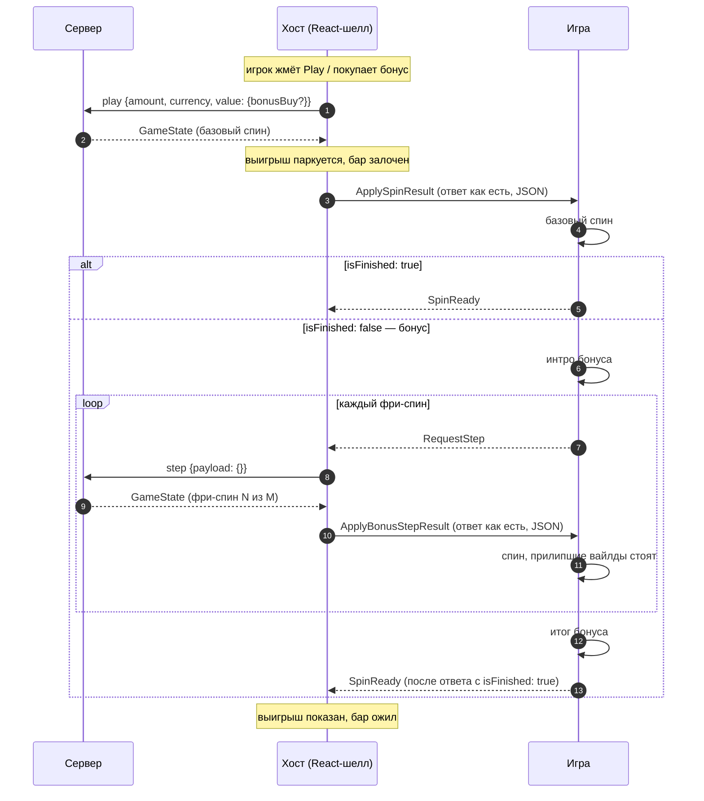

# Fruit Love Fever

> Линейный слот 5 × 3 с бонусом фри-спинов, в котором выпавшие вайлды прилипают к своим клеткам. Хост
> присылает ответ на спин, бонус игра ведёт сама: просит каждый фри-спин `RequestStep`, проигрывает ответ
> `ApplyBonusStepResult` и в конце раунда один раз отвечает `SpinReady`.

|  |  |
|---|---|
| **Id режима** | протокол `ModeProtocols['fruitLoveFever']` · шелл `fruit-love-fever` · конфигуратор `fruit-love-fever` · бэкенд `gameMode=fruit-love-fever` |
| **JS-мост** | [`FruitLoveFeverBridge`](js.md) · mock: `FruitLoveFeverMockHost` |
| **Unity-мост** | [нет — рецепт](unity.md) |
| **Демо** | `js/examples/demo-games/src/modes/fruit-love-fever` (порт 5198, `?mock=1`) |
| **С версии** | protocol `1.19.0` · js `1.17.0` |
| **Исходник контракта** | [`protocol/src/fruitLoveFever.ts`](../../../protocol/src/fruitLoveFever.ts) |

## Механика

Барабаны 5 × 3, 20 фиксированных линий, выигрыш слева направо. На линии платит только старшая комбинация,
выигрыши линий складываются. Вайлд заменяет всё, кроме скаттера, и выпадает только на барабанах 2–4. Он
несёт множитель (`coeff` клетки: `"2"`, `"3"`); множители вайлдов одной линии **складываются**.

Три скаттера и больше запускают бонус: 8–12 фри-спинов. Вайлд, выпавший во фри-спине, остаётся в своей
клетке до конца бонуса. Сервер сам кладёт прилипшие вайлды в доску каждого следующего шага. Бонус можно
купить: `x75` (Standard Buy, 75 ставок) или `x200` (High-Value Buy, 200 ставок). Покупку решает хост; игра
получает тот же ответ, что и после выпавших скаттеров.

## Раунд по шагам



1. Ставку, баланс, лимиты и покупку бонуса решает хост. Игра в этом не участвует.
2. Хост пересылает ответ на `play` **без изменений** командой `ApplySpinResult` и держит выигрыш у себя:
   показать его раньше — значит раскрыть исход раньше анимации.
3. `isFinished: true` — обычный спин. Игра доигрывает его и шлёт `SpinReady`.
4. `isFinished: false` — бонус. `bonusGame.currentGameNumber` равен `null`, фри-спинов ещё не было. Игра
   играет интро и просит первый фри-спин `RequestStep`.
5. На каждый `RequestStep` хост зовёт `step` и присылает ответ `ApplyBonusStepResult`. Темп задаёт игра:
   следующий `RequestStep` уходит, когда предыдущий фри-спин доигран.
6. Ответ с `isFinished: true` — последний фри-спин. Игра доигрывает его, показывает итог бонуса и шлёт
   **один** `SpinReady` на весь раунд.

## Команды хоста → игра

| Команда | Когда приходит | Payload | Что делает игра |
|---|---|---|---|
| `ApplySpinResult` | ответ сервера на `play` — спин или покупка бонуса | JSON-строка [`FruitLoveFeverSpinResult`](#fruitlovefeverspinresult) | играет базовый спин; без бонуса — `SpinReady`, с бонусом — интро и `RequestStep` |
| `ApplyBonusStepResult` | ответ сервера на `step` после `RequestStep` | JSON-строка `FruitLoveFeverStepResult` (та же форма, `bonusGame` есть всегда) | играет фри-спин; дальше `RequestStep` или, если `isFinished`, итог и `SpinReady` |
| `ApplyGameConfig` | на старте сцены (в ответ на `RequestGameConfig`) | JSON-строка конфига платформы ([пример](#конфиг-get-game-config)) | берёт валюту, если показывает суммы |
| `ApplyGameState` | на старте сцены (в ответ на `RequestGameState`) и после переподключения | JSON-строка `get-game-state`: последний ответ незавершённого раунда или `{"status":"none"}` | `isFinished: false` — продолжает бонус ([восстановление](#восстановление-и-ошибки)) |

Остальное — общие команды: `SetFastGame`, `ApplyWhiteLabel`, `ApplyTranslations`, `DisabledPlayPressed`
и прочие ([общий протокол](../../concepts/core-protocol.md)). Имена `ApplyBonusStepResult` и `RequestStep`
— те же, что у plinko-aztec: новых имён на проводе режим не вводит.

## События игры → хост

| Событие | Когда слать | Что делает хост |
|---|---|---|
| `RequestStep` | бонус: один раз на фри-спин, когда предыдущий доигран; повторно — если пришёл `ApplyGameState`, пока игра ждёт шаг | зовёт `step`, присылает `ApplyBonusStepResult` |
| `SpinReady` | один раз на раунд: после базового спина без бонуса или после последнего фри-спина | показывает выигрыш, снимает лок бета, запускает следующий автоспин |
| `RequestGameConfig`, `RequestGameState` | на старте сцены, повторяя до ответа | отвечает `ApplyGameConfig` / `ApplyGameState` |
| `RequestPlay` | игрок тапнул по сцене вместо кнопки Play | делает спин как с кнопки, а если Play сейчас неактивна — шлёт `DisabledPlayPressed` |

Событий бонуса (`BonusActive`, `BonusEnded` и т. п.) у режима нет: бонус — продолжение того же раунда.

## Данные

### `FruitLoveFeverSpinResult`

Ответ на `play`, ответ на `step` и незавершённое состояние — один `GameState` платформы с полями режима на
верхнем уровне:

```ts
interface FruitLoveFeverSpinResult {
  status: 'win' | 'lose';            // внутри бонуса — 'win', даже если ещё ничего не выиграно
  bet: { amount: string; currency: string; decimalPlaces: number };
  betAmount: string;                 // то, что списано: при покупке — полная цена
  currency: string;
  coeff: number | string;            // от betAmount; внутри бонуса не обновляется до последнего фри-спина
  isFinished: boolean;               // false, пока у бонуса есть фри-спины
  isWin: boolean;
  winAmount: string;                 // итог раунда на этот момент
  slot: {
    reelsCells: Record<'1' | '2' | '3' | '4' | '5', FruitLoveFeverCell[]>;
    reelsPosition: Record<'1' | '2' | '3' | '4' | '5', number>;
    winLines: FruitLoveFeverWinLine[];
  };
  bonusBuy?: 'x75' | 'x200';         // только у купленного бонуса
  bonusGame?: FruitLoveFeverBonusGame;
}

interface FruitLoveFeverCell {
  outcomeNumber: number;             // код символа, 0..12 — единственный надёжный id
  outcome: string;                   // мусор стенда (имена chicken-road), не использовать
  index: number;                     // ряд, 0 — верхний
  coeff?: number | string;           // множитель вайлда
}

interface FruitLoveFeverWinLine {
  line: number | string;             // номер линии, 1..20
  coeff: number | string;            // выплата линии в ставках базовой игры
  inclusionIndexes: number[];        // ряд клетки на каждом барабане с первого; длина = длина комбинации
}

interface FruitLoveFeverBonusGame {
  currentGameNumber: number | null;  // сыгранный фри-спин, 1..M; null — ещё ни одного
  totalFreeSpinsAmount: number;      // M
  coeff: number | string;            // коэффициент этого фри-спина
  winAmount: string;                 // выигрыш этого фри-спина, не всего бонуса
}
```

`FruitLoveFeverStepResult` — тот же интерфейс с обязательным `bonusGame`. `FruitLoveFeverGameState` —
`FruitLoveFeverSpinResult | { status: 'none' }`.

Настоящий ответ dev-бэка на первый фри-спин бонуса (ставка 1). Показаны два барабана из пяти и две линии
из четырёх:

```json
{
  "status": "win",
  "bet": { "amount": "1.00", "currency": "USD", "decimalPlaces": 2 },
  "betAmount": "1.00",
  "coeff": 5,
  "currency": "USD",
  "isFinished": false,
  "isWin": true,
  "winAmount": "6.80",
  "slot": {
    "reelsCells": {
      "1": [
        { "outcomeNumber": 5, "outcome": "hydrant", "index": 0 },
        { "outcomeNumber": 8, "outcome": "k", "index": 1 },
        { "outcomeNumber": 9, "outcome": "q", "index": 2 }
      ],
      "3": [
        { "outcomeNumber": 10, "outcome": "j", "index": 0 },
        { "outcomeNumber": 0, "outcome": "wild", "coeff": "2", "index": 1 },
        { "outcomeNumber": 9, "outcome": "q", "index": 2 }
      ]
    },
    "reelsPosition": { "1": 13, "2": 36, "3": 72, "4": 37, "5": 13 },
    "winLines": [
      { "line": 1, "coeff": "0.50", "inclusionIndexes": [1, 1, 1] },
      { "line": 8, "coeff": "1.00", "inclusionIndexes": [0, 0, 1] }
    ]
  },
  "bonusGame": { "currentGameNumber": 1, "totalFreeSpinsAmount": 10, "coeff": "1.800000000000", "winAmount": "1.80" }
}
```

`winAmount` 6.80 — это 5.00 за скаттеры базового спина плюс 1.80 первого фри-спина. `coeff` 5 — ещё от
базового спина.

### Символы и доска

| `outcomeNumber` | Символ | За 3 / 4 / 5 |
|---|---|---|
| 0 | Wild (с множителем) | 25 по спецификации; линия из одних вайлдов на dev-бэке не встречалась |
| 1 | Pineapple | 60 / 150 / 400 |
| 2 | Banana | 40 / 100 / 300 |
| 3 | Coconut | 20 / 60 / 200 |
| 4 | Strawberry | 12 / 40 / 100 |
| 5 | Mojito | 10 / 30 / 80 |
| 6 | Bra | 8 / 20 / 60 |
| 7 · 8 | A · K | 5 / 10 / 40 |
| 9 · 10 · 11 | Q · J · Ten | 2 / 5 / 20 |
| 12 | Scatter: 3 и больше — бонус | — |

Выплаты — на все 20 линий: линия платит `выплата / 20 × сумма множителей вайлдов в комбинации` (без
вайлдов — × 1). Так считается `coeff` каждой записи `winLines`; модель mock-хоста повторяет `winLines` всех
62 записанных досок dev-бэка.

`reelsCells` — по барабанам `"1"`…`"5"`, в каждом три клетки с `index` 0..2. Демо-игра раскладывает их в
доску по барабанам, `клетка = (барабан − 1) × 3 + index`. Клетки линии — `inclusionIndexes[i]` на барабане
`i + 1`.

Константы протокола: `FRUIT_LOVE_FEVER_REELS` (5 × 3), `FRUIT_LOVE_FEVER_SYMBOLS` (коды по именам),
`FRUIT_LOVE_FEVER_SYMBOL_NAMES` (имена по кодам), `FRUIT_LOVE_FEVER_BONUS_BUYS` (цены покупок в ставках).

### Цена и выплаты

| Спин | `value` запроса | `amount` | Ставка, от которой считаются коэффициенты линий и фри-спинов |
|---|---|---|---|
| обычный | `{}` | ставка | ставка |
| покупка Standard | `{ bonusBuy: 'x75' }` | ставка × 75 | `amount / 75` |
| покупка High-Value | `{ bonusBuy: 'x200' }` | ставка × 200 | `amount / 200` |

`value` обязателен: без него, как и с неизвестным `bonusBuy`, сервер отвечает `Invalid payload`. Цен
покупок в конфиге нет — они в самом id. `betAmount` ответа равен `amount`. Итоговый `coeff` последнего
фри-спина считается от `amount`: покупка за 75 с выигрышем 223.95 даёт `coeff: 2.986`.

### Конфиг (`get-game-config`)

```json
{
  "betConfig": {
    "minBetAmount": "0.12",
    "maxBetAmount": "10000.00",
    "maxWinAmount": "100000.00",
    "defaultBetAmount": "0.010000000000000000",
    "betPresets": [],
    "currency": "USD"
  },
  "currency": { "code": "USD", "type": "FIAT", "displayName": "$", "decimalPlaces": 2 }
}
```

## Правила и инварианты

1. **Один раунд — один `SpinReady`.** Не по фри-спину: хост снимает лок и показывает выигрыш только по нему.
   Лишний `SpinReady` откроет бар посреди бонуса, пропущенный — заблокирует игру. Таймаута на стороне
   хоста нет.
2. **Один `RequestStep` на фри-спин.** Следующий — только когда предыдущий доигран. Повтор — только в ответ
   на `ApplyGameState`, пришедший во время ожидания шага: после переподключения запрос мог потеряться.
3. **Символ — по `outcomeNumber`.** Строки `outcome` на стенде — остатки chicken-road (`hydrant`,
   `police`, `taxi`…); строить по ним сцену нельзя.
4. **Прилипший вайлд стоит до конца бонуса.** Клетка вайлда из фри-спина в следующих шагах не крутится.
   Сервер уже кладёт его в `reelsCells`; доска без него — битый ответ.
5. **Итог бонуса — верхний `winAmount`.** `bonusGame.winAmount` — выигрыш одного фри-спина. Верхний
   `coeff` внутри бонуса не обновляется до последнего шага.
6. **Числа приходят то числом, то строкой.** `coeff` верхнего уровня — число, в линиях и `bonusGame` —
   строка; `line` бывает и тем, и другим. Читать оба варианта.
7. **Деньги — строки.** `winAmount`, `betAmount` — десятичные строки платформы. Не складывать их как
   `number`, если сумма уходит игроку на экран.

## Восстановление и ошибки

- **Перезагрузка посреди бонуса.** `get-game-state` возвращает последний ответ раунда с `isFinished: false`:
  ответ на `play`, если шагов ещё не было, иначе последний шаг. Игра ставит эту доску без вращения,
  показывает «фри-спин `currentGameNumber` из `totalFreeSpinsAmount`» (`null` — ни одного) и продолжает
  `RequestStep`. Вайлды состояния считаются прилипшими, если `currentGameNumber` не `null`. После последнего
  шага `get-game-state` отвечает `{"status":"none"}`.
- **Переподключение во время ожидания шага.** `ApplyGameState`, пришедший, пока игра ждёт
  `ApplyBonusStepResult`, — сигнал, что запрос мог потеряться: игра шлёт `RequestStep` ещё раз.
- **Отказ сервера.** `{"error": "Active round already exist"}` — `play` во время живого бонуса;
  `{"error": "Active round not found"}` — `step` без раунда; `{"error": {"message": "Something went wrong
  while creating bet"}}` — не хватает баланса или ставка ниже минимума. До игры доходит только принятый
  ответ; отказ хост показывает сам.
- **Битый ответ.** Если игра не может разобрать ответ или в нём пропал прилипший вайлд, это дефект: игра
  пишет ошибку в лог, показывает сломанное состояние и **не** шлёт `SpinReady`. Бар остаётся залоченным,
  сбой виден сразу. Так ведут себя демо-игры всех режимов.

## Смотрите также

- [JS: как встроить](js.md) · [Unity: как встроить](unity.md)
- [Жизненный цикл раунда](../../concepts/round-lifecycle.md) · [Общий протокол](../../concepts/core-protocol.md)
- Шаг бонуса с теми же именами: [plinko-aztec](../plinko-aztec/README.md)
- Спецификация бэкенда: Confluence «Fruit Love Fever - WebSocket API»
