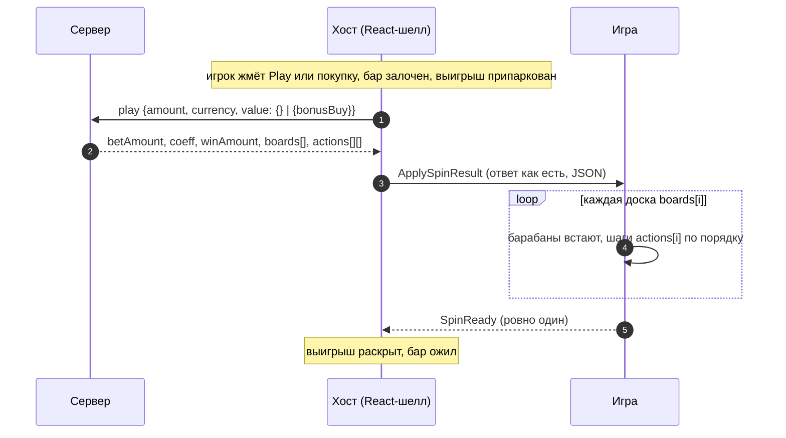

# Joker Slot

> Монетный слот 3 × 4 из семейства chicken-coin. Монеты и джекпот-медальоны ложатся на крайние барабаны,
> Joker Coin — на средний и собирает их. Джокеры запускают бонус, который можно и купить. Раунд атомарный:
> хост присылает ответ сервера целиком, игра проигрывает все доски и один раз отвечает `SpinReady`.

|  |  |
|---|---|
| **Id режима** | протокол `ModeProtocols['jokerSlot']` · шелл `joker-slot` · конфигуратор `joker-slot` · бэкенд `gameMode=joker-pyre` |
| **JS-мост** | [`JokerSlotBridge`](js.md) · mock: `JokerSlotMockHost` |
| **Unity-мост** | [нет — рецепт](unity.md) |
| **Демо** | `js/examples/demo-games/src/modes/joker-slot` (порт 5200, `?mock=1`) |
| **Живая игра** | оригинал — `joker-pyre.inout.games` (бэк prod, `action: "bet"`); у нас — только демо |
| **С версии** | protocol `1.21.0` · js `1.19.0` |
| **Исходник контракта** | [`protocol/src/jokerSlot.ts`](../../../protocol/src/jokerSlot.ts) |

## Механика

Три барабана по четыре символа, восемь линий. Доска и алфавит — те же, что у
[slot-coin](../slot-coin/README.md): бэкенд joker-pyre — это chicken-coin с другим бонусным магазином.
Имена символов взяты из оригинального клиента (`JOKER_SLOT_SYMBOLS`).

- **Базовый спин.** Три одинаковых обычных символа на линии платят (`WIN_LINES`). Монеты ×1…×15 и медальоны
  MINI…GRAND ложатся только на крайние барабаны. Если на среднем барабане выпал **Joker Coin** (`l`), он
  собирает все монеты доски (`STRIKE_COINS_COLLECTION`). **Super Joker Coin** (`m`) сначала докладывает
  монеты от себя (`SUPER_STRIKE_COINS_ADDED`), потом собирает.
- **Бонус.** Запускается выпавшей «кучей золота» (`PILE_OF_GOLD`) или покупкой (`BONUS_BUY`). Обе кладут на
  доску монеты и джокеров, затем `BONUS_RUN` даёт первую доску бонуса. Дальше идут бонусные доски: джокеры
  прилипают к среднему барабану, монеты каждого спина ложатся на крайние, и **каждый** джокер их собирает.
  Счётчик спинов (`BONUS_SPINS_COUNT`) снова становится 3, когда выпало новое, иначе уменьшается на 1.
  На 0 бонус кончается.
- **Покупка.** Две карточки, как в оригинале:

| `value.bonusBuy` | Цена | Карточка | Чем стартует |
|---|---|---|---|
| `x75` | ставка × 75 | Bonus | «1 or more Joker Coins»: Joker Coin (во всех записях — один) |
| `x200` | ставка × 200 | Super Bonus | «One Super Joker Coin from the start» — один Super Joker Coin |

`get-game-config` отдаёт `bonusBuyMultiplier: { x75, x200, x300 }`, но `x300` сервер отклоняет («The game is
temporarily unavailable…»). Игра продаёт две покупки — `JOKER_SLOT_BONUS_BUYS`.

## Раунд по шагам



1. Хост шлёт `play`. `amount` — число: ставка или **полная цена** покупки (ставка × 75 / × 200). Сервер цену
   не проверяет, считает её хост. Опции — только внутри `value` (иначе «Invalid payload»).
2. Ответ уходит в игру как есть одной командой `ApplySpinResult`: базовая доска и все доски бонуса.
3. Игра проигрывает `boards[i]` с `actions[i]` по порядку и после последней доски шлёт **один** `SpinReady`.
   До него хост держит бар залоченным и выигрыш припаркованным.

## Команды хоста → игра

| Команда | Когда приходит | Payload | Что делает игра |
|---|---|---|---|
| `ApplySpinResult` | спин или покупка приняты сервером | JSON-строка [`JokerSlotSpinResult`](#jokerslotspinresult) | проигрывает все доски и шлёт `SpinReady` |
| `ApplyGameState` | старт, переподключение | `{"status":"none"}` — всегда | ничего: восстанавливать нечего |
| `ApplyGameConfig` | старт | ответ `get-game-config` как есть | обычно ничего |
| `UpdateCoeffs` | общая синхронизация хоста | `number[]` | игнорирует |

Из общих команд режиму важны `DisabledPlayPressed` и `SetFastGame` — см.
[общий протокол](../../concepts/core-protocol.md).

## События игры → хост

| Событие | Когда слать | Что делает хост |
|---|---|---|
| `SpinReady` | один раз, когда доиграна **последняя** доска ответа (покупка тоже) | раскрывает выигрыш, снимает лок бара, планирует следующий автоспин |
| `RequestGameConfig`, `RequestGameState` | на старте сцены | отвечает по общей синхронизации |
| `RequestPlay` | игрок тапнул по сцене вместо Play | спин как с кнопки, а если Play неактивна — `DisabledPlayPressed` |

Бонусных событий (`BonusActive`, `BonusEnded`…) и `RequestStep` у режима нет: бонус — это доски того же ответа.

## Данные

### `JokerSlotSpinResult`

```ts
interface JokerSlotSpinResult {
  status: 'win' | 'lose';
  bet: { amount: string; currency: string; decimalPlaces: number };
  betAmount: string;        // что списано: у покупки — полная цена
  coeff: number | string;   // коэффициент раунда к betAmount (на stage — число)
  currency: string;
  isFinished: boolean;      // всегда true
  isWin: boolean;
  winAmount: string;        // выигрыш раунда — показывать его
  rounds: number;           // boards.length
  boards: string[];         // базовая доска, затем доски бонуса
  actions: JokerSlotAction[][]; // шаги доски boards[i], по порядку
}
```

Доска — строка из 12 кодов, **по барабанам сверху вниз**: ячейка = `reel * 4 + row` (как у slot-coin).

| Код | Символ (`JOKER_SLOT_SYMBOLS`) | Платит |
|---|---|---|
| `0` | `empty` — только на досках бонуса | — |
| `1`…`9` | bar, bell, cherry, grape, lemon, orange, seven, plum, watermelon | по линиям |
| `a`…`g` | монеты ×1 · ×2 · ×3 · ×5 · ×7 · ×10 · ×15 | когда их собирает джокер |
| `h`…`k` | MINI ×25 · MINOR ×50 · MAJOR ×150 · GRAND ×1000 | когда их собирает джокер |
| `l` | `joker` — Joker Coin, средний барабан | — |
| `m` | `superJoker` — Super Joker Coin, средний барабан | — |

Линии (`JOKER_SLOT_WIN_LINES`, номер = `winLineNumber`): 0–3 — ряды сверху вниз (`[0,4,8]` … `[3,7,11]`),
4 — `[0,5,10]`, 5 — `[1,6,11]`, 6 — `[2,5,8]`, 7 — `[3,6,9]`.

### Шаги доски

| `action` | Поля | Что показать |
|---|---|---|
| `WIN_LINES` | `winLines: {winLineNumber, coeff, payout}[]`, `totalCoeff`, `totalPayout` | подсветить линии |
| `STRIKE_COINS_COLLECTION` | `triggerIndex`, `coins: {index, symbol, coeff, payout}[]`, `totalCoeff`, `totalPayout` | монеты летят в джокера `triggerIndex`; при нескольких джокерах — по шагу на каждого |
| `SUPER_STRIKE_COINS_ADDED` | `triggerIndex`, `coins: {index, symbol}[]` | Super Joker кладёт монеты в ячейки; **в строке доски их нет** |
| `SUPER_STRIKE_MULTIPLIER_ADDED` | `triggerIndex`, `multiplier` | множитель на Super Joker |
| `ENHANCED_SUPER_STRIKE` | `triggerIndex`, `strikes: {index, symbol, coeff, payout}[]`, `totalCoeff`, `totalPayout` | Super Joker собирает других джокеров: их сбор платит ещё раз |
| `PILE_OF_GOLD` · `BONUS_BUY` | `coins`, `strikes: {index, symbol}[]` | старт бонуса: монеты и джокеры ложатся на доску |
| `BONUS_RUN` | `board: string[][]` (12 ячеек по одному коду), иногда `multiplier` | первая доска бонуса; следующие шаги этой доски играются на ней |
| `BONUS_SPINS_COUNT` | `count` | сколько спинов бонуса осталось после этой доски |

Список открыт (`JOKER_SLOT_ACTIONS`): неизвестное действие пропускать. `SUPER_STRIKE_JACKPOT_ADDED` и
`SUPER_STRIKE_MULTIPLIER_COLLECTED` форма на stage не записана.

Пример — купленный Super Bonus, начало (stage, 2026-11-06):

```json
{
  "betAmount": "200.00", "coeff": 1.01, "winAmount": "202.00", "rounds": 14,
  "boards": ["a66644448888", "000000m00000", "000000m00000", "c00000mm0000", "…"],
  "actions": [
    [
      { "action": "BONUS_BUY", "coins": [{ "symbol": "a", "index": 10 }], "strikes": [{ "symbol": "m", "index": 6 }] },
      { "action": "SUPER_STRIKE_COINS_ADDED", "triggerIndex": 6, "coins": [{ "symbol": "b", "index": 9 }, { "symbol": "b", "index": 3 }, { "symbol": "d", "index": 11 }] },
      { "action": "BONUS_RUN", "board": [["a"], ["0"], ["0"], ["b"], ["0"], ["0"], ["m"], ["0"], ["0"], ["b"], ["a"], ["d"]] },
      { "action": "STRIKE_COINS_COLLECTION", "triggerIndex": 6, "coins": ["…"], "totalCoeff": "11.00", "totalPayout": "11.000000000000" }
    ],
    [{ "action": "BONUS_SPINS_COUNT", "count": 2 }],
    "…"
  ]
}
```

Монеты базовой доски тоже переходят в бонус: `a` в ячейке 0 базовой доски стоит и на доске `BONUS_RUN`.

## Правила и инварианты

1. **Один `ApplySpinResult` — один `SpinReady`, после последней доски.** Раньше — бар оживёт посреди бонуса.
   Позже или никогда — бар останется залоченным: таймаута у хоста нет.
2. **`actions[i]` относится к `boards[i]`, шаги — по порядку.** После `BONUS_RUN` шаги той же доски идут по
   доске бонуса.
3. **Монеты Super Joker'а в строке доски не видны** — их несут `SUPER_STRIKE_COINS_ADDED` и сбор.
4. **Деньги частей — к базовой ставке.** В купленном бонусе `payout` монеты считан от `betAmount / цена`, а
   `coeff` раунда — к полной цене. Показывать итог только из верхнего `winAmount`: он равен `coeff × betAmount`
   в десятичной арифметике, обрезанному до центов, и может быть на цент меньше суммы частей (31 ставка при
   x75 → `30.99`).
5. **Неизвестное действие — пропустить; неизвестный код или ячейка вне доски — ошибка:** доску нельзя
   нарисовать честно.
6. **Ставку решает хост.** Тап по сцене — `RequestPlay`. Во время автоплея бар залочен целиком, кроме кнопки
   остановки.

## Восстановление и ошибки

- **Перезагрузка.** Раунд закрывается одним ответом, `get-game-state` всегда `{ status: 'none' }`. Если спин
  был в полёте, сервер его уже рассчитал: выигрыш на балансе, анимация потеряна.
- **Отказ сервера** (`{ error: 'Invalid payload' }`, `{ error: { message } }`). Игра ничего не получает. Хост
  показывает тост, открывает бар и останавливает автоплей. Записанные отказы: строковый `amount` или нет
  `value` — «Invalid payload»; ставка ниже минимума — «Something went wrong while creating bet»; `x300` —
  «The game is temporarily unavailable…».
- **Игра не может разобрать раунд.** Не молчать: лог ошибки и видимое «сломанное» состояние сцены. Демо
  `SpinReady` в этом случае не шлёт: раунд не показан, бар остаётся залоченным, ошибка на виду.
- **`SpinReady` не пришёл** — бар заблокирован навсегда (решение 2026-09-27). Чинят в игре.

## Смотрите также

- [JS: как встроить](js.md) · [Unity: как собрать мост](unity.md)
- [slot-coin](../slot-coin/README.md) — тот же алфавит и доска
- [Жизненный цикл раунда](../../concepts/round-lifecycle.md) · [Общий протокол](../../concepts/core-protocol.md)
