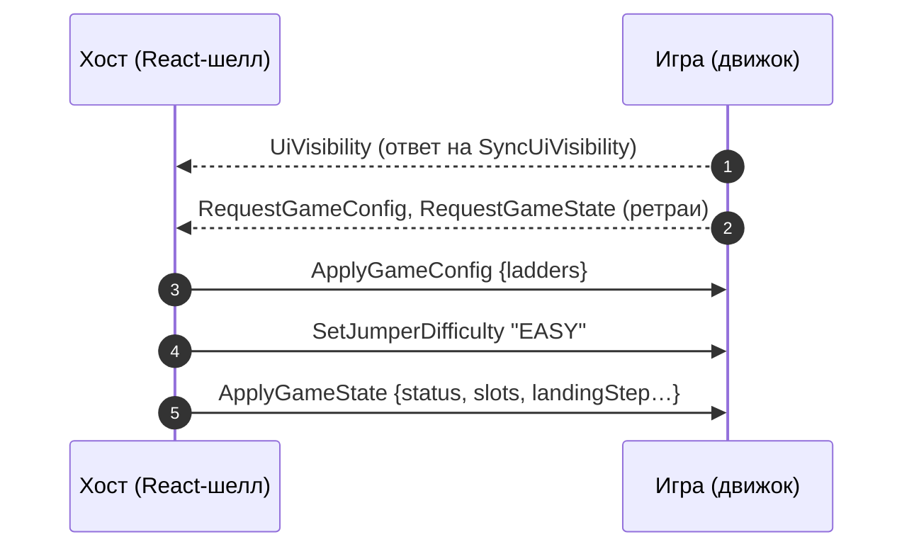
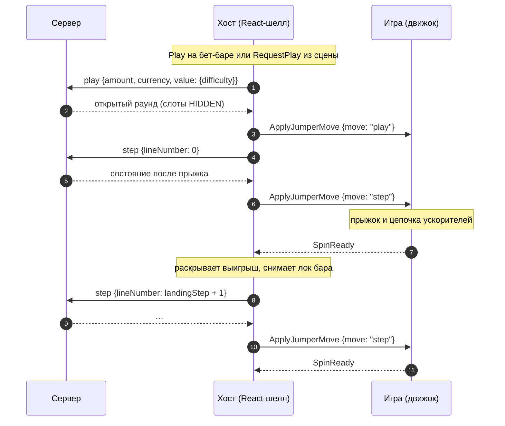
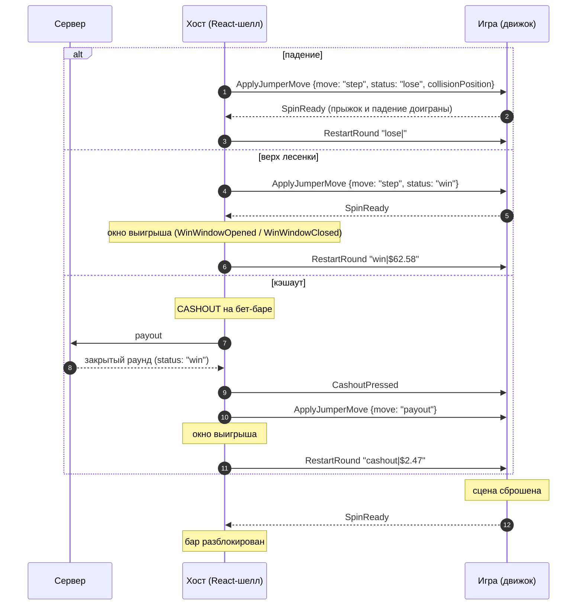

# Jumper

> Игрок прыгает вверх по лесенке ступеней, у каждой свой коэффициент. Ускорители — батут, джетпак, ракета —
> перебрасывают его сразу через несколько ступеней. Движок рисует прыжок, цепочку ускорителей и падение. Ставкой,
> сервером и деньгами владеет хост.

|  |  |
|---|---|
| **Id режима** | протокол `ModeProtocols['jumper']` · шелл `jumper` · конфигуратор `jumper` · бэкенд `gameMode=jumper`, `gameCategory=jumper` |
| **JS-мост** | [`JumperBridge`](js.md) · mock: `JumperMockHost` |
| **Unity-мост** | [`JumperWebBridge`](unity.md) (namespace `Modules.Jumper`) · префаб `JumperWebBridge.prefab` · mock: `JumperMockHost` (C#) |
| **Демо** | `js/examples/demo-games/src/modes/jumper` (порт 5196) · заглушка для шелла `js/examples/jumper-stub` (порт 5181) |
| **Хост** | RoadFrontent `src/modes/jumper/` · ADR-0008 · протокол бэка `src/modes/jumper/PROTOCOL.md` |
| **С версии** | protocol `1.16.0` · js `1.14.0` · Unity-пакет `1.0.0` (сейчас 1.18.0 / 1.16.0 / 1.1.0) |

Продового движка jumper пока нет. Мосты готовы на обеих платформах, а режим в шелле проверяют демо-игрой и
заглушкой `jumper-stub`.

## Механика

**Лесенка.** Ступени нумеруются с нуля. У каждой сложности своя лесенка: коэффициент на каждую ступень, дальности
ускорителей и цена бонуса. На dev-бэке сложностей три — `EASY` (40 ступеней), `MEDIUM` (38), `HARD` (35).
Ускорители бросают на 2 / 4 / 8 ступеней, бонус стоит 100 ставок. Эти числа приходят конфигом, в коде движка их
не зашивают. До первого прыжка игрок стоит под ступенью 0, на `JUMPER_START_STEP = -1`.

**Прыжок.** Каждый ход — прыжок на ступень `landingStep + 1`. Ступени со слотами ускорителей известны с открытия
раунда, но все слоты скрыты (`HIDDEN`). Слот раскрывается, когда игрок на него прыгнул или пролетел над ним:
показывает свой ускоритель или `NONE`, если слот пустой. Ускорители складываются в цепочку. Пример: прыжок на 8
(джетпак, +4) → 12 (батут, +2) → игрок стоит на 14. Ступени, через которые он перелетел, не играются.
Коэффициент раунда — коэффициент ступени, где игрок стоит.

**Конец раунда.** Исход решает сервер, и вариантов три:

- падение: ставка проиграна, раунд закрыт; падение бывает и посреди цепочки;
- приземление на верхнюю ступень: раунд закрыт выигрышем;
- кэшаут после хотя бы одного прыжка: игрок забирает выигрыш текущей ступени.

**Бонус** покупается за `bonusBuyMultiplier` ставок. Сервер сразу рассчитывает и выплачивает всю серию фри-геймов.
Сколько их будет, знает только ответ. Каждый фри-гейм — маршрут от ступени 0 до финальной ступени. Серию движок
проигрывает сам и сообщает хосту о ходе серии.

**Сложность** выбирают на бет-баре хоста, только между раундами. Движку она приходит своей командой
`SetJumperDifficulty`: у jumper нет `DAREDEVIL`, поэтому crush-команда `SetDifficulty` сюда не подходит.
**Автоплей** тоже ведёт хост: цель «кэшаут на ступени N», ходы, ставки. Движок только узнаёт, что автоплей
включён или выключен.

## Раунд по шагам

### Старт и восстановление



1. Пока не пришёл первый `UiVisibility`, хост раз в 250 мс шлёт `SyncUiVisibility`. Первый `UiVisibility` для
   него значит «мост жив», и до этого момента он не синхронизирует сцену и не возобновляет бонус. Мосты отвечают на
   `SyncUiVisibility` сами (JS — `BridgeBase`, Unity — `LayoutWebBridge`).
2. Игра просит конфиг и состояние с ретраями: 10 попыток раз в 0,5 с, пока не пришёл конфиг.
3. Конфиг несёт лесенки **всех** сложностей. Поэтому смене сложности не нужен лишний запрос.
4. Сложность хост шлёт после конфига: движок выбирает лесенку из уже пришедших. mock-хосты шлют их в обратном
   порядке, поэтому движок должен принимать оба порядка (см. «Правила», п. 11).
5. `ApplyGameState` — «приведи сцену к этому раунду», а не ход. Анимации и `SpinReady` после него не нужны.

### Ставка и прыжки



1. `play` списывает ставку, но игрок ещё стоит на старте. Движок раскладывает скрытые слоты и **не** шлёт
   `SpinReady`.
2. Первый прыжок `step {lineNumber: 0}` хост шлёт сразу, не дожидаясь движка. Движку оба хода приходят подряд.
3. На `step` движок проигрывает прыжок с цепочкой ускорителей и только потом шлёт `SpinReady`. Ответ сервера
   приходит, пока прыжок ещё летит, поэтому хост паркует выигрыш и держит бар залоченным до `SpinReady`: так игрок
   не увидит исход раньше, чем приземлится.
4. Следующий прыжок — снова Play: хост сам считает `lineNumber = landingStep + 1`. Игра ступень не выбирает.

### Конец раунда



1. Прыжок, который закрыл раунд (падение или верх), проигрывается как любой другой и заканчивается `SpinReady`.
   Только после этого хост шлёт `RestartRound`. В отличие от road, проигранный раунд движок jumper сам не
   перезапускает.
2. Окно выигрыша хост открывает по `SpinReady` верхнего прыжка. `RestartRound` уходит, когда окно отпустило раунд.
   Если коэффициент ниже порога окна, `RestartRound` уходит сразу.
3. `CashoutPressed` хост шлёт только после того, как сервер выплатил выигрыш, в том же такте, где открывает окно,
   и перед ходом `payout`. Если payout отказан, движок ничего не получает, и живой раунд остаётся на экране.
4. На `payout` движок показывает закрытый раунд и `SpinReady` **не** шлёт: он ждёт `RestartRound`.
5. На любой `RestartRound` движок сбрасывает сцену и отвечает `SpinReady`. До этого бар залочен целиком, а сторожа
   по таймауту нет: без `SpinReady` бар не оживёт никогда.

### Купленный бонус

```mermaid
sequenceDiagram
    autonumber
    participant S as Сервер
    participant H as Хост (React-шелл)
    participant G as Игра (движок)
    Note over H: покупка в магазине (между раундами)
    H->>S: play {amount: ставка × bonusBuyMultiplier, value: {difficulty, bonusType: "default"}}
    S-->>H: открытый раунд без слотов
    H->>S: step {lineNumber: 0}
    S-->>H: закрытый раунд: вся серия, выигрыш зачислен
    Note over H: окно «You won free games» → шторка перехода
    H->>G: TransitionScreenOpenStarted / …Finished
    H->>G: StartBonus {games, totalCoefficient, totalWin…}
    G-->>H: BonusActive
    loop каждый фри-гейм
        Note over G: маршрут от ступени 0 до finalStep
        G-->>H: BonusProgressSave {completedIterations, totalIterations}
    end
    G-->>H: BonusEnded
    Note over H: окно итога серии, переход; серию закрывает хост
```

1. Серию сервер рассчитывает целиком в ответе на `step {lineNumber: 0}` купленного раунда. Хост перекладывает
   её в `JumperStartBonusPayload` и отдаёт одним сообщением.
2. `StartBonus` уходит под закрытой шторкой перехода: за ней движок меняет сцену.
3. После каждого доигранного фри-гейма — `BonusProgressSave` со счётчиком. По нему хост считает накопленный
   выигрыш и сохраняет прогресс на случай перезагрузки.
4. После последнего фри-гейма — `BonusEnded`. `BonusProgressClear` и `BonusCleared` движок jumper **не** шлёт:
   серия оплачена при покупке. Хост сам снимает состояние бонуса за закрытыми воротами перехода после окна итога.

## Команды хоста → игра

| Команда | Когда приходит | Payload | Что делает игра |
|---|---|---|---|
| `ApplyGameConfig` | старт, ресинк, ответ на `RequestGameConfig` | JSON `JumperGameConfigPayload` строкой | Запоминает лесенки всех сложностей |
| `SetJumperDifficulty` | после конфига: на старте, при ресинке и восстановлении, при смене сложности между раундами | `'EASY' \| 'MEDIUM' \| 'HARD'` | Выбирает лесенку из конфига и перестраивает поле |
| `ApplyGameState` | старт, ресинк, ответ на `RequestGameState`; не приходит, пока движок играет купленную серию | JSON `JumperRoundState` строкой | Ставит сцену в описанный раунд без анимации; `status: 'none'` — пустая лесенка, игрок на старте |
| `ApplyJumperMove` | каждый ход живого раунда | `JumperMovePayload` | `play` — раскладывает слоты, без `SpinReady`; `step` — играет прыжок, затем `SpinReady`; `payout` — показывает закрытый раунд, ждёт `RestartRound` |
| `RestartRound` | после закрытого раунда: падение — после `SpinReady` прыжка; верх и кэшаут — после окна выигрыша | `"<reason>\|<amount>"`: `"lose\|"`, `"win\|$62.58"`, `"cashout\|$2.47"` | Сбрасывает сцену, затем `SpinReady` |
| `SetAutoplay` | автоплей включили или выключили | `boolean` | Отражает состояние в сцене. Ходы делает хост |
| `StartBonus` | серия куплена (или возобновлена после перезагрузки), под закрытой шторкой перехода | `JumperStartBonusPayload` | Играет все фри-геймы, шлёт бонусные события |

Общие команды — в [общем протоколе](../../concepts/core-protocol.md). У jumper есть особенности:

| Команда | Особенность jumper |
|---|---|
| `CashoutPressed` | Приходит после выплаты, в такте открытия окна и перед `ApplyJumperMove` `payout`. Это момент убрать со сцены то, что принадлежит живому раунду (коэффициент над игроком) |
| `DisabledPlayPressed` | Ответ на `RequestPlay`, пока прыжок летит, сцена сбрасывается, идёт бонус или автоплей. Игра отыгрывает отказ (тряска, подсказка) |
| `WinWindowOpened` / `WinWindowClosed` | Окно выигрыша после верха лесенки, после кэшаута и итог серии |
| `TransitionScreen*` | Шторка вокруг купленной серии: `StartBonus` приходит, пока она закрыта |

## События игры → хост

| Событие | Когда слать | Что делает хост |
|---|---|---|
| `SpinReady` | ровно один раз: после каждого доигранного `step` (приземление или падение) и после сброса сцены на `RestartRound` | Раскрывает припаркованный результат. Если прыжок закрыл раунд — шлёт `RestartRound` (падение) или открывает окно (верх). Иначе снимает лок бара |
| `BonusActive` | серия начала играть | Включает бонусный UI |
| `BonusProgressSave` | после каждого доигранного фри-гейма | Считает выигрыш сыгранных фри-геймов по лесенке, сохраняет прогресс для перезагрузки, обновляет «осталось фри-геймов» |
| `BonusEnded` | последний фри-гейм доигран | Показывает итог серии и закрывает её за воротами перехода |

Общие события — `UiVisibility`, `RequestGameConfig`, `RequestGameState`, `RequestPlay`, звуки — описаны в
[общем протоколе](../../concepts/core-protocol.md). `RequestPlay` (тап по сцене) хост обрабатывает как свою кнопку
Play: ставка или прыжок приходят `ApplyJumperMove`, а при неактивной Play — `DisabledPlayPressed`.

Канал jumper не включает `BonusProgressClear`, `BonusCleared`, `BonusPurchaseRequest` и события других режимов
(`DropFinished`, `RoundShown`). Мосты jumper их не шлют. Чужое событие хост логирует как ошибку
`[jumper] The engine sent an event jumper does not handle`.

## Данные

Все типы — `protocol/src/jumper.ts`. Хост перекладывает в них ответы сервера: массивы вместо карт сервера по
ступеням и именованные поля. Так Unity читает их обычным `JsonUtility`-классом, а веб получает как есть.

**Деньги и коэффициенты** — канонические десятичные строки: цифры и необязательная точка, без знака, экспоненты и
хвостовых нулей (`"2.7"`, а не `"2.70"`). На одном бэкенде сервер шлёт числа, на другом строки; хост приводит всё к
одной форме. Форматирует для показа игра. **Перечисления** — имена бэкенда, регистр важен.

```ts
const JUMPER_DIFFICULTIES = ['EASY', 'MEDIUM', 'HARD'] as const;
const JUMPER_ACCELERATORS = ['TRAMPOLINE', 'JETPACK', 'ROCKET'] as const;
const JUMPER_START_STEP = -1; // where the player stands before the first jump

type JumperSlotState = 'HIDDEN' | 'NONE' | JumperAccelerator;
type JumperRoundStatus = 'none' | 'in-game' | 'win' | 'lose';
type JumperMove = 'play' | 'step' | 'payout';
```

### Конфиг — `ApplyGameConfig`

```ts
interface JumperGameConfigPayload {
  ladders: JumperLadder[]; // one per difficulty, in JUMPER_DIFFICULTIES order
}

interface JumperLadder {
  difficulty: JumperDifficulty;
  coefficients: string[]; // the coefficient of each step, by its index
  accelerators: { accelerator: JumperAccelerator; steps: number }[];
  bonusBuyMultiplier: number; // the bonus price in bets, a whole positive number
}
```

```json
{
  "ladders": [
    {
      "difficulty": "EASY",
      "coefficients": ["1.01", "1.04", "1.09", "…", "2.47", "2.7", "…", "62.58"],
      "accelerators": [
        { "accelerator": "TRAMPOLINE", "steps": 2 },
        { "accelerator": "JETPACK", "steps": 4 },
        { "accelerator": "ROCKET", "steps": 8 }
      ],
      "bonusBuyMultiplier": 100
    }
  ]
}
```

### Раунд — `ApplyGameState` и `ApplyJumperMove`

```ts
interface JumperRoundState {
  status: JumperRoundStatus;   // 'none' — no live round
  difficulty: JumperDifficulty;
  coeff: string;               // the coefficient of landingStep; "0" before the first jump and after a fall
  winAmount: string;
  slots: JumperSlot[];         // every accelerator slot of the round, known from its start, ascending by step
  lineNumber: number;          // the step this jump aimed at; JUMPER_START_STEP before the first one
  landingStep: number;         // where the chain ended; the next jump aims at landingStep + 1
  visitedSteps: JumperVisitedStep[]; // the accelerators the jump went through, in order
  collisionPosition?: number;  // closed rounds only: where the player fell, or would have fallen after a cash out
}

interface JumperSlot { step: number; state: JumperSlotState }
interface JumperVisitedStep { step: number; accelerator: JumperAccelerator }

interface JumperMovePayload extends JumperRoundState {
  move: JumperMove; // the request the reply answered
}
```

| Поле | Как читать |
|---|---|
| `slots` | Шаг слота и что он показывает. `HIDDEN`, пока игрок не прыгнул на него и не пролетел над ним. Пустые слоты раскрываются как `NONE` |
| `lineNumber` | Куда целился этот прыжок. Первая точка анимации |
| `visitedSteps` | Сработавшие ускорители по порядку. `step` каждого — точка, откуда игрока бросило дальше |
| `landingStep` | Конец цепочки. У живого раунда и выигрыша — ступень, где игрок стоит. **У проигрыша — цель цепочки, а не позиция игрока** |
| `collisionPosition` | Только у закрытого раунда. Проигрыш — ступень падения, может быть посреди цепочки. Кэшаут — где игрок упал бы; это любая ступень, в том числе ниже `landingStep`. Верх лесенки и бонус — за её пределами (`coefficients.length`) |

Ход `step`, прыжок по цепочке (EASY, ставка 1 USD, записан с dev-бэка):

```json
{
  "move": "step",
  "status": "in-game",
  "difficulty": "EASY",
  "coeff": "2.47",
  "winAmount": "2.47",
  "slots": [
    { "step": 1, "state": "NONE" }, { "step": 3, "state": "TRAMPOLINE" }, { "step": 4, "state": "NONE" },
    { "step": 8, "state": "JETPACK" }, { "step": 9, "state": "NONE" }, { "step": 12, "state": "TRAMPOLINE" },
    { "step": 15, "state": "HIDDEN" }, { "step": 18, "state": "HIDDEN" }
  ],
  "lineNumber": 8,
  "landingStep": 14,
  "visitedSteps": [
    { "step": 8, "accelerator": "JETPACK" },
    { "step": 12, "accelerator": "TRAMPOLINE" }
  ]
}
```

Путь игрока: 8 → 12 → 14. Слот 9 раскрылся, потому что игрок над ним пролетел. Список `slots` здесь сокращён: в
настоящем ответе 17 слотов.

Ход `step` с падением (MEDIUM). Цель — 10, там батут, цепочка вела на 12, но игрок упал на 10:

```json
{
  "move": "step",
  "status": "lose",
  "difficulty": "MEDIUM",
  "coeff": "0",
  "winAmount": "0",
  "slots": [{ "step": 0, "state": "TRAMPOLINE" }, { "step": 10, "state": "TRAMPOLINE" }, { "step": 13, "state": "HIDDEN" }],
  "lineNumber": 10,
  "landingStep": 12,
  "visitedSteps": [{ "step": 10, "accelerator": "TRAMPOLINE" }],
  "collisionPosition": 10
}
```

Анимация падения: цепочку `lineNumber → visitedSteps → landingStep` обрезать на `collisionPosition`. В примере
выше остаётся `[10]`, и падение — оттуда.

Ход `play` — раунд открыт, игрок на старте:

```json
{
  "move": "play", "status": "in-game", "difficulty": "EASY", "coeff": "0", "winAmount": "0",
  "slots": [{ "step": 1, "state": "HIDDEN" }, { "step": 3, "state": "HIDDEN" }],
  "lineNumber": -1, "landingStep": -1, "visitedSteps": []
}
```

Раунда нет (`ApplyGameState`): `{"status":"none","difficulty":"HARD","coeff":"0","winAmount":"0","slots":[],
"lineNumber":-1,"landingStep":-1,"visitedSteps":[]}`.

### Бонус — `StartBonus`

```ts
interface JumperStartBonusPayload {
  difficulty: JumperDifficulty;
  betAmount: string;        // the bet one free game is played for: the price paid / bonusBuyMultiplier
  currency: string;
  displayBet?: string;      // the bet in the display currency ("$0.05"); empty or absent — show betAmount
  games: JumperBonusGame[];
  totalCoefficient: string; // the sum of the games' coefficients, in bets
  totalWin: string;         // the whole series' win, already paid
}

interface JumperBonusGame {
  finalStep: number;        // the step the free game ends on
  coefficient: string;      // the ladder's coefficient of finalStep
  route: JumperRoutePoint[];
}

interface JumperRoutePoint {
  step: number;
  action: 'STEP' | JumperAccelerator; // STEP — the next jump goes to step + 1; an accelerator — step + its distance
}
```

Маршрут начинается со ступени 0 и перечисляет только площадки, **с которых** прыгали. Последний прыжок
приземляется на `finalStep`, своей точки у него нет. Серия куплена на EASY за 100 USD (9 фри-геймов, сумма
88.13 ставки); первый фри-гейм — по записанному ответу dev-бэка:

```json
{
  "difficulty": "EASY",
  "betAmount": "1",
  "currency": "USD",
  "games": [
    {
      "finalStep": 19,
      "coefficient": "3.98",
      "route": [
        { "step": 0, "action": "STEP" }, { "step": 1, "action": "JETPACK" }, { "step": 5, "action": "TRAMPOLINE" },
        { "step": 7, "action": "TRAMPOLINE" }, { "step": 9, "action": "JETPACK" }, { "step": 13, "action": "JETPACK" },
        { "step": 17, "action": "STEP" }, { "step": 18, "action": "STEP" }
      ]
    }
  ],
  "totalCoefficient": "88.13",
  "totalWin": "88.13"
}
```

Остальные восемь фри-геймов в примере опущены. Путь первого: 0 → 1 → 5 → 7 → 9 → 13 → 17 → 18 → 19.
`displayBet` хост сейчас не шлёт. Unity-адаптер шелла заменяет код демо-валюты `DEMO` на `"D"` в `currency`, веб
получает код как есть.

### Прогресс бонуса — `BonusProgressSave`

```json
{ "completedIterations": 2, "totalIterations": 9 }
```

Счётчик ведётся по фри-геймам **этого** `StartBonus`. После перезагрузки хост отдаёт только оставшиеся игры и сам
добавляет к счётчику уже сыгранные. `completedIterations` не больше `totalIterations`, а `totalIterations` равен
`games.length`. Иначе хост логирует ошибку и прогресс не принимает.

## Правила и инварианты

1. **Результат не показывать раньше приземления.** Хост держит выигрыш и лок бара до `SpinReady`. Если движок
   выведет коэффициент или «упал» до конца анимации, он проспойлерит исход.
2. **`play` — без `SpinReady`.** Первый прыжок хост шлёт сразу. Лишний `SpinReady` может открыть бар до того, как
   прыжок доигран.
3. **Один `SpinReady` на каждый `step` и на каждый `RestartRound`.** Сторожа по таймауту нет (решение
   2026-09-27). Если `SpinReady` не пришёл, бар залочен навсегда, и это ошибка сборки движка, а не повод для
   таймера в хосте.
4. **`payout` — без `SpinReady`, дальше ждать `RestartRound`.** Раунд закрывает перезапуск сцены после окна.
5. **Закрытый прыжок — тоже прыжок.** Падение и верх лесенки сначала доигрываются и подтверждаются `SpinReady`,
   и только потом хост шлёт `RestartRound`. Сбрасывать сцену самому нельзя: хост ещё покажет окно.
6. **`landingStep` проигрыша — не позиция игрока.** Падение — на `collisionPosition`, путь до неё обрезается.
   Иначе игрок долетит до 12 и «упадёт» на 10.
7. **Ступень выбирает хост.** Следующий прыжок всегда `landingStep + 1`, сервер отказывает на любой другой. Игра
   только просит ход (`RequestPlay`) и никогда не делает ставку сама.
8. **Лесенку, дальности и цену брать из конфига.** Сейчас везде 2 / 4 / 8 и 100, но это настройка сложности
   на бэкенде, а не константа протокола.
9. **Деньги — строками, считать в десятичных.** Для показа форматирует игра. Сумма в `RestartRound` — готовая
   строка хоста (`"$2.47"`), её показывают как есть.
10. **Имена — точные.** `"easy"` или `"Easy"` — не сложность: Unity-мост пишет предупреждение и игнорирует
    команду, enum-свойства payload'ов бросают `FormatException`.
11. **Конфиг и сложность независимы.** Хост шлёт сначала конфиг, потом сложность, mock-хосты — наоборот. Поле
    строится, когда известны оба. Смена сложности приходит только между раундами.
12. **`ApplyGameState` — не ход.** Сцена ставится в состояние без анимации и без `SpinReady`.
13. **Серия не прерывается ресинком.** Пока движок играет серию, хост не шлёт `ApplyGameState`: состояние «раунда
    нет» оборвало бы её (сервер закрыл раунд ещё при покупке).
14. **Автоплей ведёт хост.** Во время автоплея бар залочен целиком, кроме кнопки остановки. `RequestPlay` из
    сцены получает `DisabledPlayPressed`.

## Восстановление и ошибки

- **Перезагрузка посреди раунда.** После `UiVisibility` хост шлёт `ApplyGameConfig` → `SetJumperDifficulty`
  (сложность живого раунда) → `ApplyGameState` со `status: 'in-game'`. Сцена ставит игрока на `landingStep` (или
  на старт, если `landingStep = -1`) и раскрывает слоты. Следующий Play прыгает на `landingStep + 1`.
- **Перезагрузка без раунда.** `status: 'none'` с выбранной на баре сложностью: пустая лесенка, игрок на старте.
- **Перезагрузка посреди купленной серии.** Сервер уже выплатил её, поэтому остаток хост берёт из того, что
  сохранил сам. Порядок тот же, что при покупке: окно «осталось N фри-геймов», шторка, `StartBonus` только с
  оставшимися играми (`totalCoefficient` и `totalWin` — всей серии). Если серия доиграна, ничего не приходит. Если
  сохранённую серию не прочитать, хост показывает тост и забывает её.
- **Отказ сервера на прыжок** (`You cant open this line`, сеть). Хост показывает тост, останавливает автоплей и
  сразу разблокирует бар. Движок ничего не получает, его последний ход остаётся в силе.
- **Ответ ломает контракт** (схема, бонус без покупки — `bonusIsTriggered` в обычном прыжке). Хост показывает
  тост, разблокирует бар и заново читает сессию. Движок получает `ApplyGameConfig` / `SetJumperDifficulty` /
  `ApplyGameState` и приводит сцену к тому, что держит сервер.
- **Отказ payout** (`Cannot payout without steps`, сеть). `CashoutPressed` не приходит, раунд живой, бар открыт.
- **Отказ покупки бонуса.** Хост показывает тост и шлёт `ApplyBonusPurchaseResult {modeId, isPurchased: false,
  error}`. Этой команды нет в канале jumper: `JumperBridge` пишет в лог предупреждение, а у `JumperWebBridge` нет
  приёмника, и Unity пишет ошибку `SendMessage` в консоль. На сцену это не влияет.
- **Payload не читается.** Unity: `DeserializePayload` возвращает `null`, и команда пропускается. Enum-свойство
  с неизвестным именем бросает `FormatException` при чтении. JS: невалидный JSON у `ApplyGameConfig` /
  `ApplyGameState` бросает исключение из `JSON.parse` в `receive()`.

## Смотрите также

- [JS: как встроить](js.md) · [Unity: как встроить](unity.md)
- [Жизненный цикл раунда](../../concepts/round-lifecycle.md) · [Общий протокол](../../concepts/core-protocol.md) ·
  [Mock-режим](../../concepts/mock-mode.md)
- Исходники контракта: `protocol/src/jumper.ts`, `protocol/src/commands.ts` (`JumperCommand`),
  `protocol/src/modes.ts` (`ModeProtocols['jumper']`)
- Хост: RoadFrontent `src/modes/jumper/` (`runtime/`, `engine/` — сборка payload'ов, `PROTOCOL.md`), ADR-0008
