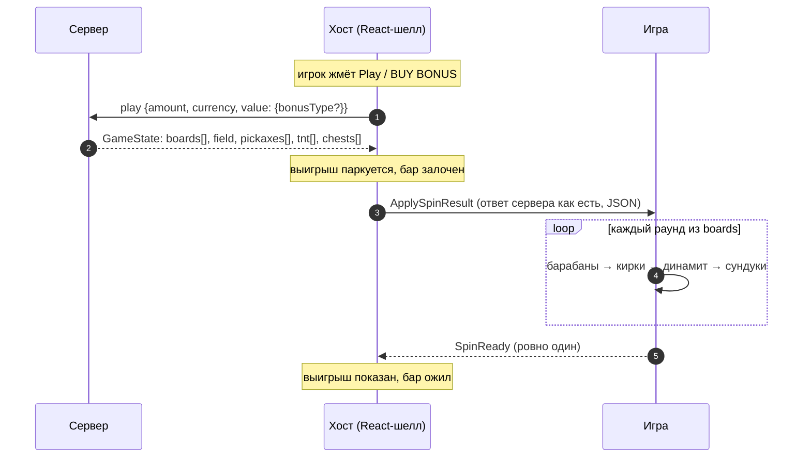

# Mine Slot

> Слот 5 × 3, у которого кирки с барабанов падают в поле блоков под ними, ломают блоки и открывают
> сундуки с множителями. Хост присылает ответ сервера целиком, игра проигрывает все раунды и один раз
> отвечает `SpinReady`.

|  |  |
|---|---|
| **Id режима** | протокол `ModeProtocols['mineSlot']` · шелл `mine-slot` · конфигуратор `mine-slot` · бэкенд `gameMode=mine-slot` |
| **JS-мост** | [`MineSlotBridge`](js.md) · mock: `MineSlotMockHost` |
| **Unity-мост** | [`MineSlotWebBridge`](unity.md) · префаб `MineSlotWebBridge.prefab` · namespace `Modules.MineSlot` |
| **Демо** | `js/examples/demo-games/src/modes/mine-slot` (порт 5197, `?mock=1`) |
| **С версии** | protocol `1.18.0` · js `1.16.0` · Unity-пакет `1.1.0` |
| **Исходник контракта** | [`protocol/src/mineSlot.ts`](../../../protocol/src/mineSlot.ts) |

## Механика

Над полем — барабаны 5 × 3. На них выпадают кирки четырёх видов, динамит, книга чар и скаттер. Каждая
кирка падает в свою колонку поля 5 × 6 и наносит урон сверху вниз, пока не кончится её сила. Блок,
получивший урон не меньше своей прочности, ломается и платит свой коэффициент. Колонка, пробитая до дна,
открывает сундук. Множители открытых сундуков перемножаются и умножают выигрыш блоков.

Три скаттера и больше запускают бонус: 4 фри-спина **на том же поле**. Между фри-спинами поле не
перегенерируется: то, что сломал базовый спин, остаётся сломанным. Бонус можно купить сразу за 100 ставок
(`bonus-buy`) или поднять его шанс за 3 ставки на каждый спин (`bonus-boost`). Оба варианта — выбор хоста;
игра получает уже сыгранный сервером результат.

## Раунд по шагам



1. Ставку, баланс, лимиты, покупку бонуса и буст решает хост. Игра в этом не участвует.
2. Сервер отвечает на `play` всем раундом сразу: базовый спин и, если выпал или куплен бонус, все
   фри-спины (`rounds` = 1 или 5).
3. Хост пересылает ответ **без изменений** командой `ApplySpinResult` и держит выигрыш у себя, пока игра
   не доиграет. Показать выигрыш раньше — значит раскрыть исход раньше анимации.
4. Игра проигрывает раунды по порядку на одном поле и после последнего шлёт **одно** событие `SpinReady`.
   На нём хост показывает выигрыш и снимает блокировку бет-бара.

## Команды хоста → игра

| Команда | Когда приходит | Payload | Что делает игра |
|---|---|---|---|
| `ApplySpinResult` | ответ сервера на `play` — обычный спин, спин с бустом или купленный бонус | JSON-строка [`MineSlotSpinResult`](#mineslotspinresult) | проигрывает все `rounds` раундов и шлёт `SpinReady` |
| `ApplyGameConfig` | на старте сцены (в ответ на `RequestGameConfig`) и при смене валюты | JSON-строка конфига платформы ([пример](#конфиг-get-game-config)) | берёт размеры поля и прочность блоков, если рисует их по конфигу |
| `ApplyGameState` | на старте сцены (в ответ на `RequestGameState`) | JSON-строка `GameState`; без раунда — `{"status":"none"}` | приводит сцену в покой |

Остальное — общие команды: `SetFastGame`, `ApplyWhiteLabel`, `ApplyTranslations`, `DisabledPlayPressed`
и прочие ([общий протокол](../../concepts/core-protocol.md)). Своих команд кроме `ApplySpinResult` у режима
нет: покупка бонуса и буст меняют только запрос хоста к серверу.

## События игры → хост

| Событие | Когда слать | Что делает хост |
|---|---|---|
| `SpinReady` | один раз, когда доиграны **все** раунды ответа | показывает выигрыш, снимает лок бета, запускает следующий автоспин |
| `RequestGameConfig`, `RequestGameState` | на старте сцены, повторяя до ответа | отвечает `ApplyGameConfig` / `ApplyGameState` |
| `RequestPlay` | игрок тапнул по сцене вместо кнопки Play | делает спин как с кнопки, а если Play сейчас неактивна — шлёт `DisabledPlayPressed` |

Событий бонуса (`BonusActive`, `BonusEnded` и т. п.) у режима нет: фри-спины — часть того же ответа.

## Данные

### `MineSlotSpinResult`

Ответ сервера на `play` — `GameState` платформы с полями режима на верхнем уровне:

```ts
interface MineSlotSpinResult {
  status: 'win' | 'lose' | 'in-game' | 'none';
  bet?: { amount: string; currency: string; decimalPlaces: number };
  betAmount: string;      // цена спина — то, что списано (см. «Цена и выплаты»)
  currency: string;
  coeff: number;          // winAmount / betAmount
  isFinished: boolean;
  isWin: boolean;
  winAmount: string;      // весь выигрыш ответа
  rounds: number;         // 1 — обычный спин; 5 — базовый + 4 фри-спина
  boards: string[];       // по строке из 15 символов на раунд
  field: string;          // 30 блоков поля в начале ответа
  pickaxes: MineSlotHit[];
  tnt: MineSlotHit[];
  chests: MineSlotChest[];
}

interface MineSlotHit {
  round: number;          // индекс в boards
  index: number;          // клетка барабанов, reel * 3 + row
  brokenBlocks: MineSlotBrokenBlock[];
}

interface MineSlotBrokenBlock {
  index: number;          // клетка поля, column * 6 + level
  damage: number;
  coeff?: number;         // только у удара, который блок доломал
  payout?: string;
}

interface MineSlotChest {
  col: number;
  coeff: number;          // множитель: 2, 3, 4, 5, 10, 25, 50 или 100
  payout: string;
}
```

Настоящий ответ dev-бэка: обычный спин, ставка 1, два удара из пяти показаны.

```json
{
  "status": "win",
  "bet": { "amount": "1.00", "currency": "USD", "decimalPlaces": 2 },
  "betAmount": "1.00",
  "coeff": 0.3,
  "currency": "USD",
  "isFinished": true,
  "isWin": true,
  "winAmount": "0.30",
  "rounds": 1,
  "boards": ["eb12xxxxx52x11x"],
  "field": "dssrgodssrgcdssrcgddsrggddsrgg",
  "pickaxes": [
    {
      "round": 0,
      "index": 2,
      "brokenBlocks": [
        { "index": 0, "damage": 1 },
        { "index": 1, "damage": 2, "coeff": 0.1, "payout": "0.100000000000000000" },
        { "index": 2, "damage": 2, "coeff": 0.1, "payout": "0.100000000000000000" }
      ]
    },
    { "round": 0, "index": 3, "brokenBlocks": [{ "index": 6, "damage": 1 }, { "index": 7, "damage": 1 }] }
  ],
  "tnt": [],
  "chests": []
}
```

### Кодировка барабанов и поля

Обе строки — **по колонкам, сверху вниз**:

```
boards[r] — 15 символов, клетка = reel * 3 + row      field — 30 символов, клетка = column * 6 + level

reel:   0   1   2   3   4                              column:  0   1   2   3   4
row 0   0   3   6   9  12                              level 0  0   6  12  18  24   ← верх поля
row 1   1   4   7  10  13                              level 1  1   7  13  19  25
row 2   2   5   8  11  14                              …
                                                       level 5  5  11  17  23  29   ← над сундуком
```

| Символ барабана | Что это | Сила |
|---|---|---|
| `x` | пусто | — |
| `1` · `2` · `3` · `5` | кирка: деревянная · каменная · золотая · зачарованная | 1 · 2 · 3 · 5 |
| `d` | динамит: падает после всех кирок, бьёт соседние блоки | 2 |
| `e` | книга чар: все кирки её барабана получают силу 5 | — |
| `b` | скаттер: 3 и больше — бонус из 4 фри-спинов | — |

| Блок поля | Название | Прочность | Коэффициент |
|---|---|---|---|
| `d` | земля | 1 | 0 |
| `s` | камень | 2 | 0.1 |
| `r` | редстоун | 4 | 1 |
| `g` | золото | 5 | 3 |
| `c` | кристалл | 6 | 5 |
| `o` | обсидиан | 7 | 25 |

Константы этих таблиц экспортирует протокол: `MINE_SLOT_REELS`, `MINE_SLOT_FIELD`, `MINE_SLOT_SYMBOLS`,
`MINE_SLOT_BLOCKS`, `MINE_SLOT_CHEST_COEFFS`. В Unity им соответствуют `MineSlotReels`, `MineSlotField`,
`MineSlotSymbols`, `MineSlotBlocks`.

### Цена и выплаты

Сервер принимает в `play` **полную цену** спина и сам выводит из неё ставку:

| Спин | `value` запроса | `amount` | Ставка, от которой считаются выплаты |
|---|---|---|---|
| обычный | `{}` | ставка | ставка |
| с бустом | `{ bonusType: 'bonus-boost' }` | ставка × 3 | `amount / 3` |
| покупка бонуса | `{ bonusType: 'bonus-buy' }` | ставка × 100 | `amount / 100` |

Множители приходят в конфиге (`bonuses`). `betAmount` и `coeff` ответа считаются от цены: покупка за 100
с выигрышем 66 даёт `coeff: 0.66`. `payout` блоков и сундуков считаются от ставки. Игре это важно, только
если она сама показывает суммы: итог раунда — всегда `winAmount`.

### Конфиг (`get-game-config`)

```json
{
  "board": { "rows": 3, "cols": 5 },
  "field": { "rows": 6, "cols": 5 },
  "pickaxes": { "1": 1, "2": 2, "3": 3, "5": 5 },
  "blocks": { "d": 1, "s": 2, "r": 4, "g": 5, "c": 6, "o": 7 },
  "bonuses": { "bonus-boost": 3, "bonus-buy": 100 },
  "betConfig": { "minBetAmount": "0.10", "maxBetAmount": "10000.00", "maxWinAmount": "100000.00", "betPresets": [] },
  "currency": { "code": "USD", "type": "FIAT", "displayName": "$", "decimalPlaces": 2 }
}
```

Ответ dev-бэка; иконка валюты (`currency.icon`, SVG) опущена. Шелл отдаёт игре этот конфиг как есть (capability `wantsRawGameConfig`).

## Правила и инварианты

1. **Один ответ — один `SpinReady`.** Не по раунду, не по кирке: хост снимает лок и показывает выигрыш
   только по нему. Лишний `SpinReady` откроет бар посреди бонуса, пропущенный — заблокирует игру
   навсегда. Таймаута на стороне хоста нет: событие обязано прийти.
2. **Поле не пересоздаётся между фри-спинами.** `field` — состояние на начало ответа; каждый следующий
   раунд бьёт по тому, что осталось.
3. **Порядок ударов — порядок списков.** В раунде сначала все `pickaxes` (по колонкам, от деревянной к
   зачарованной), затем `tnt` слева направо. `round` удара говорит, в каком раунде он случился.
4. **`coeff` и `payout` есть только у доламывающего удара.** Промежуточный урон — без них.
5. **Деньги — строки.** `winAmount`, `betAmount`, `payout` — десятичные строки платформы. Не складывать
   их как `number`, если сумма уходит игроку на экран.
6. **Игра не решает, можно ли ставить.** Тап по сцене — `RequestPlay`; ставку, лимиты и блокировку
   держит хост.

## Восстановление и ошибки

- **Перезагрузка.** Раунд Mine Slot завершается в одном ответе, поэтому восстанавливать нечего:
  `get-game-state` возвращает `{"status":"none"}`, и игра стартует в покое.
- **Отказ сервера.** До игры доходит только принятый спин. Отказ (`{"error": …}`) хост показывает сам и
  снимает лок без `ApplySpinResult`.
- **Битый ответ.** Хост проверяет ответ на границе (`boards`, `field`, `pickaxes`, `tnt`, `chests`) и не
  отдаёт игре невалидный. Если игра всё же не может его разобрать, это дефект, а не повод продолжить: игра
  пишет ошибку в лог, показывает сломанное состояние и **не** шлёт `SpinReady`. Бар остаётся залоченным,
  сбой виден сразу. Так ведут себя демо-игры всех режимов.

## Смотрите также

- [JS: как встроить](js.md) · [Unity: как встроить](unity.md)
- [Жизненный цикл раунда](../../concepts/round-lifecycle.md) · [Общий протокол](../../concepts/core-protocol.md)
- Хост: RoadFrontent `src/modes/mine-slot/` (спин, буст, покупка, раскрытие выигрыша по `SpinReady`)
- Спецификация бэкенда: Confluence «Mine Slot — WebSocket API»
