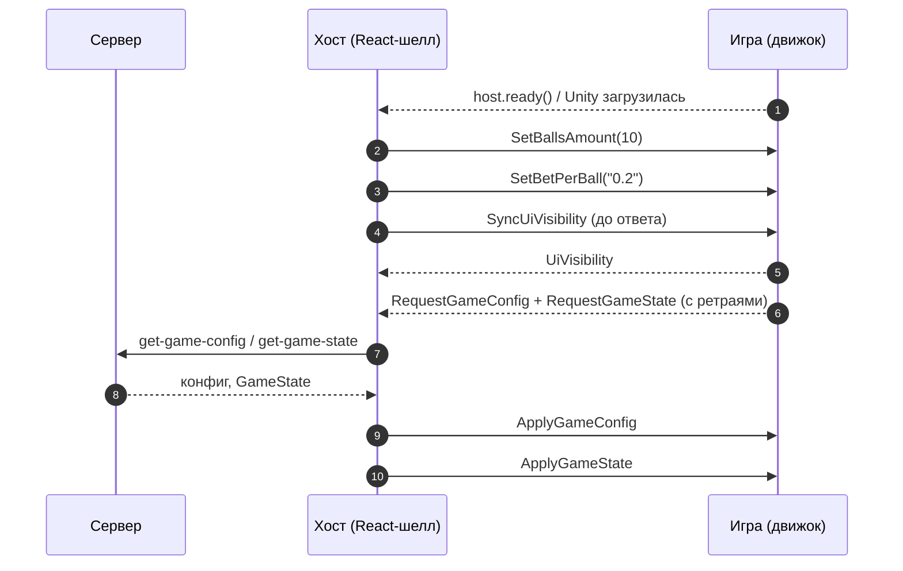
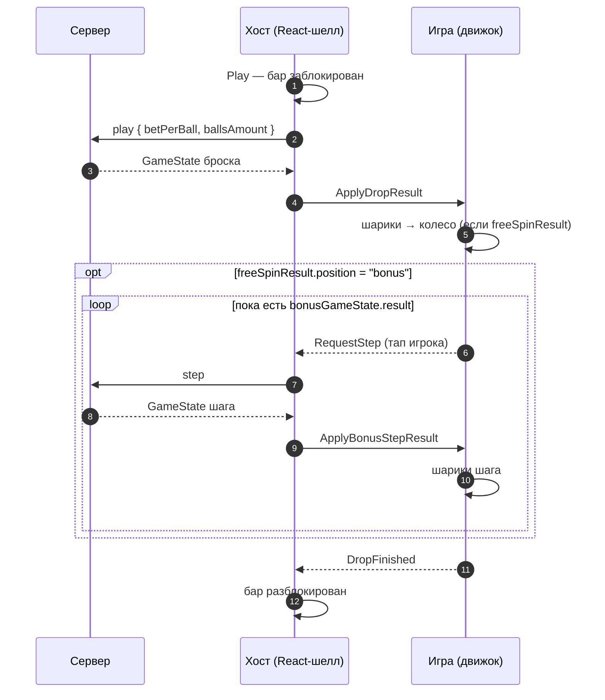

# Plinko Aztec

> Игрок бросает за одну ставку серию шариков; движок проигрывает падение каждого шарика в ячейку, которую назвал
> сервер, крутит колесо фортуны, если шарик попал в ячейку колеса, и ведёт бонусную игру по тапам игрока.

|  |  |
|---|---|
| **Id режима** | протокол `ModeProtocols['plinkoAztec']` · шелл `plinko-aztec` · конфигуратор `plinko-aztec` · бэкенд `gameMode=plinko-aztec` |
| **JS-мост** | [`PlinkoAztecBridge`](js.md) · mock: `PlinkoAztecMockHost` |
| **Unity-мост** | [`PlinkoAztecWebBridge`](unity.md) · префаб `PlinkoAztecWebBridge.prefab` · mock: `PlinkoAztecMockHost` (C#) |
| **Демо** | `js/examples/demo-games/src/modes/plinko-aztec` (dev-сервер на порту 5191) |
| **С версии** | protocol `1.9.0` (ключ `plinkoAztec` в `ModeProtocols` — с `1.8.0`, `SetBetPerBall` / `RequestBetPerBall` — с `1.9.0`) · js `1.13.0` · Unity-пакет `1.0.0` (ставка за шар и mock — в `1.1.0`, тега `unity-v1.1.0` пока нет) |

## Механика

Доска со штырьками, внизу — линия ячеек. Линию присылает конфиг (`positions`): у каждой ячейки свой коэффициент,
ячейка с коэффициентом `0` — ячейка колеса фортуны (`spin`). В бет-баре игрок выбирает **ставку за шар**
(`betPerBall`, десятичная строка: `"0.2"`, `"2"`) и **число шариков в броске** (`ballsAmount`; допустимые
значения диктует бэкенд — `ballsAmountOptions` конфига, обычно `10 / 20 / 50`). Ставка броска — их произведение.

Бросок целиком считает сервер в ответ на `play`: в какую ячейку упал каждый шарик (`ballsResult`), сколько раз он
задел бамперы по пути (`bonusBumpAmount`), на чём встало колесо, если шарик попал в ячейку колеса
(`freeSpinResult`), и началась ли бонусная игра (`bonusGameState.result`). Игра ничего не решает — она
проигрывает ответ и сообщает, когда доиграла.

Попадания в бамперы копятся между бросками в счётчиках — отдельно для каждой комбинации валюты, числа шариков и
ставки за шар, ключом `CUR-balls-betPerBall` (`"USD-10-0.2"`). Бонусная игра — серия шагов: каждый шаг игрок
запускает тапом по полю, сервер присылает его шарики (`ballPerDrop` штук). Бамперы внутри бонуса поднимают
уровень, а с ним — число шариков за шаг. Когда шаги кончились, `bonusGameState.result` из ответа пропадает.

## Раунд по шагам

### Загрузка



1. Как только движок загрузился, хост пушит текущий выбор бет-бара: `SetBallsAmount` и `SetBetPerBall`. Дальше
   он пушит их на каждое переключение. Выбор, запомненный с прошлого визита, приходит отдельной сменой чуть позже.
2. Первое `UiVisibility` хост считает подтверждением, что мост принимает команды: до него конфиг и состояние не
   уходят (ждёт до 10 с, потом шлёт вслепую).
3. На `RequestGameConfig` и на `RequestGameState` хост отвечает одинаково — полной ресинхронизацией: приходят **оба**
   `ApplyGameConfig` и `ApplyGameState`. Сырые, как их отдал сервер: разбирает игра.
4. `ApplyGameState` — «приведи сцену к этому». Если в нём есть `bonusGameState.result`, игрок перезагрузился посреди
   бонусной игры: игра показывает бонус и ждёт тапа.

### Бросок, колесо и бонусная игра



1. Игрок жмёт Play (или тапает поле — игра шлёт `RequestPlay`). Хост блокирует бар до того, как уйдёт запрос:
   двойной тап не отправит два броска.
2. Хост зовёт `play` с `amount = betPerBall × ballsAmount` и `value: { betPerBall, ballsAmount }` и пересылает ответ
   в `ApplyDropResult` как есть.
3. Игра роняет каждый шарик в его ячейку, затем крутит колесо, если пришёл `freeSpinResult`.
4. Если колесо дало бонус, в ответе есть `bonusGameState.result`: игра входит в бонус и ждёт тапа. Каждый тап —
   ровно один `RequestStep`, следующий — только после того, как шарики шага доиграли.
5. Хост на `RequestStep` зовёт `step` (без payload) и присылает ответ `ApplyBonusStepResult`. Сам хост шаги не
   считает и не блокирует: следит за ними игра.
6. Когда доиграно всё — шарики, колесо и бонус до последнего шага, — игра шлёт **один** `DropFinished`. Только им
   хост снимает блокировку бара: таймера-сторожа нет.

## Команды хоста → игра

| Команда | Когда приходит | Payload | Что делает игра |
|---|---|---|---|
| `SetBallsAmount` | После загрузки, на каждое переключение в баре, в ответ на `RequestBallsAmount` | `number` — целое `> 0` | Запоминает число шариков следующего броска, показывает лоток. То же значение повторно — без события; `<= 0` или не целое — предупреждение в лог, выбор не меняется |
| `SetBetPerBall` | Так же, как `SetBallsAmount` | `string` — десятичная строка бэкенда (`"0.2"`) | Запоминает ставку за шар строкой как есть. Сравнивается по сумме: `"2"` после `"2.0"` — не смена. Пусто, не число, `0`, знак, запятая, экспонента — предупреждение, выбор не меняется |
| `ApplyGameConfig` | На старте и на любой ресинхронизации | JSON `PlinkoAztecGameConfig` | Строит линию ячеек, берёт лимиты и прогресс бамперов |
| `ApplyGameState` | На старте, на запрос игры, после переподключения | JSON `PlinkoAztecGameState` | Приводит сцену к состоянию; восстанавливает идущий бонус |
| `ApplyDropResult` | Сервер ответил на `play` | JSON `PlinkoAztecGameState` | Проигрывает шарики → колесо → вход в бонус |
| `ApplyBonusStepResult` | Сервер ответил на `step` (после `RequestStep`) | JSON `PlinkoAztecGameState` | Проигрывает шарики шага, обновляет счётчики бонуса |

На проводе Unity шаг бонуса приходит методом `ApplyStepResult` — это имя метода, а не другая команда
(см. [Unity](unity.md#api-plinkoaztecwebbridge)).

Общие команды — в [общем протоколе](../../concepts/core-protocol.md). Особенности режима:

- `SetFastGame` — у бара режима есть тумблер скорости.
- `DisabledPlayPressed` — ответ на `RequestPlay`, пока Play бара недоступна (модалка, лоадер, бар скрыт игрой).
  Во время летящего броска хост **не** присылает `DisabledPlayPressed` — повторный бросок он отклоняет молча.
- `RestartRound`, `StartBonus`, окна результата (`WinWindow*`), автоплей и покупки бонуса в режиме нет.

## События игры → хост

| Событие | Когда слать | Что делает хост |
|---|---|---|
| `DropFinished` | Один раз на `ApplyDropResult` — когда доиграны шарики, колесо и вся бонусная игра | Снимает блокировку бара. Без события бар остаётся заблокированным навсегда |
| `RequestStep` | Тап игрока в бонусной игре — один на шаг, пока не пришёл его результат | Зовёт `step`, присылает `ApplyBonusStepResult`; ошибка — тост игроку, команды нет |
| `RequestBallsAmount` | Код игры поднялся позже пуша и хочет явный ответ | Присылает `SetBallsAmount` с текущим выбором |
| `RequestBetPerBall` | То же для ставки за шар | Присылает `SetBetPerBall` |
| `RequestPlay` | Тап по полю вне бонусной игры — то же, что Play бара | Бросок обычным путём или `DisabledPlayPressed` |
| `RequestGameConfig` / `RequestGameState` | Старт сцены (мост повторяет до ответа) | Полная ресинхронизация: оба `Apply*` |
| `UiVisibility` | Сразу после загрузки и в ответ на `SyncUiVisibility` | Отмечает мост готовым, раскладывает свой UI |

## Данные

В `protocol/src` формы payload'ов этого режима нет: команды несут JSON строкой, а разбирает его мост игры.
Формы ниже сверены с `RoadFrontent/src/modes/plinko-aztec/types.ts` (что хост получает от сервера и пересылает как
есть) и с C#-классами `WebPlinkoAztecPayloads.cs`.

### Конфиг (`ApplyGameConfig`)

```ts
interface PlinkoAztecGameConfig {
  betConfig: {
    minBetAmount: string;     // суммы — строками с точностью валюты: "0.20"
    maxBetAmount: string;
    maxWinAmount: string;
    defaultBetAmount: string;
    decimalPlaces: string;    // строкой: "2"
    currency: string;
  };
  /** Линия ячеек слева направо. coefficient 0 — ячейка колеса. */
  positions: { coefficient: number; probability: number }[];
  /** Допустимые значения ballsAmount для play: [10, 20, 50]. */
  ballsAmountOptions: number[];
  showStartupModal?: boolean;
  /** Прогресс бамперов по комбинациям "CUR-balls-betPerBall" — те же счётчики, что bonusGameState.progress. */
  bonusGameProgress: Record<string, number>;
}
```

Варианты ставки за шар в конфиге не приходят: их список держит хост (`BET_PER_BALL_OPTIONS` —
`"0.2"`, `"0.4"`, `"1"`, `"2"`) и сообщает выбор командой `SetBetPerBall`.

### Состояние, бросок и шаг (`ApplyGameState`, `ApplyDropResult`, `ApplyBonusStepResult`)

Все три — один и тот же GameState платформы: базовые поля общие для всех игр, поля Aztec лежат на верхнем уровне.

```ts
interface PlinkoAztecGameState {
  /** 'lose' бывает только в бонусной игре. */
  status: 'none' | 'in-game' | 'win' | 'lose';
  bet?: { amount: string; currency: string; decimalPlaces: number };
  isFinished?: boolean;          // false, пока идёт бонусная игра
  isWin?: boolean;
  /** Коэффициент броска или шага: сумма коэффициентов шариков. */
  coeff?: number;
  /** Выигрыш броска или шага строкой. */
  winAmount?: string;
  ballsAmount?: number;          // шариков в броске
  betPerBall?: string;           // ставка за шар; ставка броска = betPerBall × ballsAmount
  ballsResult?: PlinkoAztecBallResult[];
  /** Есть, только если в броске сработало колесо. */
  freeSpinResult?: PlinkoAztecFreeSpinResult;
  bonusGameState?: PlinkoAztecBonusGameState;
  betAmount?: string;            // дубли bet.amount / bet.currency на верхнем уровне
  currency?: string;
  error?: string;
}

/** Один шарик. */
interface PlinkoAztecBallResult {
  /** Ячейка по её коэффициенту ("0.2", "20") или "spin" — ячейка колеса. Не индекс! */
  position: string;
  /** Коэффициент, который заплатила ячейка; "0" у ячейки колеса. */
  coeff: string;
  /** Попаданий в бамперы по пути вниз. */
  bonusBumpAmount: number;
}

/** Колесо фортуны. */
interface PlinkoAztecFreeSpinResult {
  /** Сектор: множитель ("2") или "bonus" — бонусная игра. */
  position: string;
  winAmount: string;
  coeff: string;
}

interface PlinkoAztecBonusGameState {
  /** Счётчики бамперов по комбинациям "CUR-balls-betPerBall", например "USD-10-1". */
  progress: Record<string, number>;
  /** Идущая бонусная игра; нет поля — бонуса нет. */
  result?: PlinkoAztecBonusGameResult;
}

interface PlinkoAztecBonusGameResult {
  /** Номер бонусной игры с 1 — когда выиграно несколько сразу. */
  gameNumber: number;
  level: number;
  /** Бамперов, набранных на текущем уровне. */
  progress: number;
  /** Шариков за шаг на текущем уровне. */
  ballPerDrop: number;
  /** Осталось ШАГОВ бонуса — не шариков, несмотря на имя. */
  ballsAmount: number;
  freeSpinProgress: number;
  /** Накопленный выигрыш бонусной игры. */
  winAmount: string;
}
```

### Пример: бросок с колесом

Ответ mock-хоста `PlinkoAztecMockHost` (сценарий `fortune-wheel`, 10 шариков по `"0.2"`). Это не запись с
dev-бэка: суммы мок считает иллюстративно, но форма та же, что у сервера.

```json
{
  "bet": { "amount": "2.00", "currency": "USD", "decimalPlaces": 2 },
  "betAmount": "2.00",
  "currency": "USD",
  "ballsAmount": 10,
  "betPerBall": "0.2",
  "bonusGameState": { "progress": { "USD-10-0.2": 5 } },
  "status": "win",
  "isFinished": true,
  "isWin": true,
  "coeff": 30.2,
  "winAmount": "12.08",
  "ballsResult": [
    { "position": "spin", "coeff": "0", "bonusBumpAmount": 1 },
    { "position": "9", "coeff": "9", "bonusBumpAmount": 0 },
    { "position": "9", "coeff": "9", "bonusBumpAmount": 0 },
    { "position": "2", "coeff": "2", "bonusBumpAmount": 1 },
    { "position": "4", "coeff": "4", "bonusBumpAmount": 1 },
    { "position": "spin", "coeff": "0", "bonusBumpAmount": 1 },
    { "position": "spin", "coeff": "0", "bonusBumpAmount": 0 },
    { "position": "0.2", "coeff": "0.2", "bonusBumpAmount": 0 },
    { "position": "2", "coeff": "2", "bonusBumpAmount": 1 },
    { "position": "4", "coeff": "4", "bonusBumpAmount": 0 }
  ],
  "freeSpinResult": { "position": "2", "coeff": "2", "winAmount": "12.08" }
}
```

Шаг бонусной игры выглядит так же, только `ballsResult` короче (`ballPerDrop` шариков), `freeSpinResult` нет, а в
`bonusGameState.result` — счётчики бонуса:

```json
{
  "status": "in-game",
  "isFinished": false,
  "coeff": 160,
  "winAmount": "32.00",
  "ballsResult": [
    { "position": "4", "coeff": "4", "bonusBumpAmount": 0 },
    { "position": "130", "coeff": "130", "bonusBumpAmount": 1 },
    { "position": "26", "coeff": "26", "bonusBumpAmount": 2 }
  ],
  "bonusGameState": {
    "progress": { "USD-10-0.2": 9 },
    "result": {
      "gameNumber": 1, "level": 1, "progress": 3, "ballPerDrop": 3,
      "ballsAmount": 4, "freeSpinProgress": 0, "winAmount": "32.00"
    }
  }
}
```

(Поля `bet`, `betAmount`, `currency`, `ballsAmount`, `betPerBall` в шаге те же, что в броске, — опущены.)

### Кодировки

- **Ячейка шарика** — `position` по коэффициенту, а не по индексу. Линия симметрична, у каждого коэффициента
  обычно две ячейки (слева и справа): какую выбрать, решает доска. Демо чередует близнецов по номеру шарика
  (`slotIndexOf` в `aztecRound.ts`), чтобы бросок расходился по обе стороны.
- **Ячейка колеса** — `position: "spin"` у шарика и `coefficient: 0` в `positions`.
- **Сектор колеса** — `freeSpinResult.position`: `"bonus"` или множитель строкой. Само колесо (набор секторов)
  сервер не присылает — рисует его игра и следит, чтобы нужный сектор на нём был.
- **Ключ прогресса** — `` `${currency}-${ballsAmount}-${betPerBall}` ``, ставка — строкой бэкенда без округления
  (`"USD-10-0.2"`, `"USD-50-1"`). Поэтому мост хранит `betPerBall` строкой, а не числом.

## Правила и инварианты

1. **Один `DropFinished` на `ApplyDropResult`, после всего.** Хост снимает блокировку бара только этим событием.
   Пришлёте раньше бонуса — бар оживёт посреди бонусной игры, и игрок сделает ставку поверх неё; не пришлёте —
   бар не разблокируется никогда (сторожа по таймауту нет).
2. **Шаги бонуса `DropFinished` не шлют.** `ApplyBonusStepResult` — продолжение того же броска; событие уходит
   один раз, когда в ответе пропал `bonusGameState.result` и шарики последнего шага сели.
3. **Один `RequestStep` на шаг.** Хост шаги не дедуплицирует: два тапа подряд — два запроса `step` на сервер.
   Следующий тап принимается, только когда шарики предыдущего шага доиграли.
4. **Не показывать результат раньше анимации.** Выигрыш, колесо и вход в бонус раскрываются по ходу падения, а не в
   момент прихода ответа: ответ сервера опережает то, что видит игрок.
5. **Деньги — строками.** `betPerBall`, `winAmount`, суммы `betConfig` в `number` не переводятся: `0.1` в нём
   неточна, а ключ прогресса собирается из строки бэкенда дословно.
6. **Выбор бет-бара принадлежит хосту.** Игра число шариков и ставку не меняет и не валидирует по конфигу — только
   показывает то, что пришло в `SetBallsAmount` / `SetBetPerBall`. В броске сервер присылает свои `ballsAmount` и
   `betPerBall`: проигрывать нужно их, а не кэш выбора.
7. **Ответы проигрываются по очереди.** Новый `Apply*` не прерывает анимацию предыдущего — встаёт за ней.

## Восстановление и ошибки

- **Перезагрузка посреди бонусной игры.** `ApplyGameState` приходит со `status: "in-game"` и
  `bonusGameState.result`: игра показывает бонус и ждёт тапа. Блокировки бара у новой страницы нет, броска,
  который ждёт `DropFinished`, — тоже: после последнего шага восстановленного бонуса `DropFinished` слать не нужно
  (хосту это безразлично — лишний `DropFinished` ничего не ломает).
- **Перезагрузка посреди броска.** Бросок у сервера уже завершён: `ApplyGameState` приходит без
  `bonusGameState.result` (или с ним, если колесо дало бонус) — сцена встаёт в покой либо в бонус.
- **Сервер отказал в `play`.** Хост показывает тост и сразу снимает блокировку; `ApplyDropResult` не приходит, игре
  делать нечего.
- **Сервер отказал в `step`.** Хост показывает тост и **ничего не шлёт** игре. Игра, которая ждёт шаг, должна снова
  принять тап, иначе бонус залипнет (демо этого не умеет — см. открытые вопросы в [js.md](js.md#частые-ошибки)).
- **Битый payload.** JS-мост бросает из `JSON.parse`, Unity-мост пишет предупреждение `Failed to parse …` и событие
  не поднимает. В обоих случаях `DropFinished` не уйдёт и бар останется заблокированным — ошибку разбора игра
  обязана показать (лог, экран ошибки), а не проглотить.
- **Повторный `SetBallsAmount` / `SetBetPerBall` с тем же значением** — без события: мост сравнивает с кэшем.
- **Переподключение.** Хост повторяет ресинхронизацию: снова `ApplyGameConfig` + `ApplyGameState`. Игра приводит
  сцену к присланному, а не накладывает поверх.

## Смотрите также

- [JS: как встроить](js.md) · [Unity: как встроить](unity.md)
- [Жизненный цикл раунда](../../concepts/round-lifecycle.md) · [Общий протокол](../../concepts/core-protocol.md) ·
  [Mock-режим](../../concepts/mock-mode.md)
- Исходники контракта: `protocol/src/modes.ts` (`plinkoAztec`), `protocol/src/commands.ts` (`PlinkoCommand`,
  `TwistCommand`), `protocol/src/events.ts` (`PlinkoEvent`), `protocol/src/unityWire.ts`
- Хост: `RoadFrontent/src/modes/plinko-aztec/` (`usePlinkoAztec.ts`, `plinkoAztecStep.ts`,
  `plinkoAztecEngineEvents.ts`, `types.ts`)
