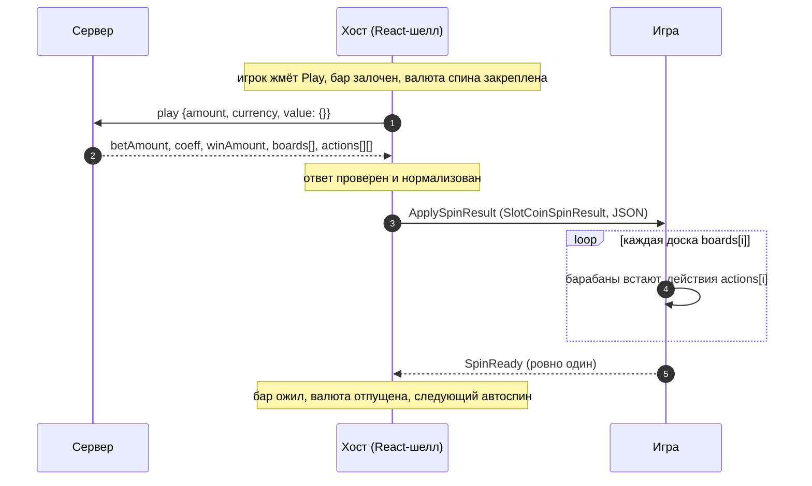

# Slot Coin

> Барабанный слот 3 × 4 с монетами: монеты и джекпот-медальоны ложатся на крайние барабаны, монета-триггер
> собирает их в себя. Сервер считает весь раунд, хост присылает его одной командой, игра проигрывает все
> доски и один раз отвечает `SpinReady`.

|  |  |
|---|---|
| **Id режима** | протокол `ModeProtocols['slotCoin']` (устар. `ModeProtocols['slot']`) · шелл `slot-coin` (читает и `gameCategory=slot`) · конфигуратор `slot-coin` · бэкенд `gameMode=chicken-coin` |
| **JS-мост** | [`SlotCoinBridge`](js.md) · mock: `SlotCoinMockHost` |
| **Unity-мост** | нет — [как собрать по контракту](unity.md) |
| **Демо** | `js/examples/demo-games/src/modes/slot-coin` (порт 5194, `?mock=1`) |
| **Живая игра** | MegaSlot (Phaser), мост в `src/bridge/bridgeEntry.ts` — на прежних именах `SlotBridge` + `createPhaserBoot` |
| **С версии** | protocol `1.17.0` (под именем `slot` — с `1.2.0`) · js `1.15.0` (`SlotBridge` — с `1.6.0`) · Unity-пакет — нет |
| **Исходник контракта** | [`protocol/src/payloads.ts`](../../../protocol/src/payloads.ts) (`SlotCoinSpinResult`, `SLOT_COIN_ACTIONS`), [`commands.ts`](../../../protocol/src/commands.ts) (`SlotCoinCommand`), [`legacySlotNames.ts`](../../../protocol/src/legacySlotNames.ts) |

## Механика

Три барабана по четыре символа. На каждом спине выпадает доска. Монеты-множители (×1…×15) и
джекпот-медальоны (mini, minor, major, grand) ложатся только на первый и третий барабаны. Если на доске
появляется монета-триггер, все монеты слетаются в её ячейку и платят свои коэффициенты.

Раунд может состоять из нескольких досок — бонусные респины идут в том же ответе. Ставку, выигрыш и все
доски считает сервер; игра только проигрывает их по порядку. Своих команд, кроме результата спина, у
режима нет, и покупки бонуса тоже нет.

До `protocol 1.17.0` / `js 1.15.0` режим назывался `slot`. Прежние имена остаются `@deprecated`-синонимами
до смены мажорной версии:

| Сейчас | Прежнее имя |
|---|---|
| `SlotCoinBridge`, `SlotCoinMockHost`, `SlotCoinMockHostOptions` | `SlotBridge`, `SlotMockHost`, `SlotMockHostOptions` |
| `SlotCoinSpinResult`, `SlotCoinAction`, `SlotCoinBoardCoin`, `SlotCoinCollectionAction`, `SlotCoinCommand` | `SlotSpinResult`, `SlotAction`, `SlotCoin`, `SlotCoinsCollectionAction`, `SlotCommand` |
| `SLOT_COIN_ACTIONS` | `SLOT_ACTIONS` |
| `ModeProtocols['slotCoin']` | `ModeProtocols['slot']` |

## Раунд по шагам



1. Хост отправляет `play` и держит бар залоченным. Валюта спина закреплена до `SpinReady`: кошелёк,
   переключённый во время вращения, не меняет валюту показанного выигрыша.
2. Хост проверяет ответ схемой (`src/modes/slot-coin/schema.ts`) и нормализует его в
   [`SlotCoinSpinResult`](#slotcoinspinresult). Отказ (`{ error }`) и битый ответ до игры не доходят.
3. Игра получает весь раунд одной командой `ApplySpinResult` и проигрывает доски по порядку.
4. После последней доски игра шлёт **одно** событие `SpinReady`. На нём хост снимает лок бара и отпускает
   валюту. Во время автоплея следующий спин уходит через 150 мс после разблокировки.

## Команды хоста → игра

| Команда | Когда приходит | Payload | Что делает игра |
|---|---|---|---|
| `ApplySpinResult` | спин принят сервером | JSON-строка [`SlotCoinSpinResult`](#slotcoinspinresult) | проигрывает все доски и шлёт `SpinReady` |
| `ApplyGameConfig` | общая синхронизация хоста, если в конфиге сервера есть лесенка коэффициентов | JSON-строка в обёртке road (`GameConfigPayload`: `coefficients`, `bonusModes`, `currency`, лимиты ставки, `balance`) | обычно ничего: слоту лесенка не нужна |
| `UpdateCoeffs` | общая синхронизация хоста | `number[]` — лесенка road или запасная | игнорирует |
| `SetAutoplay` | автоплей включён / выключен | `boolean` | игнорирует; спины всё равно приходят `ApplySpinResult` |

`ApplyGameState` настоящий хост slot-coin **не шлёт**: восстанавливать барабану нечего, список команд
рестора пуст (`slotCoinSession.restoreCommands`). `SlotCoinMockHost` на `RequestGameState` отвечает
`{"status":"none"}`.

Из общих команд режиму важны `DisabledPlayPressed` и `SetFastGame` — см.
[общий протокол](../../concepts/core-protocol.md).

## События игры → хост

| Событие | Когда слать | Что делает хост |
|---|---|---|
| `SpinReady` | один раз, когда доиграна **последняя** доска ответа | снимает лок бара, отпускает валюту спина, планирует следующий автоспин |
| `RequestGameConfig`, `RequestGameState` | на старте сцены, если сцене нужен конфиг | отвечает по общей синхронизации (см. выше) |
| `RequestPlay` | игрок тапнул по сцене вместо Play | спин как с кнопки, а если Play неактивна — `DisabledPlayPressed` |

**Событий бонуса не слать.** `BonusActive`, `BonusEnded` и прочие у slot-coin попадают в общий обработчик
бонуса road и открывают шторку перехода — у режима нет своего бонуса. `BonusPurchaseRequest` хост
отклоняет: `ApplyBonusPurchaseResult { isPurchased: false }` и тост «Bonus buy is not available».

## Данные

### `SlotCoinSpinResult`

```ts
interface SlotCoinSpinResult {
  betAmount: string;   // ставка
  coeff: string;       // коэффициент раунда
  currency: string;
  isFinished: boolean;
  isWin: boolean;
  winAmount: string;   // весь выигрыш раунда
  rounds: number;      // число досок
  boards: string[];    // доски по порядку: базовый спин, затем бонусные
  actions: SlotCoinAction[][]; // по массиву действий на доску
}

interface SlotCoinAction {
  action: string;          // одно из SLOT_COIN_ACTIONS, но список открыт
  [key: string]: unknown;  // поля зависят от action
}
```

Хост собирает это из ответа сервера (`src/modes/slot-coin/types.ts`, `normalizeSlotCoinSpinResult`):

| Поле | Если в ответе нет или `null` |
|---|---|
| `betAmount`, `coeff`, `winAmount` | `"0"` |
| `currency` | `""` |
| `isFinished` | `true` (ложь — только явное `false`) |
| `isWin` | `true`, если сервер сказал `true` или `winAmount > 0` |
| `rounds` | `boards.length`; не меньше 1 |
| `actions` | `[]` |
| `boards` | обязательны: пустой список или пустая доска — ответ отклоняется |

Пример — выигрыш по линии. Это ответ в форме сервера из тестов хоста (`types.test.ts`), не запись с
dev-бэка:

```json
{
  "betAmount": "1.00",
  "coeff": "6.00",
  "currency": "USD",
  "isFinished": true,
  "isWin": true,
  "winAmount": "6.00",
  "rounds": 1,
  "boards": ["886666668666"],
  "actions": [
    [
      { "action": "WIN_LINES", "winLines": [{ "winLineNumber": 2, "payout": "2.00", "coeff": "2.00" }] }
    ]
  ]
}
```

Сбор монет (так его собирает `SlotCoinMockHost`):

```json
{
  "boards": ["1a3b47l592c8"],
  "actions": [
    [
      {
        "action": "STRIKE_COINS_COLLECTION",
        "triggerIndex": 6,
        "coins": [
          { "index": 1, "symbol": "a", "coeff": "1", "payout": "1.00" },
          { "index": 3, "symbol": "b", "coeff": "2", "payout": "2.00" },
          { "index": 10, "symbol": "c", "coeff": "3", "payout": "3.00" }
        ]
      }
    ]
  ]
}
```

### Доска

Строка из 12 символов, **по барабанам, сверху вниз**: ячейка = `reel * 4 + row`. Размер доски в payload не
приходит — он задан шкафом игры (3 × 4).

```
reel:   0   1   2
row 0   0   4   8
row 1   1   5   9
row 2   2   6  10
row 3   3   7  11
```

Символ — **ключ**, а не число: коды идут `0`…`9`, затем `a`…`m`. Арифметикой их не сворачивать.

| Код | Символ | Коэффициент |
|---|---|---|
| `0` | пустая ячейка — только в бонусных досках | — |
| `1`…`9` | обычные символы | — |
| `a` · `b` · `c` · `d` · `e` · `f` · `g` | монеты | ×1 · ×2 · ×3 · ×5 · ×7 · ×10 · ×15 |
| `h` · `i` · `j` · `k` | джекпоты mini · minor · major · grand | ×25 · ×50 · ×150 · ×1000 |
| `l` | монета-триггер (средний барабан) | — |
| `m` | особый символ, назначение не описано | — |

Алфавит восстановлен по эталонному клиенту; протокол его не экспортирует. Таблица живёт в
`SlotCoinMockHost` пакета и в `slotCoinSymbols.ts` демо.

### Действия

Известные `action` — константа `SLOT_COIN_ACTIONS` протокола:

| Ключ | `action` | Форма |
|---|---|---|
| `winLines` | `WIN_LINES` | `winLines: { winLineNumber, payout, coeff }[]` |
| `strikeCoinsCollection` | `STRIKE_COINS_COLLECTION` | `SlotCoinCollectionAction`: `triggerIndex`, `coins: SlotCoinBoardCoin[]` |
| `superStrikeCoinsAdded` | `SUPER_STRIKE_COINS_ADDED` | не описана |
| `superStrikeMultiplierAdded` | `SUPER_STRIKE_MULTIPLIER_ADDED` | не описана |
| `superStrikeJackpotAdded` | `SUPER_STRIKE_JACKPOT_ADDED` | не описана |
| `superStrikeMultiplierCollected` | `SUPER_STRIKE_MULTIPLIER_COLLECTED` | не описана |
| `enhancedSuperStrike` | `ENHANCED_SUPER_STRIKE` | не описана |
| `pileOfGold` | `PILE_OF_GOLD` | не описана |
| `bonusRun` | `BONUS_RUN` | не описана |
| `bonusBuy` | `BONUS_BUY` | не описана |
| `bonusSpinsCount` | `BONUS_SPINS_COUNT` | не описана |

```ts
interface SlotCoinBoardCoin {
  index: number;    // ячейка доски, reel * 4 + row
  symbol?: string;  // код символа доски
  payout?: string;  // деньги — строкой
  coeff?: string;
}

interface SlotCoinCollectionAction extends SlotCoinAction {
  action: 'STRIKE_COINS_COLLECTION';
  triggerIndex: number; // ячейка монеты-триггера, куда летят монеты
  coins: SlotCoinBoardCoin[];
}
```

Монета без `coeff` оценивается по символу доски (таблица выше).

## Правила и инварианты

1. **Один `ApplySpinResult` — один `SpinReady`, после последней доски.** Раньше — игрок увидит живую
   кнопку посреди раунда. Позже или никогда — бар останется залоченным: таймаута у хоста нет.
2. **Доски — по порядку, `actions[i]` относится к `boards[i]`.** Массив действий может быть короче досок —
   доска без действий это обычный спин.
3. **Неизвестное действие — пропустить.** Список открыт, сервер может прислать то, чего нет в
   `SLOT_COIN_ACTIONS`. Неизвестный **символ** или ячейка вне доски — ошибка: доску нельзя нарисовать
   честно.
4. **Деньги — строки.** `winAmount` — итог раунда и единственный источник суммы. Суммы монет в моке
   иллюстративные.
5. **Событий бонуса и покупки нет.** Бонусные доски приходят в том же ответе.
6. **Ставку решает хост.** Тап по сцене — `RequestPlay`. Во время автоплея бар залочен целиком, кроме
   кнопки остановки.

## Восстановление и ошибки

- **Перезагрузка.** Раунд закрывается одним ответом, восстанавливать нечего. Хост ничего не шлёт в ответ
  на `RequestGameState`, игра стартует в покое. Если спин был в полёте, сервер его уже рассчитал: выигрыш
  на балансе, анимация потеряна.
- **Отказ сервера** (`{ error: { message } }` или `{ error: 'message' }`). Игра ничего не получает. Хост
  показывает тост, открывает бар и останавливает автоплей.
- **Битый ответ** (нет `boards`). Хост пишет `SlotCoinSpinReplyError` с путями невалидных полей и ведёт
  себя как при отказе («Failed to spin»).
- **Игра не может разобрать раунд.** Не молчать: лог ошибки и видимое «сломанное» состояние сцены. Демо
  `SpinReady` в этом случае не шлёт: раунд не показан, бар остаётся залоченным, ошибка на виду.
- **`SpinReady` не пришёл** — бар заблокирован навсегда (решение 2026-09-27). Чинят в игре.

## Смотрите также

- [JS: как встроить](js.md) · [Unity: как собрать мост](unity.md)
- [Жизненный цикл раунда](../../concepts/round-lifecycle.md) · [Общий протокол](../../concepts/core-protocol.md)
- Хост: RoadFrontent `src/modes/slot-coin/` — `runtime/slotCoinRound.ts` (спин), `types.ts` и `schema.ts`
  (граница ответа), `runtime/slotCoinEngineEvents.ts` (`SpinReady`), `session/slotCoinSession.ts` (пустой
  рестор)
