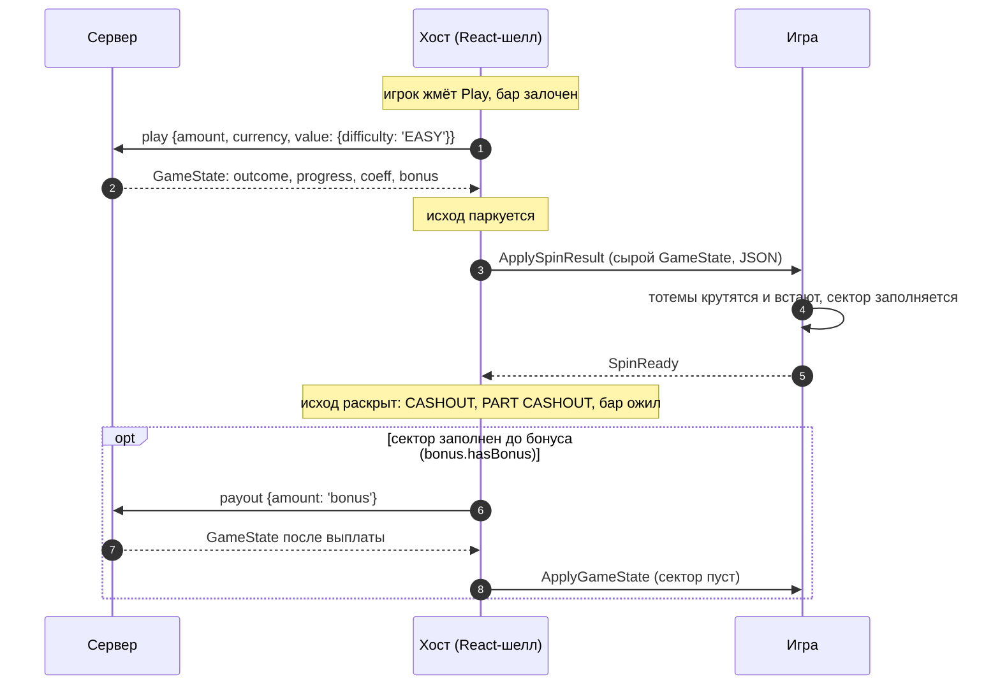
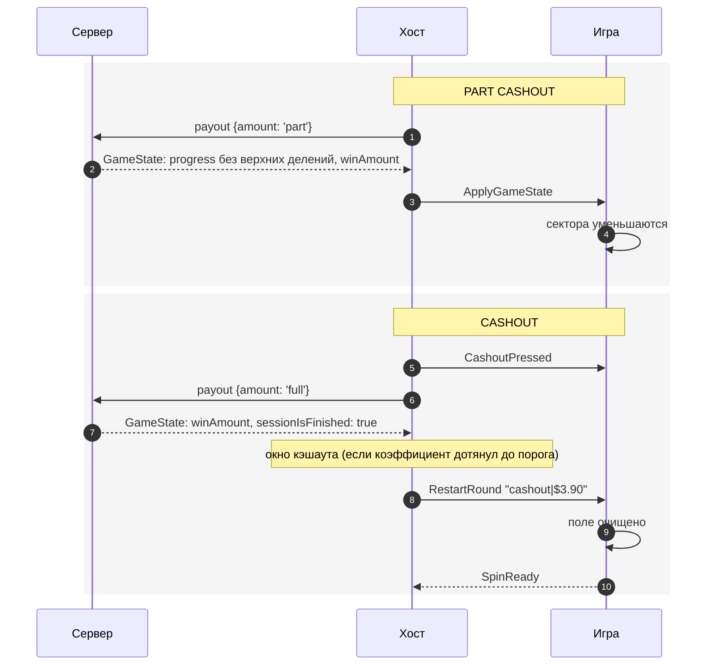
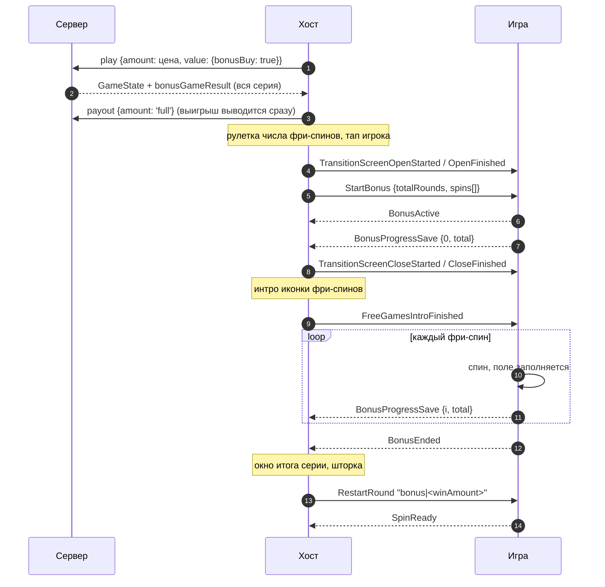

# Twist

> Слот с тотемами: каждый спин заполняет одно деление одного из трёх секторов поля. Игрок забирает
> выигрыш целиком или частями, пока смерть не обнулит поле. Хост пересылает игре сырые ответы сервера,
> игра проигрывает их и отвечает `SpinReady`. Купленную серию фри-спинов игра крутит сама.

|  |  |
|---|---|
| **Id режима** | протокол `ModeProtocols['twist']` · шелл `twist` · конфигуратор `twist` · бэкенд `gameMode=twist`, с покупкой бонуса — `twist-san-quentin` |
| **JS-мост** | [`TwistBridge`](js.md) · mock: в пакете нет, есть `TwistMockHost` демо-игры |
| **Unity-мост** | нет — [как собрать по контракту](unity.md) |
| **Демо** | `js/examples/demo-games/src/modes/twist` (порт 5193, `?mock=1`) |
| **Живая игра** | TwistReact (Phaser). Мост у неё свой (`src/bridge/bridgeEntry.ts`), протокол скопирован вручную, `@omega/webbridge-js` она не использует |
| **С версии** | protocol `1.1.0` (`ApplySpinResult`, `StartBonus` с `TwistStartBonusPayload`), `1.4.0` (`FreeGamesIntroFinished`), `1.8.0` (канал `ModeProtocols.twist`) · js `1.15.0` · Unity-пакет — нет |
| **Исходник контракта** | [`protocol/src/modes.ts`](../../../protocol/src/modes.ts) (`TwistCommandChannel`), [`commands.ts`](../../../protocol/src/commands.ts) (`SpinCommand`, `TwistCommand`), [`payloads.ts`](../../../protocol/src/payloads.ts) (`TwistStartBonusPayload`) |

## Механика

На поле три сектора: `fire`, `earth` и `water`. Спин выбрасывает тройку тотемов, и сервер называет её
исход (`outcome`):

| Исход | Тотемы | Что происходит |
|---|---|---|
| `fire` · `earth` · `water` | три одного цвета | в секторе заполняется следующее деление |
| `air` | не тройка | промах, поле не меняется |
| `death` | три черепа | поле обнуляется, сессия закрыта, накопленное сгорает |

Повторный `play` с той же ставкой продолжает сессию. Отдельного шага у режима нет. Деньги игрок забирает
кнопками хоста:

- **CASHOUT** (`payout full`) платит ставку × сумму коэффициентов всех секторов и закрывает сессию.
- **PART CASHOUT** (`payout part`) снимает верхнее деление каждого заполненного сектора и платит разницу.
  Сессия продолжается. Кнопка доступна, когда в каком-нибудь секторе заполнено два деления и больше.

У каждого сектора на одно деление больше, чем коэффициентов. Последнее деление — бонус. Сектор,
заполненный до него, сервер держит как невыведенный бонус (`bonus.hasBonus`). Хост выводит его сам
(`payout bonus`), как только тотемы встали.

| Сектор | Коэффициенты делений | Делений с бонусным |
|---|---|---|
| `fire` | 3.9 · 12.5 · 28 · 52 · 85 · 133 · 200 | 8 |
| `earth` | 2.5 · 7.7 · 16 · 27.5 · 44 | 6 |
| `water` | 1.55 · 4.85 · 10 | 4 |

Таблицы сервер не присылает. Хост и игра держат одни и те же значения: хост — в
`src/modes/twist/twistCoefficients.ts`, демо — в `twistTable.ts`.

**Покупка бонуса** есть только в сборке `twist-san-quentin`. Сервер в одном ответе считает целую серию
фри-спинов (10–25), без смерти. Хост отдаёт серию игре одной командой `StartBonus`, и игра крутит её в
своём темпе.

## Раунд по шагам

### Спин



1. Хост отправляет `play` и держит бар залоченным. Сервер отвечает, пока тотемы ещё не начали крутиться.
2. Хост **паркует** исход (`src/modes/twist/twistSpinReveal.ts`). Если показать его сразу, суммы на
   CASHOUT и доступность PART CASHOUT опередят то, что игрок видит на экране.
3. Ответ уходит игре как есть, JSON-строкой. Форму GameState знает только игра.
4. Игра проигрывает спин и шлёт `SpinReady`. По этому событию хост раскрывает исход и снимает лок бара.
   Тайм-аута нет: без `SpinReady` бар не оживёт.
5. Если спин заполнил сектор до бонусного деления, хост выводит бонус сразу после раскрытия и присылает
   новое состояние командой `ApplyGameState`. Отвечать на неё не нужно: бар хост откроет сам, когда
   выплата закончится.

`death` приходит обычным `ApplySpinResult` с `sessionIsFinished: true`. Игра обнуляет поле и шлёт
`SpinReady`. `RestartRound` после проигрыша не приходит.

### Кэшаут



1. Частичный кэшаут — это голое `ApplyGameState`. Игра приводит поле к присланному `progress` и ничего
   не шлёт: бар хост разблокирует сам, по ответу сервера.
2. При полном кэшауте `CashoutPressed` приходит сразу по нажатию, до запроса и окна. Это единственный
   момент убрать со сцены то, что принадлежит живому раунду (см. [общий протокол](../../concepts/core-protocol.md)).
3. `RestartRound` приходит, когда окно кэшаута отпустило раунд. Если коэффициент ниже порога окна, окна
   нет, `RestartRound` приходит сразу, и выигрыш рисует сама игра по сумме из payload.
4. На `RestartRound` игра очищает поле и шлёт `SpinReady`. Бар ждёт именно его.

### Купленная серия фри-спинов



1. Сервер считает всю серию сразу и возвращает её в `bonusGameResult`. Хост раскладывает её в
   `TwistStartBonusPayload`: каждый фри-спин — отдельная строка GameState, той же формы, что у спина.
2. Выигрыш серии хост выводит с сервера сразу, не дожидаясь анимации: пока он не выведен, сервер держит
   сессию и не принимает новую ставку.
3. `StartBonus` приходит, когда шторка перехода начала уходить, но экран ещё закрыт. Здесь игра меняет
   локацию и готовит доску. Первый спин ждёт `FreeGamesIntroFinished`: хост шлёт её, когда шторка ушла и
   иконка фри-спинов долетела до панели. Если иконки нет, команда приходит всё равно.
4. После каждого фри-спина игра шлёт `BonusProgressSave`. Хост показывает «Free games left» =
   `totalIterations − completedIterations` и запоминает, сколько спинов уже показано, — для перезагрузки.
5. `BonusEnded` обязателен: только он закрывает серию. Тайм-аута нет.
6. Потом хост показывает итог, закрывает шторку и шлёт `RestartRound "bonus|…"`. Игра возвращается в
   обычный режим и шлёт `SpinReady`.

## Команды хоста → игра

| Команда | Когда приходит | Payload | Что делает игра |
|---|---|---|---|
| `ApplySpinResult` | ответ сервера на спин | JSON-строка [`TwistGameState`](#twistgamestate) | крутит тотемы, приводит поле к `progress`, шлёт `SpinReady` |
| `ApplyGameState` | старт сцены (в ответ на `RequestGameState`), частичный кэшаут, автовывод бонуса сектора | JSON-строка `TwistGameState` | приводит поле к `progress` без спина; ничего не шлёт |
| `ApplyGameConfig` | старт сцены (в ответ на `RequestGameConfig`) | JSON-строка: ответ `get-game-config` как есть (capability `wantsRawGameConfig`) | берёт нужное; таблицы секторов в нём нет |
| `RestartRound` | после полного кэшаута и после итога серии | строка `<причина>\|<сумма>`: `cashout\|$3.90`, `bonus\|12.5` | очищает поле, может показать сумму, шлёт `SpinReady` |
| `SetAutoplay` | автоплей включён / выключен | `boolean` | по желанию: убрать свои подсказки. Спины по-прежнему приходят `ApplySpinResult` |
| `StartBonus` | куплена серия (или доигрывается после перезагрузки) | [`TwistStartBonusPayload`](#twiststartbonuspayload) | готовит серию, шлёт `BonusActive` и `BonusProgressSave`, ждёт `FreeGamesIntroFinished` |
| `FreeGamesIntroFinished` | интро иконки фри-спинов доиграло | — | крутит первый фри-спин серии |
| `UpdateCoeffs` | общая синхронизация хоста шлёт лесенку road | `number[]` | игнорирует: таблица секторов своя |

Из общих команд режиму важны `CashoutPressed`, `WinWindowOpened` / `WinWindowClosed`,
`TransitionScreen*` и `DisabledPlayPressed`. Их смысл — в [общем протоколе](../../concepts/core-protocol.md).

`ApplyBonusStepResult` в канал twist **не входит**, хотя записан в союзе `TwistCommand`. Шаг серии хост
игре не шлёт: серию игра крутит сама из `StartBonus`. Команду использует только plinko-aztec.

## События игры → хост

| Событие | Когда слать | Что делает хост |
|---|---|---|
| `SpinReady` | тотемы спина встали и поле показало новый `progress`; поле очищено после `RestartRound` | раскрывает исход, снимает лок бара, запускает следующий автоспин |
| `BonusActive` | серия из `StartBonus` началась | — (событие серии) |
| `BonusProgressSave` | сразу после `BonusActive` (`completedIterations: 0`) и после каждого фри-спина | двигает «Free games left», сохраняет курсор серии |
| `BonusEnded` | последний фри-спин доигран | закрывает серию: окно итога, шторка, `RestartRound` |
| `RequestGameConfig`, `RequestGameState` | на старте сцены, повторяя до ответа | отвечает `ApplyGameConfig` / `ApplyGameState` |
| `RequestPlay` | игрок тапнул по сцене вместо Play | спин как с кнопки, а если Play неактивна — `DisabledPlayPressed` |

`BonusProgressClear`, `BonusCleared` и `BonusPurchaseRequest` режим не шлёт. Покупку ведёт сам хост, из
магазина.

## Данные

### `TwistGameState`

Протокол типизирует payload как `string` (`SpinCommand`) и форму не разбирает. Форму задаёт сервер twist;
хост описывает её в `src/modes/twist/types.ts`:

```ts
interface TwistGameState {
  status?: 'none' | 'in-game' | 'win' | 'lose'; // не доверять, см. ниже
  betAmount?: string;
  bet?: { amount?: string; currency?: string; decimalPlaces?: number };
  currency?: string;
  isFinished?: boolean;        // «действие рассчитано», а не «сессия закрыта»
  isWin?: boolean;
  coeff?: string;              // накопленный коэффициент; на стейдже приходит и числом
  winAmount?: string;          // выплата; у живой сессии "0.00"
  outcome?: 'fire' | 'earth' | 'water' | 'air' | 'death';
  sessionIsFinished?: boolean; // единственный признак закрытой сессии
  progress?: { fire: number; earth: number; water: number }; // заполнено делений
  bonus?: { hasBonus: boolean; coeff?: string };             // невыведенный бонус сектора
  partWithdrawCoeff?: string;  // что списал последний payout part
  isBonusGame?: boolean;       // купленная серия ждёт полного вывода
  bonusGameResult?: unknown;   // серия целиком; игре не нужна, она приходит в StartBonus
  error?: string;
}
```

Пример спина живой сессии. Это форма, собранная по типам хоста и наблюдениям со стейджа, а не запись
ответа:

```json
{
  "betAmount": "1.000000000",
  "bet": { "amount": "1.000000000", "currency": "USD", "decimalPlaces": 2 },
  "currency": "USD",
  "status": "lose",
  "isFinished": true,
  "isWin": false,
  "winAmount": "0.00",
  "coeff": 15,
  "outcome": "fire",
  "progress": { "fire": 2, "earth": 1, "water": 0 },
  "sessionIsFinished": false,
  "bonus": { "hasBonus": false }
}
```

Как читать:

- **Живость сессии — только `sessionIsFinished`.** `status` сервер присылает, но врёт: `lose` на
  промежуточном спине значит «этот спин не выиграл». `isFinished: true` стоит и у частичного кэшаута живой
  сессии. Хост синтезирует свой `status` сам (`normalizeTwistGameState`), игре он не нужен.
- **`progress` авторитетен.** Игра рисует присланное, а не прибавляет деление к своему.
- **У закрытой сессии `progress` — остаток.** После `death` или полного кэшаута поле пустое, что бы ни
  лежало в `progress`.
- **Числа приходят то числом, то строкой** (`coeff`, иногда счётчики). Читать оба вида.

### `TwistStartBonusPayload`

```ts
interface TwistStartBonusPayload {
  totalRounds: number; // сколько фри-спинов объявил сервер; с него стартует «Free games left»
  spins: string[];     // по JSON-строке GameState на фри-спин
}
```

Фри-спин — строка той же формы, что спин, без смерти:

```json
{
  "betAmount": "100.000000000",
  "currency": "USD",
  "outcome": "earth",
  "progress": { "fire": 1, "earth": 1, "water": 0 },
  "autoWinCoeff": "0",
  "isFinished": false,
  "sessionIsFinished": false,
  "bonus": { "hasBonus": false }
}
```

- `outcome` — `fire`, `earth`, `water` или `air`. `death` в серии не бывает.
- `progress` серии стартует с пустого поля и копится от спина к спину.
- `autoWinCoeff` — коэффициент за попадание в сектор, заполненный до предела.
- `betAmount` — из ответа на покупку, то есть **списанная цена серии**, а не ставка игрока.
- На Unity-проводе `StartBonus` идёт как `JSON.stringify(payload)`: строки `spins` закодированы внутри
  JSON ещё раз, и каждую нужно разобрать отдельно.

### Прогресс серии (`BonusProgressSave`)

```json
{ "completedIterations": 3, "totalIterations": 12 }
```

В JS — поле `raw` события, в Unity — хвост сообщения `BonusProgressSave_{…}`.

### `RestartRound`

`<причина>|<сумма>`. Причины у twist две:

| Payload | Когда | Сумма |
|---|---|---|
| `cashout\|$3.90` | полный кэшаут | строка для показа, с символом валюты |
| `bonus\|12.5` | итог купленной серии | десятичная строка сервера (`winAmount`), без символа |

## Правила и инварианты

1. **Один `ApplySpinResult` — один `SpinReady`, один `RestartRound` — один `SpinReady`.** Хост раскрывает
   исход и открывает бар только по нему.
2. **Во фри-спинах `SpinReady` не слать.** Обработчик хоста примет его за конец хода и разблокирует бар
   посреди серии. Серию отчитывают `BonusActive` → `BonusProgressSave` × N → `BonusEnded`.
3. **`BonusEnded` — обязательно.** Хост ждёт его без тайм-аута: без него серия не закроется, и игрок не
   увидит итог.
4. **Первый фри-спин — только после `FreeGamesIntroFinished`.** Иначе тотемы закрутятся под пролетающей
   иконкой. Команда может прийти раньше, чем игра дошла до серии в своей очереди, поэтому это защёлка, а
   не разовое событие.
5. **`ApplyGameState` не требует ответа.** Это «приведи поле к этому»: рестор, частичный кэшаут, вывод
   бонуса.
6. **Команды проигрываются по очереди.** `RestartRound` или `ApplyGameState` могут прийти, пока спин ещё
   анимируется. Они ждут конца анимации, а не рвут сцену.
7. **Деньги — строки.** `winAmount`, `betAmount` и суммы в `RestartRound` не пересчитывать в `number`,
   если они уходят игроку на экран.
8. **Ставку решает хост.** Тап по сцене — `RequestPlay`. Ставку, лимиты, автоплей и покупку хост держит
   сам. Во время автоплея бар залочен целиком, кроме кнопки остановки.

## Восстановление и ошибки

- **Перезагрузка посреди сессии.** Игра шлёт `RequestGameConfig` и `RequestGameState`. Хост отвечает
  сырым конфигом и сырым состоянием сессии. Игра рисует `progress` сразу, без спина.
- **Перезагрузка с невыведенным бонусом сектора.** Хост сначала выводит бонус (`payout bonus`), и игра
  получает состояние уже после выплаты.
- **Перезагрузка посреди серии.** Хост хранит серию и курсор в localStorage. После рестора он шлёт
  `StartBonus` с оставшимися спинами (`totalRounds` = их число), без рулетки, затем
  `FreeGamesIntroFinished`. Дальше — как у свежей покупки: `BonusEnded` → итог → `RestartRound "bonus|…"`.
- **Отказ сервера на спин.** Игра ничего не получает. Хост показывает тост и открывает бар сам.
- **Сбой автовывода бонуса.** Хост показывает тост и перечитывает сессию: может снова прийти
  `ApplyGameState`.
- **Игра не может разобрать payload.** Не молчать: лог ошибки и видимое «сломанное» состояние сцены. Демо
  в этом случае `SpinReady` не шлёт: ход не показан, бар остаётся залоченным, ошибка на виду.
- **`SpinReady` не пришёл.** Бар заблокирован навсегда — сторожа по таймауту у хоста нет (решение
  2026-09-27). Это дефект сборки игры, его чинят в игре.

## Смотрите также

- [JS: как встроить](js.md) · [Unity: как собрать мост](unity.md)
- [Жизненный цикл раунда](../../concepts/round-lifecycle.md) · [Общий протокол](../../concepts/core-protocol.md)
- Хост: RoadFrontent `src/modes/twist/` — `runtime/twistSpin.ts` (спин), `twistSpinReveal.ts` (парковка
  исхода), `runtime/twistPartCashout.ts`, `runtime/twistFullCashout.ts`, `runtime/twistBonusBuy.ts`,
  `runTwistFreeSpins.ts` (серия), `resumeTwistBonusGame.ts` (серия после перезагрузки)
- Спецификация бэкенда: Confluence «Twist»
