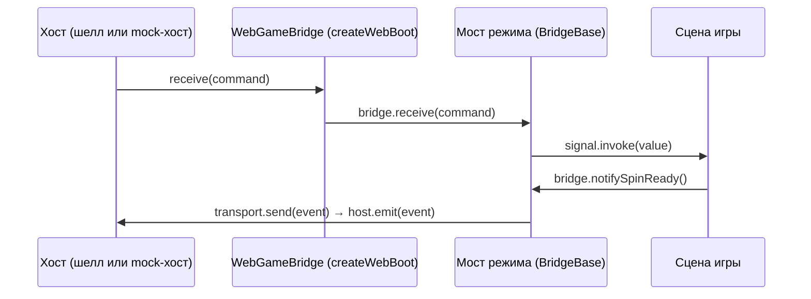

# Ядро JS-моста

> Справочник `@omega/webbridge-js` за пределами режимов: база `BridgeBase`, сигналы, транспорт, хранилище,
> логи, загрузка игры в шелл (`createWebBoot`, `registerWebBoot`), общий mock-хост с панелью и Vite-плагины
> для работы с конфигуратором. Что значат команды и события — в [общем протоколе](../concepts/core-protocol.md).

## Коротко

```ts
import { createWebBoot, CrushBridge, registerWebBoot } from '@omega/webbridge-js';

registerWebBoot(
  createWebBoot({
    createBridge: (transport) => new CrushBridge(transport),
    createGame: (bridge, container, options, host) => {
      const game = new MyGame(bridge, container, options.devicePixelRatio ?? 1);
      // Тиком позже: mock-хост успевает привязаться к возвращённой игре.
      window.setTimeout(() => {
        host.ready();
        bridge.start();
      }, 0);
      return game;
    },
    destroyGame: (game) => game.destroy(),
  }),
);
```

`MyGame` — ваш класс игры: сцены подписываются на сигналы `bridge` и зовут его методы. Пошагово, от
пустого проекта до шелла, — в [старте на JS](../guides/getting-started-js.md).

## Экспорты пакета

| Точка входа | Для чего | Что экспортирует |
|---|---|---|
| `@omega/webbridge-js` | код игры, идёт в бандл | ядро: `BridgeBase`, `Signal`, `SignalHandler`, `BridgeTransport`, `BridgeStorage`, `BridgeLogger`, `isMockEnabled`, `isCheatsEnabled`; загрузка: `createWebBoot`, `registerWebBoot`, `WebBootConfig`; mock: `MockHost`, `MockHostOptions`, `MockPanel`, `MockPanelAction`; мосты и mock-хосты режимов; типы `BetBarViewportMetricsPayload`, `ViewportPoint`, `ViewportRect` |
| `@omega/webbridge-js/vite` | `vite.config.ts`, исполняется в Node | `localBuildServer`, `LocalBuildOptions`, `mockBuildEndpoint`, `BuildEndpointOptions` |

Устаревшие синонимы (живут до мажорной версии): `createPhaserBoot`, `PhaserBootConfig` (до 1.12.0),
`SlotBridge`, `SlotMockHost`, `SlotMockHostOptions` (режим `slot-coin` до 1.15.0 назывался `slot`).

1. **Основная точка входа — только для бандлера.** Модули в `dist` импортируют друг друга без
   расширений (`./core/BridgeBase`), так их разрешают Vite, esbuild и Rollup, но не Node. Игру собирают
   бандлером.
2. **`/vite` — отдельно.** Там код для Node (`node:child_process`, `node:fs`), и в бандл игры он попадать
   не должен. Её модули импортируют друг друга с `.js`: Vite грузит конфиг проекта загрузчиком Node.
3. **Типы протокола** — из `@omega/webbridge-protocol`, он ставится зависимостью пакета.

## Как устроено



1. **Ядро не знает движка.** Мост работает с `BridgeTransport` — «отправить `EngineEvent`». Хост веб-игры
   появляется только в `web/createWebBoot.ts`. Так мост не тянет Phaser или Pixi в чужой билд.
2. **Ядро не знает строк провода.** Команда приходит объектом. JSON разбирается только там, где контракт
   объявил payload строкой (`ApplyGameConfig`, `ApplyGameState`, `ApplyTranslations`, `ApplySpinResult`…).
3. **Игра зависит от моста, мост от игры — нет.** Сцены подписываются на сигналы; мост не импортирует ни
   одной игровой сущности.
4. **Имена зеркалят C#**, поэтому документ режима описывает обе платформы разом:

| C# (`com.pixi.webbridge`) | TS (`@omega/webbridge-js`) |
|---|---|
| `WebBridgeBase<T>` | `BridgeBase` |
| `RoadWebBridge` | `CrushBridge` |
| `PlinkoWebBridge` / `PlinkoAztecWebBridge` | `PlinkoBridge` / `PlinkoAztecBridge` |
| `WheelWebBridge` / `JumperWebBridge` / `MineSlotWebBridge` | `WheelBridge` / `JumperBridge` / `MineSlotBridge` |
| `event Action<T>` | `Signal<T>` |
| `WebBridgeUtils.Send` | `BridgeTransport.send` |
| `WebBridgeUtils.*LocalStorage` | `BridgeStorage` |
| `WebBridgeLogger` | `BridgeLogger` |
| `WebBridgeUtils.IsMockEnabled` / `IsCheatsEnabled` | `isMockEnabled()` / `isCheatsEnabled()` |
| `MockDebugIMGUI` | `MockPanel` |

## `BridgeBase`

Абстрактная база каждого моста режима: принимает все команды ядра, ведёт стартовую синхронизацию,
white-label, fast game, видимость интерфейса и звуки. Игровая специфика — в наследнике
(`CrushBridge`, `MineSlotBridge`…).

### Сигналы (хост → игра)

| Сигнал | Значение | Команда |
|---|---|---|
| `whiteLabelReceived` | `boolean` | `ApplyWhiteLabel` |
| `fastGameChanged` | `boolean` | `SetFastGame`, а также `notifyFastGameChanged` самой игры |
| `orientationChanged` | `Orientation` | `ChangeOrientation` |
| `translationsReceived` | `Record<string, string>` | `ApplyTranslations` (уже разобран `JSON.parse`) |
| `disabledPlayPressed` | — | `DisabledPlayPressed` |
| `cashoutPressed` | — | `CashoutPressed` |
| `winWindowOpened` / `winWindowClosed` | — | `WinWindowOpened` / `WinWindowClosed` |
| `winWindowSignal` | `WinWindowSignalPayload` | `WinWindowSignal` |
| `transitionScreenOpenStarted` / `transitionScreenOpenFinished` | — | `TransitionScreenOpenStarted` / `…OpenFinished` |
| `transitionScreenCloseStarted` / `transitionScreenCloseFinished` | — | `TransitionScreenCloseStarted` / `…CloseFinished` |
| `desktopBetBarViewportMetricsReceived` | `string` — JSON `BetBarViewportMetricsPayload` | `SetDesktopBetBarViewportMetrics` |
| `mobileBetBarViewportMetricsReceived` | `string` — JSON `BetBarViewportMetricsPayload` | `SetMobileBetBarViewportMetrics` |
| `canvasSizeReceived` | `string` — JSON `CanvasSizePayload` | `SetCanvasSize` |

Метрики и размер холста приходят строкой, как их собрал хост: разбирает игра.

```ts
import type { BetBarViewportMetricsPayload } from '@omega/webbridge-js';

bridge.mobileBetBarViewportMetricsReceived.add((json) => {
  const metrics = JSON.parse(json) as BetBarViewportMetricsPayload;
  layout.setBottomInset(metrics.heightEndViewport);    // доля высоты холста снизу
  layout.setTopInset(metrics.heightStartViewport ?? 0); // нет поля — сверху ничего
});
```

Команды, которые база принимает молча: `SetLoggingEnabled` (переключает `BridgeLogger.isEnabled`),
`SyncUiVisibility` (мост сам отвечает `UiVisibility`), `SetAssetsBasePath` (наследие Addressables,
игнорируется). `ApplyGameConfig` и `ApplyGameState` база отдаёт наследнику; остальные команды — в его
`handleGameCommand`.

### Методы (игра → хост)

| Метод | Событие | Когда звать |
|---|---|---|
| `requestPlay()` | `RequestPlay` | ход из самой сцены (тап по полю, своя кнопка). Хост отвечает как на Play бара |
| `requestWhiteLabel()` | `RequestWhiteLabel` | на старте, если у игры есть брендинг: хост сам white-label не пушит |
| `requestFastGame()` | `RequestFastGame` | код поднялся после пуша и хочет значение |
| `notifyFastGameChanged(isEnabled)` | `FastGameChanged` | игра сама переключила fast game; молчит, если значение не сменилось |
| `playSound(key, volume?)` | `PlaySound` | разовый звук |
| `playMusic(key, volume?)` | `PlayMusic` | музыка (шелл её игнорирует, см. [звуки](../concepts/core-protocol.md#звуки)) |
| `playLoop(key, volume?)` / `stopLoop(key)` | `PlayLoop` / `StopLoop` | зацикленный звук и его остановка |
| `setUiVisibility(patch)` | `UiVisibility` | спрятать или заморозить элементы хоста; патч сливается с прежним состоянием, уходит состояние целиком |
| `dispose()` | — | останавливает стартовую синхронизацию; `createWebBoot` зовёт его в `destroy` |

`volume` без значения в событие не попадает: хост играет звук с громкостью по умолчанию.

Методы мостов режимов, которыми запускается синхронизация, — `start()` (зовёт `beginInitialSync`),
`requestGameConfig()` и `requestGameState()`. Они есть у каждого моста режима.

### Состояние

| Свойство | Тип | Что хранит |
|---|---|---|
| `currentIsWhiteLabel` | `boolean \| null` | последний `ApplyWhiteLabel`; `null` — хост ещё не ответил |
| `isFastGameEnabled` | `boolean` | текущий fast game; `false`, пока хост не прислал своё |

Значения кэшируются: сцена, поднявшаяся после ответа хоста, читает их напрямую, а не ждёт сигнала.

### Для наследника

| Член | Что это |
|---|---|
| `protected constructor(transport)` | мост получает транспорт и держит его в `protected readonly transport` |
| `abstract requestGameConfig()` / `requestGameState()` | шлют `RequestGameConfig` / `RequestGameState` |
| `protected abstract applyGameConfig(payload: string)` | разобрать конфиг своего режима |
| `protected abstract applyGameState(payload: string)` | разобрать состояние сессии |
| `protected abstract handleGameCommand(command)` | команды не из ядра: `Exclude<EngineCommand, CoreCommand>` |
| `protected hasReceivedInitialConfig` | наследник ставит `true`, когда пришёл конфиг: синхронизация останавливается |
| `protected beginInitialSync()` | запустить стартовую синхронизацию |

Мост своего режима — в [добавлении режима](../guides/adding-a-mode.md).

### Стартовая синхронизация

`beginInitialSync()` сразу шлёт `RequestGameConfig` и `RequestGameState` и повторяет их каждые 500 мс,
пока наследник не выставил `hasReceivedInitialConfig` или не прошло 10 попыток. Звать — когда сцена
готова принять данные: мосты режимов делают это в `start()`.

1. **В mock-режиме синхронизации нет.** При `?mock=1` метод сразу выходит, а mock-хост сам пушит конфиг
   и состояние на `host.ready()`. Поэтому в шелле `?mock=1` в адресе страницы ставить нельзя: мост не
   спросит хоста.
2. **Ответ на `RequestGameState` — не повод остановиться.** Останавливает только конфиг: без таблиц
   игре нечего показывать.
3. **Повтор безопасен.** Хост отвечает на каждый запрос, а одинаковый конфиг не шлёт дважды.

### Видимость и готовность

Мост хранит видимость, которую выставила игра, и отвечает ею на `SyncUiVisibility`. Хост переспрашивает
её после загрузки, и первый ответ для него — «мост готов». Поэтому готовность подтверждается сама, даже
если игра `setUiVisibility` не звала (тогда payload пуст). Показать бет-бары явно:

```ts
bridge.setUiVisibility({
  hideDesktopBetBar: false,
  hideMobileBetBar: false,
  desktopBetBarInteractable: true,
  mobileBetBarInteractable: true,
});
```

### Чего в базе нет

У `BridgeBase` нет методов для `SetVolume`, `RequestTranslations`, `RequestBetBarViewportMetrics`,
`OpenTransitionScreen` и `CloseTransitionScreen`. Хост на большинство из них и не отвечает (переводы и
метрики он пушит сам), а `SetVolume` игра может отправить из своего наследника — `transport` доступен ему:

```ts
import { CrushBridge } from '@omega/webbridge-js';

export class GameBridge extends CrushBridge {
  /** Приглушить уже играющий звук (в том числе музыку хоста). */
  public setVolume(key: string, volume: number): void {
    this.transport.send({ type: 'SetVolume', key, volume });
  }
}
```

## `Signal<T>`

Замена C#-шного `event Action<T>`.

| Член | Что делает |
|---|---|
| `add(handler): () => void` | подписка; возвращает функцию отписки |
| `remove(handler)` | отписка по ссылке |
| `clear()` | снять всех |
| `invoke(value)` | вызвать подписчиков; исключение одного логируется (`console.error`) и не мешает остальным |

```ts
const unsubscribe = bridge.cashoutPressed.add(() => scene.collapseRound());
// … в destroy сцены:
unsubscribe();
```

Мост живёт столько же, сколько игра, поэтому сцена, которая уничтожается раньше игры, обязана
отписаться.

## `BridgeTransport`

```ts
interface BridgeTransport {
  send(event: EngineEvent): void;
}
```

Канал «мост → хост». В шелле его создаёт `createWebBoot` поверх `host.emit`. В тестах — массив-накопитель:

```ts
const sent: EngineEvent[] = [];
const bridge = new CrushBridge({ send: (event) => sent.push(event) });
bridge.notifySpinReady();
// sent: [{ type: 'SpinReady' }]
```

Обёрткой транспорта удобно журналировать трафик: так делает `createDemoBoot` в демо-играх
(`js/examples/demo-games/src/kit/demoBoot.ts`).

## `BridgeStorage`

Аналог `WebBridgeUtils.*LocalStorage`: обёртка над `localStorage` с логом.

| Метод | Что делает |
|---|---|
| `save(key, value)` | `localStorage.setItem` |
| `load(key): string \| null` | `localStorage.getItem` |
| `remove(key)` | `localStorage.removeItem` |

Ошибки `localStorage` (приватный режим, квота) не перехватываются — их видит вызывающий код.

## `BridgeLogger`

| Член | Что делает |
|---|---|
| `isEnabled` | по умолчанию `false`; переключается командой `SetLoggingEnabled` (тумблер «Logs» стенда) |
| `log(message)` / `warn(message)` | пишут в консоль, только если `isEnabled` |
| `error(message)` | пишет всегда |

Логи моста в сборке выключены. На стенде конфигуратора их включает тумблер «Logs» в панели плейтеста.

## `isMockEnabled` / `isCheatsEnabled`

Флаги из адреса страницы: `?mock=1` (или `true`) и `?cheats=1` (или `true`). `isMockEnabled()` выключает
стартовую синхронизацию `BridgeBase`; что делать с флагом дальше, решает страница разработки игры. Как
устроен mock — в [mock-режиме](../concepts/mock-mode.md).

## Загрузка игры в шелл

### `createWebBoot(config)`

Собирает `WebBootFn` — фабрику, которую шелл зовёт как `__WEB_GAME_BOOT__(host, container, options)`.

```ts
interface WebBootConfig<TBridge extends BridgeBase, TGame> {
  createBridge(transport: BridgeTransport): TBridge;
  createGame(bridge: TBridge, container: HTMLElement, options: WebBootOptions, host: WebHostBridge): TGame;
  destroyGame(game: TGame): void;
}
```

Что делает фабрика при вызове:

1. создаёт транспорт `{ send: (event) => host.emit(event) }` и мост `createBridge(transport)`;
2. создаёт игру `createGame(bridge, container, options, host)`;
3. возвращает `WebGameBridge`: `receive` передаёт команду в `bridge.receive`, `destroy` зовёт
   `bridge.dispose()` и `destroyGame(game)`.

`TGame` — любой тип: пакет не зависит ни от одного движка. Правила для `createGame`:

1. **`host.ready()` зовёт игра**, когда реально готова принимать команды. До этого шелл держит команды в
   очереди, лоадер не уходит.
2. **Не в том же тике, что фабрика.** Mock-хост привязывается к игре (`attach`) уже после возврата
   фабрики, а пушит конфиг именно на `ready()`. Синхронный `ready()` в `createGame` оставит mock без игры.
3. **`host.setProgress(0..1)`** — прогресс загрузки ассетов для лоадера шелла.
4. **`options.devicePixelRatio`** — потолок DPR, который выбрал шелл: бэкстор холста —
   `cssSize × min(window.devicePixelRatio, options.devicePixelRatio)`. Не рендерить в нативный DPR телефона.
5. **Холст — внутри `container`** (`#web-game-root`) и тянется на него целиком.

### `registerWebBoot(boot)`

Кладёт фабрику в `window.__WEB_GAME_BOOT__` и в прежнее имя `window.__PHASER_BOOT__`: шеллы тегов до
1.12.0 ищут только его. Зовётся из точки входа бандла.

### Прежние имена

`createPhaserBoot` и `PhaserBootConfig` — `@deprecated`-синонимы `createWebBoot` и `WebBootConfig`
(`web/legacyPhaserNames.ts`). Игры на них продолжают собираться.

## `MockHost` — mock-хост crush

Заменитель шелла и сервера для режима [crush](../modes/crush/README.md): отвечает на запросы игры и сам
ведёт раунд. Игра при этом идёт по настоящему пути — та же фабрика, тот же мост, те же команды.
Реализует `WebHostBridge`, поэтому передаётся в фабрику вместо шелла.

```ts
import { isMockEnabled, MockHost, MockPanel } from '@omega/webbridge-js';

if (isMockEnabled()) {
  const host = new MockHost({ loseChance: 0.3 });
  host.attach(boot(host, document.getElementById('game')!));
  host.bindKeys();
  new MockPanel(host).mount();
}
```

| Опция | По умолчанию | Что это |
|---|---|---|
| `difficulties` | EASY / MEDIUM / HARD / DAREDEVIL — иллюстративные лесенки | лесенки коэффициентов по имени сложности |
| `difficulty` | первая в `difficulties` | текущая сложность |
| `loseChance` | `0.2` | вероятность проигрыша на шаге (0..1) |
| `currency` | `'USD'` | валюта в конфиге |

Пустой `difficulties` — ошибка в конструкторе.

| Член | Что делает |
|---|---|
| `attach(game)` | отдать mock-хосту игру, которую вернула фабрика |
| `ready()` | (зовёт игра) шлёт `ApplyGameConfig` и `ApplyGameState` «нет раунда» |
| `emit(event)` | (зовёт мост) отвечает на `RequestGameConfig`, `RequestGameState`, `RequestWhiteLabel` (`false`), `RequestFastGame` (`false`), `RequestPlay`; `SpinReady` освобождает «бар» |
| `step()` | ход: `ApplyStepResult` с выигрышем или проигрышем; игнорируется, пока прошлый шаг не доигран |
| `cashout()` | `CashoutPressed`, затем `RestartRound "cashout\|"` |
| `restart(reason = 'lose')` | `RestartRound "<reason>\|"` — оборвать раунд посреди лесенки |
| `setDifficulty(name)` | новая лесенка конфигом и `RestartRound "difficulty\|"` |
| `difficultyNames`, `difficulty`, `coefficients`, `loseChance` | состояние для панели; `loseChance` можно присвоить, значение обрезается до 0..1 |
| `bindKeys(target = window)` | Пробел — шаг, C — кэшаут, R — рестарт; возвращает функцию отвязки |

«Бар» занят от `ApplyStepResult` до `SpinReady`: в это время `step()` игнорируется, а `RequestPlay`
получает `DisabledPlayPressed`. Игра, которая забыла прислать `SpinReady`, залипнет и в mock-режиме.

Mock-хосты других режимов — в `js.md` своего режима:

| Режим | Mock-хост |
|---|---|
| [crush](../modes/crush/js.md) | `MockHost` (+ `MockPanel`) |
| [slot-coin](../modes/slot-coin/js.md) | `SlotCoinMockHost` |
| [plinko](../modes/plinko/js.md) | `PlinkoMockHost` |
| [plinko-aztec](../modes/plinko-aztec/js.md) | `PlinkoAztecMockHost` |
| [jumper](../modes/jumper/js.md) | `JumperMockHost` |
| [mine-slot](../modes/mine-slot/js.md) | `MineSlotMockHost` |
| [twist](../modes/twist/js.md), [wheel](../modes/wheel/js.md) | в пакете нет; свой — в демо-играх (`modes/<mode>/dev.ts`) |

## `MockPanel` — отладочная панель

Веб-аналог `MockDebugIMGUI`: круглая перетаскиваемая кнопка «M» в левом верхнем углу, по нажатию —
панель. Двигает только `MockHost`, поэтому подходит любой игре режима crush.

| Строка панели | Что делает |
|---|---|
| Difficulty `< >` | `setDifficulty` по кругу |
| Lose % `< >` | `loseChance` ± 5 % |
| Step / Cashout / Restart | `step()` / `cashout()` / `restart()` |
| свои действия | кнопки из `actions` |

```ts
interface MockPanelAction {
  label: string;
  run(): void | Promise<void>;
}

new MockPanel(host: MockHost, actions?: MockPanelAction[]).mount(target?: HTMLElement): () => void;
```

Пока `run()` выполняется, кнопка заблокирована, по ней бежит полоса и тикает счётчик секунд. Результат
(`✓` или `✗`, если `run()` бросил) держится 1,5 с. `mount` возвращает функцию, которая убирает панель.
Строки шанса бонуса, как в Unity, нет: JS-мост crush пока не умеет покупку бонуса.

## Vite-плагины (`@omega/webbridge-js/vite`)

Оба плагина работают только в `vite` (dev-сервер, `apply: 'serve'`) и в `vite build` не участвуют.

### `localBuildServer(options)`

Запускает игру с dev-сервера в настоящем шелле: в редакторе раскладки и на стенде конфигуратора с
`?localBuild=http://localhost:<порт>`. Конфигурация, раскладка и бэкенд — стендовые, код игры — ваш.

```ts
// vite.config.ts
import { localBuildServer } from '@omega/webbridge-js/vite';
import { defineConfig } from 'vite';

export default defineConfig({
  plugins: [localBuildServer({ entry: '/src/boot.ts', mode: 'crush' })],
  server: { port: 5180 },
});
```

| Опция | По умолчанию | Что это |
|---|---|---|
| `entry` | — (обязательна) | точка входа бандла — файл, который зовёт `registerWebBoot`; путь от корня проекта |
| `mode` | — | режим игры (`crush`, `slot-coin`…): админка подставит его, когда проект заводит новую игру |
| `configuratorUrl` | `https://games.omega.keitarocab.link` | админка: её открывают при старте и от её origin принимают связь с игрой |
| `shellOrigins` | `https://games.omega.keitarocab.link`, `https://master.games.keitarocab.link` | страницы шелла, которым dev-сервер отдаёт код по CORS |

Что плагин делает с dev-сервером:

1. **Отдаёт `/game.js`.** Это модуль-обёртка: клиент Vite (перезагрузка на правку) плюс `entry`. Шелл
   грузит его модулем, как `game.js` из билда конфигуратора.
2. **Пускает шелл по CORS** — только `shellOrigins` и `localhost` / `127.0.0.1` / `[::1]` на любом порту.
   Открытый CORS отдал бы исходники игры любой странице, открытой у разработчика.
3. **Фиксирует порт.** `server.origin = http://localhost:<порт>` и `strictPort: true`: ассеты адресуются
   полными URL от этого origin, иначе на чужой странице они ушли бы на origin шелла.
4. **Открывает админку** при старте и печатает её адрес (`WebBridge admin: …`). Проект уже связан с
   игрой — редактор этой игры (`/admin/games/<gameId>/editor?localBuild=…`), иначе — экран подключения
   (`/admin/connect?localBuild=…&mode=…`). `server.open: false` в конфиге проекта выключает браузер.
5. **Принимает связь с игрой.** `POST /__webbridge/project` с телом `{"gameId":"…"}` только с origin
   `configuratorUrl`; пишет `webbridge.json` в корень проекта. Ответы: `204` — записано, `403` — чужой
   origin, `400` — нет `gameId`, `405` — не POST, `413` — тело больше 1 КБ. На preflight отвечает сам, с
   `Access-Control-Allow-Private-Network: true`.

`webbridge.json` (коммитить: тогда вся команда открывает одну игру):

```json
{
  "gameId": "test-crush"
}
```

Битый `webbridge.json` (нет `gameId` или он пуст) — ошибка `ProjectFileError` при старте dev-сервера, а не
«проект не связан». Пошагово — в [старте на JS](../guides/getting-started-js.md#6-связать-с-конфигуратором).

### `mockBuildEndpoint(options)`

Эндпоинт для кнопки сборки в `MockPanel`: страница сборку запустить не может и просит dev-сервер.

| Опция | По умолчанию | Что это |
|---|---|---|
| `path` | `'/__build'` | путь эндпоинта |
| `command` | `'npm run build:drop && open dist'` | что выполнить в корне проекта (`open` — macOS) |

Запрос принимается только с локальной петли (`127.0.0.1`, `::1`): dev-сервер часто поднимают с
`host: true`. Ответ — JSON `{ ok, output }`, где `output` — последние 400 символов stdout (или stderr при
ошибке); статус `200`, `500` при ошибке команды, `403` не с петли.

```ts
// vite.config.ts
plugins: [mockBuildEndpoint({ command: 'npm run build' })],

// страница разработки
new MockPanel(host, [
  {
    label: 'Build',
    run: async () => {
      const response = await fetch('/__build');
      if (!response.ok) throw new Error(`build failed: HTTP ${response.status}`);
    },
  },
]).mount();
```

## Мосты режимов

| Режим | Мост | Документ |
|---|---|---|
| crush | `CrushBridge` | [modes/crush/js.md](../modes/crush/js.md) |
| twist | `TwistBridge` | [modes/twist/js.md](../modes/twist/js.md) |
| slot-coin | `SlotCoinBridge` | [modes/slot-coin/js.md](../modes/slot-coin/js.md) |
| wheel | `WheelBridge` | [modes/wheel/js.md](../modes/wheel/js.md) |
| plinko | `PlinkoBridge` | [modes/plinko/js.md](../modes/plinko/js.md) |
| plinko-aztec | `PlinkoAztecBridge` | [modes/plinko-aztec/js.md](../modes/plinko-aztec/js.md) |
| jumper | `JumperBridge` | [modes/jumper/js.md](../modes/jumper/js.md) |
| mine-slot | `MineSlotBridge` | [modes/mine-slot/js.md](../modes/mine-slot/js.md) |

## Версии

| Пакет | В репозитории | Последний релиз |
|---|---|---|
| `@omega/webbridge-js` | 1.16.0 (`MineSlotBridge`, `MineSlotMockHost`) | `js-v1.16.0` |
| `@omega/webbridge-protocol` | 1.18.0 (канал `mineSlot`) | `protocol-v1.18.0` |

`js-v1.16.0` собран на `protocol-v1.18.0`. Ставится tarball'ом из GitHub Releases — как, в
[старте на JS](../guides/getting-started-js.md#1-поставить-пакеты); выпуск — в [релизах](../guides/releasing.md).

## Смотрите также

- [Общий протокол](../concepts/core-protocol.md) · [Архитектура](../concepts/architecture.md) ·
  [Mock-режим](../concepts/mock-mode.md)
- [Старт на JS](../guides/getting-started-js.md) · [Новый режим](../guides/adding-a-mode.md)
- Исходники: `js/webbridge/src/core`, `src/web`, `src/mock`, `src/vite`; тесты — `js/webbridge/test`
