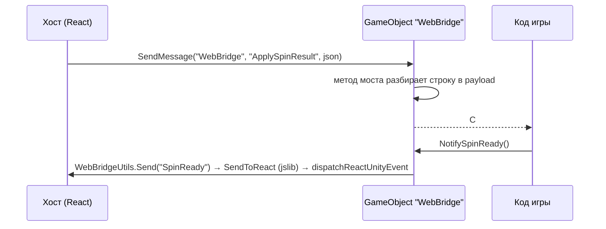
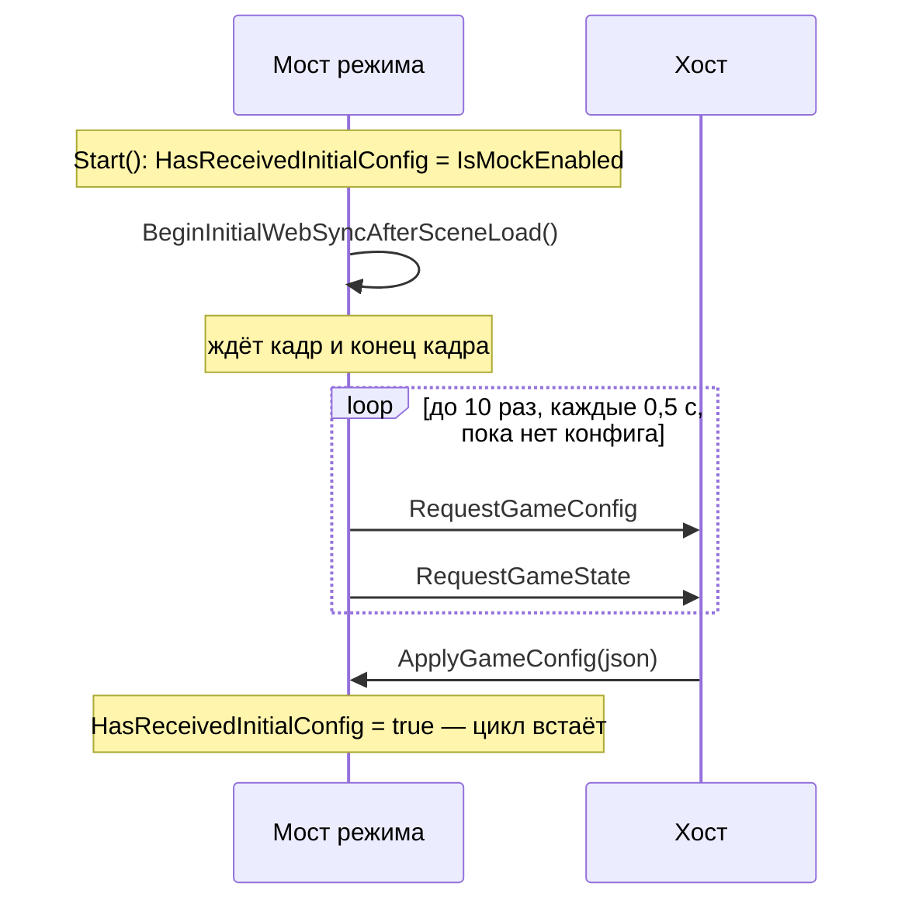

# Ядро Unity-моста — `com.pixi.webbridge`

> Справочник UPM-пакета `com.pixi.webbridge` (версия **1.1.0**, Unity **6000.0+**): база мостов
> `WebBridgeBase<T>`, сервисные мосты (раскладка, ориентация, звук, переводы, переходный экран), JSON,
> утилиты, mock и читы, меню редактора. Мосты режимов описаны в `docs/modes/<id>/unity.md`
> ([список](#мосты-режимов)). Как поставить пакет с нуля — [старт на Unity](../guides/getting-started-unity.md).

## Коротко

```csharp
using Modules.MineSlot;   // мост режима — любой наследник WebBridgeBase<T>
using Modules.Road;       // сервисные мосты: AudioWebBridge, LayoutWebBridge, ScreenOrientationWebBridge…
using UnityEngine;

public class SharedBridgeEvents : MonoBehaviour
{
    [SerializeField, WebBridgeSound] private string _deniedSound;

    private void Start()
    {
        MineSlotWebBridge bridge = MineSlotWebBridge.Instance;
        bridge.FastGameChanged += ApplySpeed;
        bridge.DisabledPlayPressed += OnDisabledPlay;
        ApplySpeed(bridge.IsFastGameEnabled);   // значение могло прийти раньше подписки
    }

    private void OnDestroy()
    {
        MineSlotWebBridge bridge = MineSlotWebBridge.Instance;
        if (bridge == null)
            return;

        bridge.FastGameChanged -= ApplySpeed;
        bridge.DisabledPlayPressed -= OnDisabledPlay;
    }

    private void ApplySpeed(bool isFast) => Time.timeScale = isFast ? 2f : 1f;

    private void OnDisabledPlay() => AudioWebBridge.Instance.PlaySound(_deniedSound);
}
```

## Что в пакете

```
unity/Assets/WebBridge/                 package.json: com.pixi.webbridge
  Runtime/                              сборка WebBridge.Runtime (autoReferenced)
    WebBridgeBase.cs                    база мостов режимов
    WebBridgeUtils.cs  Json.cs  WebBridgeLogger.cs
    WebGameStateBase.cs  WebWinWindowSignalPayload.cs  WebBridgePayloads.cs
    LayoutWebBridge.cs  ScreenOrientationWebBridge.cs  AudioWebBridge.cs  AudioMessages.cs
    TranslationsWebBridge.cs  WebBridgeUI.cs  SoundKeys.cs  WebBridgeSoundAttribute.cs  EditorAudioPreview.cs
    RestartReason.cs  RestartRoundPayload.cs
    MockConfig.cs  DebugPanelIMGUI.cs  MockDebugIMGUI.cs  CheatBridge.cs  CheatDebugIMGUI.cs
    <Mode>WebBridge.cs, <Mode>Mock*.cs, Web<Mode>Payloads.cs     мосты режимов и их mock-хосты
    Plugins/WebGL/WebBridgeStorage.jslib  CheatBridge.jslib
    Prefabs/<Mode>WebBridge.prefab
  Editor/                               сборка WebBridge.Editor (только редактор)
    WebBridgeMenuItems.cs  MockConfigWindow.cs  SoundKeysWindow.cs  WebBridgeSoundDrawer.cs
  link.xml                              <assembly fullname="WebBridge.Runtime" preserve="all" />
```

| Namespace | Что в нём |
|---|---|
| `WebBridge` | ядро без привязки к режиму: `WebBridgeBase<T>`, `WebBridgeUtils`, `Json`, `JsonValue`, `JsonKind`, `JsonNameAttribute`, `WebBridgeLogger`, `WebGameStateBase`, `WebBetPayload`, `WebWinWindowSignalPayload`, `DebugPanelIMGUI` |
| `Modules.Road` | сервисные мосты и общие для всех игр типы, исторически лежащие здесь: `LayoutWebBridge`, `ScreenOrientationWebBridge`, `AudioWebBridge`, `AudioMessages`, `TranslationsWebBridge`, `WebBridgeUI`, `SoundKeys`, `WebBridgeSoundAttribute`, `RestartReason`, `RestartRoundPayload`, payload'ы раскладки; плюс мост crush (`RoadWebBridge`), его `MockConfig`, `MockDebugIMGUI`, `CheatBridge`, `CheatDebugIMGUI` |
| `Modules.<Mode>` | мост режима и его типы: `Modules.Plinko`, `Modules.PlinkoAztec`, `Modules.Wheel`, `Modules.Jumper`, `Modules.MineSlot` |
| `Modules.Road.Editor` | меню и окна редактора |

Зависимость из `package.json` одна — `com.unity.modules.unitywebrequestaudio` 1.0.0, UPM ставит её сам;
она нужна `EditorAudioPreview`. Newtonsoft пакет не тянет: JSON разбирает собственный `Json`
([ниже](#json-jsonvalue-jsonnameattribute)). Игре, которая сама пользуется Newtonsoft, его нужно объявить
в своём `manifest.json`.

## Как это устроено



1. **Хост → игра.** Хост зовёт `unityInstance.SendMessage("WebBridge", <метод>, <параметр>)`. Unity вызывает
   публичный метод с этим именем **на каждом компоненте** объекта `WebBridge`. Параметр — строка (часто JSON)
   или число; методы с `bool` и двумя аргументами через `SendMessage` не вызвать.
2. **Игра → хост.** Любой мост шлёт строку через `WebBridgeUtils.Send(message)`. В WebGL-плеере это
   `[DllImport("__Internal")] SendToReact(string)`; функцию `SendToReact` даёт **игра** своим jslib
   ([ниже](#js-плагины)). В редакторе `Send` только пишет лог.
3. **Мост не знает игру.** Игровой код подписывается на события мостов и зовёт их методы; мосты не
   ссылаются на игровые объекты (правило из `CLAUDE.md` репозитория).

Проводные строки (имя объекта, сообщения без параметров, префиксы) на TS-стороне записаны в
[`protocol/src/unityWire.ts`](../../protocol/src/unityWire.ts), разбирает их шелл в
`RoadFrontent/src/engine/unity/unityProtocol.ts`. Смысл команд — в [общем протоколе](../concepts/core-protocol.md).

## GameObject `WebBridge` и префабы

Все мосты живут на **одном** объекте с именем `WebBridge`: хост адресует его по имени, имя класса роли не
играет. Префаб на режим кладёт на сцену пункт **GameObject → WebBridge → Create &lt;Mode&gt;WebBridge** и сам
переименовывает экземпляр в `WebBridge`.

| Префаб (`Runtime/Prefabs/`) | Компоненты |
|---|---|
| `RoadWebBridge.prefab` | `RoadWebBridge` + сервисные |
| `PlinkoWebBridge.prefab` | `PlinkoWebBridge` + сервисные |
| `PlinkoAztecWebBridge.prefab` | `PlinkoAztecWebBridge` + сервисные |
| `JumperWebBridge.prefab` | `JumperWebBridge` + сервисные |
| `MineSlotWebBridge.prefab` | `MineSlotWebBridge` + сервисные |

Сервисные компоненты в каждом префабе: `LayoutWebBridge`, `ScreenOrientationWebBridge`, `AudioWebBridge`,
`TranslationsWebBridge`, `WebBridgeUI`. У `WheelWebBridge` префаба и пункта меню нет — собрать объект вручную.

1. **На сцене — один мост.** Пункт меню откажет, если на сцене уже есть `RoadWebBridge`, `PlinkoWebBridge`,
   `PlinkoAztecWebBridge`, `JumperWebBridge` или `MineSlotWebBridge`: два моста на одном объекте получили бы
   одни и те же `SendMessage`.
2. **`LayoutWebBridge` обязателен.** Его первое сообщение `UiVisibility_{json}` хост считает признаком «мост
   жив»; до него шелл не шлёт конфиг, рестор и бонус (`engineBridgeReadiness.ts`).
3. **Объект живёт со сценой.** `DontDestroyOnLoad` пакет не зовёт: мост должен лежать в сцене, которая
   загружена всю сессию (либо грузить остальное аддитивно).
4. **Свои приёмники — на тот же объект.** Команду, у которой в пакете нет приёмника (например
   `OnWinWindowOpened`), игра принимает своим `MonoBehaviour` на объекте `WebBridge`.

## `WebBridgeBase<T>`

```csharp
namespace WebBridge
{
    [Preserve]
    public abstract class WebBridgeBase<T> : MonoBehaviour where T : WebBridgeBase<T>
}
```

База каждого моста режима: `RoadWebBridge`, `PlinkoWebBridge`, `PlinkoAztecWebBridge`, `WheelWebBridge`,
`JumperWebBridge`, `MineSlotWebBridge`. Здесь только то, что одинаково во всех играх: синглтон, стартовая
синхронизация, white label, ускоренная игра, логи, нажатия бет-бара и отметки окон результата.

### Синглтон

| Член | Что делает |
|---|---|
| `static T Instance { get; }` | Экземпляр моста. Ставится в `Awake`, сбрасывается в `OnDestroy` |
| `protected virtual void Awake()` | Второй экземпляр пишет ошибку `Instance <T> already exists.` и уничтожает **весь свой GameObject** |
| `protected virtual void OnDestroy()` | Обнуляет `Instance`, если это он |

Наследник, переопределяющий `Awake`/`OnDestroy`, обязан вызвать `base.Awake()` / `base.OnDestroy()`.
`[Preserve]` (и `link.xml` пакета) держат классы от вырезания IL2CPP: публичные методы-приёмники
`SendMessage` ничто в C# не вызывает, и без защиты стриппинг их бы удалил.

### Стартовая синхронизация



| Член | Что делает |
|---|---|
| `protected void BeginInitialWebSyncAfterSceneLoad()` | Запускает корутину: `yield null` + `WaitForEndOfFrame`, затем до **10** попыток с шагом **0,5 с** (`WaitForSecondsRealtime`) — каждая зовёт `RequestGameConfig()` и `RequestGameState()`. Повторный вызов перезапускает цикл. Работает **только в WebGL-плеере** (`UNITY_WEBGL && !UNITY_EDITOR`); в редакторе — ничего |
| `protected bool HasReceivedInitialConfig { get; set; }` | Наследник ставит `true`, когда хост прислал конфиг (обычно в `ApplyGameConfig`): цикл останавливается. В mock-режиме цикл не крутится вовсе |
| `public abstract void RequestGameConfig()` | Шлёт `RequestGameConfig` (в mock — отвечает мок-хост) |
| `public abstract void RequestGameState()` | Шлёт `RequestGameState` (в mock — отвечает мок-хост) |

Каждый мост пакета зовёт `BeginInitialWebSyncAfterSceneLoad()` из своего `Start()`, когда mock выключен.
Игровому коду звать `Request*` вручную не нужно.

### События (хост → игра)

| Событие C# | Тип аргумента | Метод `SendMessage` | Когда срабатывает |
|---|---|---|---|
| `WhiteLabelReceived` | `bool` | `ApplyWhiteLabel(int)` | ответ на `RequestWhiteLabel`: `true` — без брендинга |
| `FastGameChanged` | `bool` | `SetFastGame(int)` | хост переключил ускоренную игру или игра сама (`NotifyFastGameChanged`); то же значение повторно не поднимает |
| `DisabledPlayPressed` | — | `OnDisabledPlayPressed()` | игрок нажал Play, пока бет-бар держит её неактивной; ставки нет — повод показать причину |
| `CashoutPressed` | — | `OnCashoutPressed()` | сервер выплатил полный кэшаут: в такте открытия окна результата, раньше рестарта раунда; при отказе payout не приходит. Суммы в команде нет — она придёт с payout-командой режима или `RestartRound` |
| `WinWindowSignalReceived` | `WebWinWindowSignalPayload` | `OnWinWindowSignal(string)` | сценарий окна результата дошёл до именованной отметки ([payload](#webwinwindowsignalpayload)) |

`SetLoggingEnabled(int)` события не поднимает: `1` включает, `0` выключает `WebBridgeLogger.IsEnabled`
(тумблер логов в чит-панели шелла).

### Методы (игра → хост)

| Метод | Сообщение хосту | Ответ хоста |
|---|---|---|
| `virtual RequestWhiteLabel()` | `RequestWhiteLabel` | `ApplyWhiteLabel(1 \| 0)` — по рантайм-манифесту |
| `virtual RequestPlay()` | `RequestPlay` | ход как от кнопки Play (команда режима) либо `OnDisabledPlayPressed`, если Play сейчас недоступна (раунд идёт, автоплей, баланс, лимиты). Игра ставку не делает |
| `virtual RequestFastGame()` | `RequestFastGame` | `SetFastGame(1 \| 0)`. Хост и так пушит значение после загрузки — нужен тому, кто подписался позже |
| `NotifyFastGameChanged(bool)` | `FastGame_1` / `FastGame_0` | хост зеркалит значение в тумблер. Молчит, если значение не поменялось |

`virtual` — потому что мосты режимов в mock-режиме отвечают сами (мок-хост вместо `Send`).

### Свойства

| Свойство | Тип | Что хранит |
|---|---|---|
| `CurrentIsWhiteLabel` | `bool?` | последний ответ на `RequestWhiteLabel`; `null` — ответа не было |
| `IsFastGameEnabled` | `bool` | текущая ускоренная игра; `false`, пока хост не прислал своё значение |
| `protected static IsMockEnabled` | `bool` | то же, что `WebBridgeUtils.IsMockEnabled` |
| `protected static IsCheatsEnabled` | `bool` | то же, что `WebBridgeUtils.IsCheatsEnabled` |

### White label

Хост читает флаг из своего рантайм-манифеста и присылает его **только в ответ** на `RequestWhiteLabel`.
Игра спрашивает, когда готова показать брендинг, и читает `CurrentIsWhiteLabel`, если ответ пришёл раньше
подписки:

```csharp
bridge.WhiteLabelReceived += ApplyBranding;
if (bridge.CurrentIsWhiteLabel.HasValue)
    ApplyBranding(bridge.CurrentIsWhiteLabel.Value);
else
    bridge.RequestWhiteLabel();
```

В mock-режиме мосты Road, PlinkoAztec, Jumper и MineSlot отвечают значением из инспектора (`Is White Label`).

### Ускоренная игра

Тумблер живёт в бет-баре хоста, значением владеет хост. Он пушит сохранённое значение сразу после загрузки
движка и дальше — на каждое переключение. Игра может сменить режим сама (например, выключить ускорение на
бонусе) — `NotifyFastGameChanged(false)`: событие поднимется локально, а хост обновит тумблер. Эха нет:
`SetFastGame` с тем же значением событие не поднимает, `NotifyFastGameChanged` с тем же значением ничего не
шлёт.

### Логи

`WebBridgeLogger.IsEnabled` по умолчанию **включён в редакторе и выключен в сборке**. В WebGL-сборке логи
моста (включая `[Unity -> React] …` из `Send`) появляются только после `SetLoggingEnabled(1)` от хоста.
Предупреждения и ошибки пишутся всегда.

### Свой мост поверх базы

Минимальный мост режима — что база требует от наследника. Полный порядок добавления режима — в
[новом режиме](../guides/adding-a-mode.md).

```csharp
using System;
using UnityEngine.Scripting;
using WebBridge;

namespace Modules.MyMode
{
    [Preserve]
    public class MyModeWebBridge : WebBridgeBase<MyModeWebBridge>
    {
        public event Action<JsonValue> GameConfigReceived;

        private void Start()
        {
            HasReceivedInitialConfig = IsMockEnabled;
            if (!IsMockEnabled)
                BeginInitialWebSyncAfterSceneLoad();
        }

        public override void RequestGameConfig() => WebBridgeUtils.Send("RequestGameConfig");

        public override void RequestGameState() => WebBridgeUtils.Send("RequestGameState");

        // React entry point (SendMessage): the platform game config.
        public void ApplyGameConfig(string payload)
        {
            JsonValue config = WebBridgeUtils.DeserializePayload<JsonValue>(payload, nameof(ApplyGameConfig));
            if (config == null)
                return;

            HasReceivedInitialConfig = true;
            GameConfigReceived?.Invoke(config);
        }
    }
}
```

## `WebBridgeUtils`

`public static class WebBridgeUtils` (namespace `WebBridge`).

| Член | Что делает |
|---|---|
| `static bool IsMockEnabled` | `true` при символе `WEBBRIDGE_MOCK`; в редакторе без символа — `EditorPrefs` `WebBridge_EnableMock`; в сборке без символа — `false`. Только чтение |
| `static bool IsCheatsEnabled` | то же для `WEBBRIDGE_CHEATS` / `WebBridge_EnableCheats` |
| `static void Send(string message)` | WebGL-плеер: `SendToReact(message)`. Всегда: `WebBridgeLogger.Log("[Unity -> React] " + message)` |
| `static void SaveToLocalStorage(string key, string value)` | `localStorage.setItem` страницы ([LocalStorage](#localstorage)) |
| `static string LoadFromLocalStorage(string key)` | значение или `null` |
| `static void RemoveFromLocalStorage(string key)` | `localStorage.removeItem` |
| `static T DeserializePayload<T>(string payload, string methodName) where T : class` | разбор payload'а `SendMessage`: пустая строка → `null`; JSON-массив → первый элемент (пустой массив → `null`); ошибка разбора → предупреждение `[WebBridge] Failed to parse <methodName>: …` и `null` |
| `static string ReadString(JsonValue source, params string[] propertyNames)` | первое непустое значение из перечисленных ключей; не-строка — компактным JSON |
| `static int? ReadInt(JsonValue source, params string[] propertyNames)` | первое значение, которое читается как целое: число (дробное округляется), строка `"5"` или `"5.6"` |
| `static string FormatIntArray(IReadOnlyList<int> values)` | `[1,2,3]`; пустой или `null` → `[]` |

`DeserializePayload` возвращает `null` и при неверном JSON — приёмник проверяет результат и выходит, как в
примере выше.

## `Json`, `JsonValue`, `JsonNameAttribute`

Собственный JSON пакета (namespace `WebBridge`): дерево `JsonValue` и маппер на POCO через рефлексию.
Заменяет Newtonsoft (`JToken`, `[JsonProperty]`, `JsonConvert`).

```csharp
[Preserve, Serializable]
public class WebMyRoundPayload
{
    [JsonName("lineNumber")] public int? Step;
    [JsonName("coeff")] public float Coefficient;
    [JsonName("bonusModes")] public JsonValue BonusModes;   // произвольная форма — как есть
}

WebMyRoundPayload round = Json.Deserialize<WebMyRoundPayload>(json);
string back = Json.Serialize(round);
```

| API | Что делает |
|---|---|
| `Json.Serialize(object)` | POCO → JSON-строка (компактная) |
| `Json.Deserialize<T>(string)` | JSON → `T`; пустая строка → `default`; неверный JSON → `FormatException` |
| `[JsonName("key")]` | имя ключа для **поля**; без атрибута ключ = имя поля |
| `JsonValue.Parse(string)` | строка → дерево; неверный JSON → `FormatException` |
| `JsonValue.ToObject<T>()` / `ToObject(Type)` | дерево → POCO |
| `Kind` (`JsonKind`: `Null`, `Bool`, `Integer`, `Float`, `String`, `Array`, `Object`), `IsNull`, `IsObject`, `IsArray`, `IsString`, `IsInteger`, `IsFloat`, `IsBool` | тип узла |
| `this[string key]` | значение ключа или `null`, если ключа нет; запись создаёт/заменяет ключ |
| `this[int index]`, `Count`, `First`, `Add(JsonValue)` | массив; индекс вне границ → `null` |
| `Properties()`, `HasValues` | обход объекта, есть ли элементы |
| `AsString()`, `AsBool()`, `AsInt()`, `AsFloat()`, `AsDouble()` | скаляры; `AsInt`/`AsFloat` читают и числовые строки, `AsString` — только строку |
| `ToCompactString()` | строка — без кавычек, число — как пришло, объект/массив — JSON |
| `ToJsonString()` | узел в JSON |
| `CreateNull()`, `NewObject()`, `NewArray()`, `Of(…)`, неявные преобразования из `string`/`bool`/`int`/`long`/`float`/`double` | построение дерева |

Как маппер читает типы:

| Тип поля | Из JSON | Особенность |
|---|---|---|
| `string` | строка; другое — компактным текстом | |
| `bool` | `true`/`false` | другое → `false` |
| `int` | число, числовая строка | дробное **округляется** |
| `long` | как `int` | диапазон — `int` |
| `float` | число, числовая строка | |
| `double` | через `float` | точность — `float` |
| `enum` | имя (регистр не важен) | пишется именем |
| `T?` | как `T`; `null` → `null` | |
| `T[]`, `List<T>` | массив | не массив → пустой |
| `Dictionary<string, T>` | объект | |
| `JsonValue` | любой узел как есть | |
| класс | объект, по публичным полям экземпляра | нужен конструктор без параметров; ключа нет — поле не трогается |

1. **Только публичные поля.** Свойства и приватные поля маппер не видит — payload-классы пишутся полями.
2. **Деньги — строками.** `decimal` маппер не читает; суммы платформы приходят строками (`"1.50"`) и так и
   хранятся (`WebBetPayload.Amount`, `WebGameStateBase.WinAmount`).
3. **Классы игры — под `[Preserve]`.** Маппер создаёт экземпляры через `Activator.CreateInstance`, а `link.xml`
   пакета защищает только сборку `WebBridge.Runtime`: payload'ы из сборки игры без `[Preserve]` IL2CPP может
   вырезать.

## Общие payload'ы

### `WebGameStateBase` и `WebBetPayload`

База состояния игры для всех режимов (повторяет базовый `GameState` client-core). Мост режима наследует её
и добавляет поля, которые бэкенд кладёт на верхний уровень ответа.

| Поле C# | JSON | Тип |
|---|---|---|
| `Status` | `status` | `string`: `none`, `in-game`, `win`, `lose` |
| `Bet` | `bet` | `WebBetPayload` |
| `IsFinished` | `isFinished` | `bool?` |
| `IsWin` | `isWin` | `bool?` |
| `WinAmount` | `winAmount` | `string` |
| `Error` | `error` | `string` |

`WebBetPayload`: `Amount` (`amount`, `string`), `Currency` (`currency`), `DecimalPlaces` (`decimalPlaces`, `int?`).

### `WebWinWindowSignalPayload`

Аргумент `WinWindowSignalReceived`. Сценарий окна результата (анимации, звуки, отметки на дорожке) собирает
админ в games-configurator, играет его хост; мост только несёт отметку.

| Поле / член | JSON | Что значит |
|---|---|---|
| `Window` | `window` | ключ окна, позвавшего отметку |
| `Name` | `name` | имя отметки — его придумал админ |
| `ValueType` | `valueType` | `int`, `float`, `bool`, `string`; пусто — значения нет |
| `Value` | `value` | значение текстом |
| `HasValue` | — | `ValueType` не пуст |
| `AsInt()`, `AsFloat()`, `AsBool()`, `AsString()` | — | значение нужного типа (InvariantCulture). Не тот геттер → исключение разбора: тип задан админом, угадывать его не нужно |

```csharp
bridge.WinWindowSignalReceived += signal =>
{
    if (signal.Name == "win.tier" && signal.HasValue)
        PlayTier(signal.AsInt());
};
```

### `RestartReason` и `RestartRoundPayload`

Команда `RestartRound` у раундовых мостов (`RoadWebBridge`, `JumperWebBridge`) приходит строкой
`"<reason>|<amount>"`: `"cashout|$5.00"`, `"lose|"`. Сумма — строка отображения хоста, как есть.

```csharp
public enum RestartReason { None = 0, Win = 1, Cashout = 2, Lose = 3 }

RestartRoundPayload.Parse(payload, out RestartReason reason, out string amount);
```

`Parse` без учёта регистра узнаёт `win`, `cashout`, `lose`; пустая строка или незнакомая причина → `None`,
сумма без `|` → `null`.

### Payload'ы раскладки

Живут в `WebBridgePayloads.cs` (namespace `Modules.Road`) рядом с payload'ами crush
(`WebGameConfigPayload`, `WebGameStatePayload`, бонусные — они описаны в [crush для Unity](../modes/crush/unity.md)).

| Класс | Поля (JSON) | Где |
|---|---|---|
| `WebUiVisibilityPayload` | `hideDesktopBetBar`, `hideMobileBetBar`, `hideMobileLastWin`, `hideSettingsMenuButton`, `hideLogo`, `hideBottomBalancePanel`, `desktopBetBarInteractable`, `mobileBetBarInteractable` (все `bool`) | уходит хосту в `UiVisibility_{json}` |
| `WebMobileBetBarViewportPayload` | `widthViewport`, `heightEndViewport`, `heightStartViewport`, `heightEndWithoutBonusViewport` (`float`), `bonusButtonRight`, `betBarRight` (`WebViewportPoint`), `bonusProgressIndicator` (`WebViewportRect`) | `SetMobileBetBarViewportMetrics`, событие `MobileBetBarViewportChanged` |
| `WebViewportPoint` | `x`, `y` (`float`, доли холста 0..1) | |
| `WebViewportRect` | `topLeft`, `topRight`, `bottomLeft`, `bottomRight` (`WebViewportPoint`) | |
| `WebCanvasSizePayload` | `widthPx`, `heightPx` (`float`) | `SetCanvasSize`, событие `CanvasSizeChanged` |
| `WebBetBarHideStatePayload` | `hideDesktopBetBar`, `hideMobileBetBar` (`bool`) | событие `BetBarHideStateChanged` |

## `WebBridgeLogger`

`public static class WebBridgeLogger` (namespace `WebBridge`) — единая точка логов пакета. Код моста не зовёт
`Debug.Log` напрямую.

| Член | Что делает |
|---|---|
| `static bool IsEnabled { get; set; }` | включает `Log`. По умолчанию: редактор — `true`, сборка — `false`; хост меняет через `SetLoggingEnabled` |
| `static void Log(string)` | `Debug.Log`, если `IsEnabled` |
| `static void LogWarning(string)`, `static void LogError(string)` | пишут всегда |

## `LayoutWebBridge`

Видимость и интерактивность HTML-интерфейса хоста поверх холста и метрики бет-бара. Синглтон `Instance`.

### Методы игры (→ хост)

| Метод | Что меняет |
|---|---|
| `SetHideDesktopBetBar(bool)`, `SetHideMobileBetBar(bool)` | скрыть бет-бар; поднимают `BetBarHideStateChanged` **всегда**, `UiVisibility` — только при смене |
| `SetHideMobileLastWin(bool)`, `SetHideSettingsMenuButton(bool)`, `SetHideLogo(bool)`, `SetHideBottomBalancePanel(bool)` | скрыть элемент; шлют `UiVisibility` при смене |
| `HideBottomBalancePanel()`, `ShowBottomBalancePanel()` | `SetHideBottomBalancePanel(true / false)` |
| `SetBetBarInteractable(bool)`, `SetMobileBetBarInteractable(bool)` | интерактивность бара; пока этот бар скрыт, `UiVisibility` не шлётся |
| `BeginBatch()`, `EndBatch()` | отложить `UiVisibility` до закрытия внешнего батча — несколько флагов одним сообщением. Лишний `EndBatch` — предупреждение |
| `SyncUiVisibility()` | шлёт `UiVisibility_{json}` с текущими флагами (внутри батча — откладывает) |
| `RequestBetBarViewportMetrics()` | шлёт `RequestBetBarViewportMetrics` |

`SetHide*` и `Set*Interactable` принимают `bool` и через `SendMessage` недоступны — их зовёт только игра.
Стартовые значения флагов — в инспекторе (секция `Web UI`; `Hide Bottom Balance Panel` по умолчанию включён).
В `Start()` мост шлёт `UiVisibility` и поднимает `BetBarHideStateChanged` — это сообщение хост и ждёт как
сигнал готовности.

### Приёмники хоста и события

| Метод `SendMessage` | Событие C# | Что приходит |
|---|---|---|
| `SetMobileBetBarViewportMetrics(string)` | `MobileBetBarViewportChanged` (`WebMobileBetBarViewportPayload`) | геометрия мобильного бет-бара в долях холста, зажатая в 0..1; событие — только при изменении |
| `SetCanvasSize(string)` | `CanvasSizeChanged` (`WebCanvasSizePayload`) | размер холста в CSS-пикселях страницы; событие — только при изменении |
| `SyncUiVisibility()` | — | хост повторяет её, пока не получит первый `UiVisibility` |

### Свойства

| Свойство | Что хранит |
|---|---|
| `IsDesktopBetBarHidden`, `IsMobileBetBarHidden`, `IsMobileLastWinHidden`, `IsSettingsMenuButtonHidden`, `IsLogoHidden`, `IsBottomBalancePanelHidden` | текущие флаги |
| `MobileBetBarViewportWidth`, `MobileBetBarViewportHeightEnd`, `MobileBetBarViewportWithoutBonusHeightEnd` | ширина и нижняя кромка бара (с бонус-кнопкой и без) |
| `MobileViewportHeightStart` | доля холста сверху, закрытая интерфейсом хоста (полоса Live wins); 0 — сверху ничего |
| `MobileBetBarBonusButtonRight`, `MobileBetBarRight` (`Vector2`) | правые точки бонус-кнопки и бара |
| `MobileBetBarBonusProgressIndicatorTopLeft/TopRight/BottomLeft/BottomRight`, `HasMobileBetBarBonusProgressIndicator` | рамка индикатора бонус-прогресса |
| `CanvasWidthPx`, `CanvasHeightPx` | размер холста в CSS-пикселях; 0, пока хост не прислал |

`CanvasWidthPx`/`CanvasHeightPx` нужны, чтобы переводить размеры интерфейса хоста в координаты игры: `Screen`
в WebGL меряет буфер холста, умноженный на `devicePixelRatio`, который хост подбирает под устройство и меняет
на ходу.

## `ScreenOrientationWebBridge`

```csharp
public enum ScreenOrientationType { Desktop = 0, Mobile = 1 }
```

| Член | Что делает |
|---|---|
| `ChangeOrientation(int)` | приёмник `SendMessage`: `> 0` → `Mobile`, иначе `Desktop`; поднимает событие каждый раз |
| `event Action<ScreenOrientationType> OrientationChanged` | новая раскладка |
| `CurrentOrientation` | последняя; до первой команды — `Desktop` |

Хост шлёт `1`, когда страница в **портретной** ориентации, и `0` в альбомной — при загрузке и на каждый
поворот. В редакторе с mock мост сам считает ориентацию каждый кадр: `Screen.width / Screen.height <=
Mock Mobile Aspect Ratio` (инспектор, по умолчанию `1.1`) — `Mobile`; событие — только при смене.

## Звук: `AudioWebBridge`

Звуки идут хосту строковым ключом: дорожки и громкости живут в games-configurator, игра называет только ключ.

| Метод | Сообщение хосту | Что важно |
|---|---|---|
| `PlaySound(string key, float? volume = null)` | `PlaySound_{key}` или `PlaySound_{key}\|{volume}` | один ключ — не чаще раза за кадр: залп одинаковых попаданий в кадре — один звук. Пустой ключ — ничего |
| `PlaySoundAnyOf(params string[] keys)` | как `PlaySound` | случайный из вариантов; пустые пропускаются |
| `PlayLoop(string key, float? volume = null)` | `PlayLoop_{key}[\|{volume}]` | держит звук до `StopLoop`; повторный вызов только доводит громкость — звать из `Update` безопасно |
| `StopLoop(string key)` | `StopLoop_{key}` | незнакомый ключ — no-op |
| `SetVolume(string key, float volume)` | `SetVolume_{key}\|{volume}` | громкость **играющего** ключа без перезапуска; громкость обязательна |
| `PlayMusic(string key, float? volume = null)` | `PlayMusic_{key}[\|{volume}]` | хост это сообщение **игнорирует**: трек выбирает он сам (`engineEventRouter.ts`). Приглушить играющую музыку можно `SetVolume` |

Громкость — множитель `0..1` (`Mathf.Clamp01`), в тексте — InvariantCulture (`PlaySound_Jump|0.5`). Формат
строк собирает `AudioMessages` (`PlaySound`, `PlayMusic`, `PlayLoop`, `StopLoop`, `SetVolume`) — менять его
можно только вместе с разбором в `unityProtocol.ts` шелла.

### Звуки в редакторе

В редакторе `AudioWebBridge` ничего не шлёт: в `Awake` он добавляет себе `EditorAudioPreview` и тот играет
звук сам. Компонент существует только в редакторной сборке (`#if UNITY_EDITOR`).

1. `EditorAudioPreview` берёт первый ассет `SoundKeys` в проекте, грузит `{SoundFolderPath}/{key}.mp3`
   (`UnityWebRequestMultimedia`, `file://`) и кеширует клип.
2. `PlaySound` — one-shot на общем SFX-источнике, `PlayMusic` — зацикленно на музыкальном, `PlayLoop` — свой
   источник на ключ. `SetVolume` у one-shot меняет громкость общего SFX-источника — для всех сразу.
3. Нет папки в `SoundKeys` — предупреждение; нет файла — ошибка с путём.

### Ключи в инспекторе

```csharp
using Modules.Road;
using UnityEngine;

public class JumpSound : MonoBehaviour
{
    [SerializeField, WebBridgeSound] private string _jumpSound;

    public void Play() => AudioWebBridge.Instance.PlaySound(_jumpSound);
}
```

| Тип | Что делает |
|---|---|
| `SoundKeys` (ScriptableObject, меню ассетов **WebBridge → Sound Keys**) | `Keys` — список ключей, `SoundFolderPath` — абсолютная папка с `.mp3` для редактора |
| `WebBridgeSoundAttribute` | атрибут `[WebBridgeSound]` на `string`-поле |
| `WebBridgeSoundDrawer` (Editor) | рисует такое поле выпадающим списком ключей из первого `SoundKeys` проекта; ассета нет — обычное текстовое поле |
| `SoundKeysWindow` (Editor) | **Tools → WebBridge → Sounds**: находит `SoundKeys` или создаёт `Assets/SoundKeys.asset`; **Browse** — папка, **Scan** — добавляет ключи по именам `*.mp3` в ней |

## `TranslationsWebBridge`

Тексты игры от хоста: плоский JSON `{ "ключ": "текст" }` — все ключи под префиксом игры в Tolgee. Хост
пушит словарь сам — сразу после загрузки движка, на смену языка и на догрузку ресурсов.

| Член | Что делает |
|---|---|
| `ApplyTranslations(string json)` | приёмник `SendMessage`: **заменяет** весь словарь, вырезает невидимые символы (ZWSP…RLM `U+200B–200F`, `U+202A–202E`, BOM), ставит `HasTranslations`, поднимает `TranslationsChanged`. Пустой или неверный JSON — предупреждение, словарь прежний |
| `bool TryGet(string key, out string value)` | перевод, если есть |
| `string Get(string key)` | перевод или сам `key` |
| `bool HasTranslations` | словарь приходил хотя бы раз |
| `event Action TranslationsChanged` | пришёл новый словарь — перерисовать тексты |
| `RequestTranslations()` | шлёт `RequestTranslations`; хост на него **не отвечает** — словарь и так приходит без запроса |

Невидимые символы вставляют Tolgee DevTools и редакторы текстов: в DOM их не видно, а TMP рисует на их месте
квадраты.

## Переходный экран: `WebBridgeUI`

Переходным экраном (TransitionScreen) целиком владеет хост: сам открывает его (после окна фри-гейма на старте
бонуса, по `BonusEnded` на выходе), играет IN/IDLE/OUT и сообщает игре каждую фазу. Игра экран не открывает.

| Метод `SendMessage` | Событие C# | `CurrentPhase` |
|---|---|---|
| `OnTransitionScreenOpenStarted()` | `TransitionScreenOpenStarted` | `OpenStarted`; `TransitionCycleId++`, `IsTransitionScreenOpen = true` |
| `OnTransitionScreenOpenFinished()` | `TransitionScreenOpenFinished` | `OpenFinished` |
| `OnTransitionScreenCloseStarted()` | `TransitionScreenCloseStarted` | `CloseStarted` |
| `OnTransitionScreenCloseFinished()` | `TransitionScreenCloseFinished` | `CloseFinished`; `IsTransitionScreenOpen = false` |

Хост ведёт фазы по своим часам, и подписчик, который поднялся поздно (движок грузился после F5, медленная
сеть), может пропустить часть цикла или весь. Поэтому фаза **защёлкивается** и после `CloseFinished` не
сбрасывается, а `TransitionCycleId` растёт на каждом открытии: поздний подписчик понимает, какой это цикл, и
доигрывает пропущенное.

```csharp
private int _handledCycleId;

private void Start()
{
    WebBridgeUI ui = WebBridgeUI.Instance;
    ui.TransitionScreenOpenFinished += OnCovered;
    if (ui.TransitionCycleId != _handledCycleId && ui.CurrentPhase >= WebBridgeUI.TransitionPhase.OpenFinished)
        OnCovered();   // экран уже закрыл сцену до подписки
}

private void OnCovered()
{
    _handledCycleId = WebBridgeUI.Instance.TransitionCycleId;
    SwapSceneUnderTheScreen();
}
```

## LocalStorage

Сохранения Unity в WebGL ненадёжны, поэтому мост пишет в `localStorage` страницы через
`Runtime/Plugins/WebGL/WebBridgeStorage.jslib`.

```csharp
WebBridgeUtils.SaveToLocalStorage("tutorial.done", "1");
string done = WebBridgeUtils.LoadFromLocalStorage("tutorial.done");   // null, если ключа нет
WebBridgeUtils.RemoveFromLocalStorage("tutorial.done");
```

1. **В редакторе — заглушки.** `Load` всегда `null`, `Save`/`Remove` только логируют.
2. **Пустая строка читается как `null`.** jslib возвращает 0 для любого «ложного» значения.
3. **Ошибки браузера не бросаются.** Запрет хранилища (приватный режим, iframe) — `console.warn` в браузере,
   `Load` → `null`.
4. **Хранилище — общее со страницей шелла.** Ключи стоит префиксовать именем игры.

## Mock и читы

### Флаги

| Режим | В Play Mode редактора | В сборке |
|---|---|---|
| Mock | **Tools → WebBridge → Enable Mock** (`EditorPrefs` `WebBridge_EnableMock`) | **Tools → WebBridge → Enable Mock In Build** — символ `WEBBRIDGE_MOCK` |
| Читы | **Tools → WebBridge → Enable Cheats** (`EditorPrefs` `WebBridge_EnableCheats`) | **Tools → WebBridge → Enable Cheats In Build** — символ `WEBBRIDGE_CHEATS` |

Пункты «In Build» добавляют или убирают символ в Scripting Define Symbols **текущей** платформы
(`EditorUserBuildSettings.selectedBuildTargetGroup`). Переопределить флаг из кода нельзя: `IsMockEnabled`
читает только символ и `EditorPrefs`.

С `WEBBRIDGE_MOCK` сборка **не разговаривает с хостом**: мок-хост отвечает на `Request*` сам, стартовая
синхронизация не запускается. Перед релизной сборкой символ снимается; так в продакшн уже уезжала сборка,
у которой не открывался бонус. Как устроены mock-хосты режимов — [mock-режим](../concepts/mock-mode.md).

| Мост | Что делает в mock |
|---|---|
| `RoadWebBridge` | мок-данные из `MockConfig` и инспектора, панель `MockDebugIMGUI` (кнопка **DBG**) |
| `PlinkoAztecWebBridge` | `PlinkoAztecMockHost`, панель **PLK** |
| `JumperWebBridge` | `JumperMockHost`, панель **JMP** |
| `MineSlotWebBridge` | `MineSlotMockHost`, панель **MIN** |
| `PlinkoWebBridge`, `WheelWebBridge` | мок-хоста нет: синхронизация не запускается, отвечать некому |

### `MockConfig`

ScriptableObject мока crush (`Modules.Road`, меню ассетов **WebBridge → Mock Config**). Грузится из
`Resources/MockConfig`; редактируется окном **Tools → WebBridge → MockConfig** (`MockConfigWindow`), которое
находит ассет или создаёт `Assets/Resources/MockConfig.asset`.

| Член | Что делает |
|---|---|
| `static MockConfig Instance` | `Resources.Load<MockConfig>("MockConfig")` |
| `IReadOnlyList<RoadDifficulty> Difficulties` | сложности в порядке ассета; записи с неизвестным именем выброшены (с ошибкой в лог) |
| `RoadDifficulty DefaultDifficulty` | сложность по умолчанию; неизвестная или без своей записи — `InvalidOperationException` |
| `float[] GetCoefficients(RoadDifficulty)` | лесенка сложности; нет записи — пустой массив |
| `RoadDifficulty GetNextDifficulty(RoadDifficulty)` | следующая по кругу |

Сериализованные поля — `_difficulties` (`DifficultyEntry { string Name; float[] Coefficients; }`) и
`_defaultDifficulty` (`string`). Имена — `EASY`, `MEDIUM`, `HARD`, `DAREDEVIL` в любом регистре; строки
нарочно: игры хранят свои `MockConfig.asset` с этими полями. По умолчанию заданы `easy`, `medium`, `hard`.

### Отладочные панели

| Класс | Что это |
|---|---|
| `DebugPanelIMGUI` (`WebBridge`, abstract) | общий каркас панели: перетаскиваемая кнопка 60×60, тёмная панель, стили, строки `DrawArrowRow` (подпись + `<` значение `>`) и `DrawOption` (радио). Наследник задаёт `ButtonCaption`, `ButtonColor`, `Title`, `PanelWidth`, `MeasureContentHeight()`, `DrawContent(Rect)`, по желанию `IsAnchoredLeft`. На нём — панели Jumper, MineSlot и PlinkoAztec |
| `MockDebugIMGUI` (`Modules.Road`) | панель мока crush, кнопка **DBG**: сложность (`<`/`>` по кругу), шанс проигрыша и шанс бонус-шага шагом 5 %. Свою разметку рисует сама, не через `DebugPanelIMGUI` |
| `CheatDebugIMGUI` (`Modules.Road`) | панель читов crush, кнопка **CHT** |

Панели добавляет себе сам мост режима в `Start()` — на сцене ничего класть не нужно.

### Читы: `CheatBridge` и `CheatDebugIMGUI`

Читы фиксируют RNG бэкенда: панель выбирает сложность и сценарий, берёт `nonce` из таблицы и передаёт его
хосту, а тот подставляет в следующую ставку.

| Член | Что делает |
|---|---|
| `CheatBridge.SendOn(int nonce)` | WebGL: `window.postMessage({ isActive: true, nonce: "<nonce>" }, '*')` (`CheatBridge.jslib`, функция `CheatPostRngOn`) |
| `CheatBridge.SendOff()` | WebGL: `window.postMessage({ isActive: false }, '*')` (`CheatPostRngOff`) |

1. **Мимо `SendToReact`.** Читы идут `postMessage`, шелл слушает их в `useAutoOffRngInputPlatform.ts`.
2. **Только crush.** Панель добавляет только `RoadWebBridge` при `IsCheatsEnabled`; таблица nonce — для
   сценариев crush (`Full path`, `Full path + 3 coins`, `Full bonus path`, `Bonus total 50+`, `Bonus total 25-49`)
   по сложностям.
3. **После раунда — OFF.** Иначе следующая ставка возьмёт тот же `nonce` — об этом напоминает подсказка в
   панели.

## JS-плагины

| Файл | Функции | Кто зовёт |
|---|---|---|
| `Runtime/Plugins/WebGL/WebBridgeStorage.jslib` | `WebBridge_SaveToLocalStorage`, `WebBridge_LoadFromLocalStorage`, `WebBridge_RemoveFromLocalStorage` | `WebBridgeUtils` |
| `Runtime/Plugins/WebGL/CheatBridge.jslib` | `CheatPostRngOn`, `CheatPostRngOff` | `CheatBridge` |
| **игра:** `Assets/Plugins/WebGL/*.jslib` | `SendToReact` | `WebBridgeUtils.Send` |

`SendToReact` в пакете **нет** — его объявляет игра. Без него WebGL-сборка не линкуется. Так он выглядит в
играх платформы (MegaBlockRemake, Zuma):

```js
mergeInto(LibraryManager.library, {
  SendToReact: function (message) {
    try {
      window.dispatchReactUnityEvent("SendToReact", UTF8ToString(message));
    } catch (e) {
      console.warn("Failed to dispatch event");
    }
  },
});
```

`window.dispatchReactUnityEvent` ставит `react-unity-webgl` в шелле; имя события `SendToReact` — константа
`UNITY_REACT_EVENT` в `protocol/src/unityWire.ts`.

## Редактор

| Пункт меню | Что делает |
|---|---|
| **GameObject → WebBridge → Create RoadWebBridge** | префаб crush, объект `WebBridge` |
| **GameObject → WebBridge → Create PlinkoWebBridge** | префаб plinko |
| **GameObject → WebBridge → Create PlinkoAztecWebBridge** | префаб plinko-aztec |
| **GameObject → WebBridge → Create JumperWebBridge** | префаб jumper |
| **GameObject → WebBridge → Create MineSlotWebBridge** | префаб mine-slot |
| **Tools → WebBridge → Enable Mock** / **Enable Mock In Build** | mock в Play Mode / символ `WEBBRIDGE_MOCK` (галочка показывает состояние) |
| **Tools → WebBridge → Enable Cheats** / **Enable Cheats In Build** | читы в Play Mode / символ `WEBBRIDGE_CHEATS` |
| **Tools → WebBridge → Sounds** | `SoundKeysWindow` |
| **Tools → WebBridge → MockConfig** | `MockConfigWindow` |

Пункты **Create** ищут префаб сначала в `Packages/com.pixi.webbridge/Runtime/Prefabs/`, затем в
`Assets/WebBridge/Runtime/Prefabs/` (так пакет работает и внутри своего Unity-проекта), регистрируют Undo и
выделяют созданный объект.

## Мосты режимов

| Режим | Мост | Namespace | Префаб | Документ |
|---|---|---|---|---|
| crush | `RoadWebBridge` | `Modules.Road` | `RoadWebBridge.prefab` | [crush/unity.md](../modes/crush/unity.md) |
| plinko | `PlinkoWebBridge` | `Modules.Plinko` | `PlinkoWebBridge.prefab` | [plinko/unity.md](../modes/plinko/unity.md) |
| plinko-aztec | `PlinkoAztecWebBridge` | `Modules.PlinkoAztec` | `PlinkoAztecWebBridge.prefab` | [plinko-aztec/unity.md](../modes/plinko-aztec/unity.md) |
| wheel | `WheelWebBridge` | `Modules.Wheel` | — | [wheel/unity.md](../modes/wheel/unity.md) |
| jumper | `JumperWebBridge` | `Modules.Jumper` | `JumperWebBridge.prefab` | [jumper/unity.md](../modes/jumper/unity.md) |
| mine-slot | `MineSlotWebBridge` | `Modules.MineSlot` | `MineSlotWebBridge.prefab` | [mine-slot/unity.md](../modes/mine-slot/unity.md) |
| twist | — | — | — | [twist/unity.md](../modes/twist/unity.md) |
| slot-coin | — | — | — | [slot-coin/unity.md](../modes/slot-coin/unity.md) |

## Сводка проводных имён ядра

Хост → игра (`SendMessage("WebBridge", …)`):

| Метод | Компонент | Параметр |
|---|---|---|
| `ApplyWhiteLabel`, `SetFastGame`, `SetLoggingEnabled` | мост режима (база) | `int` 1/0 |
| `OnDisabledPlayPressed`, `OnCashoutPressed` | мост режима (база) | — |
| `OnWinWindowSignal` | мост режима (база) | JSON `{ window, name, valueType?, value? }` |
| `SetMobileBetBarViewportMetrics`, `SetCanvasSize` | `LayoutWebBridge` | JSON |
| `SyncUiVisibility` | `LayoutWebBridge` | — |
| `ChangeOrientation` | `ScreenOrientationWebBridge` | `int`: 1 — портрет |
| `ApplyTranslations` | `TranslationsWebBridge` | JSON-словарь |
| `OnTransitionScreenOpenStarted`, `…OpenFinished`, `…CloseStarted`, `…CloseFinished` | `WebBridgeUI` | — |

Хост шлёт и команды, приёмника которых в ядре нет: `SetDesktopBetBarViewportMetrics`, `SetAssetsBasePath`,
`OnWinWindowOpened`, `OnWinWindowClosed`. Без приёмника Unity пишет в консоль «SendMessage: object WebBridge
does not have receiver for function …» — это не ошибка; нужна команда — свой компонент на объекте `WebBridge`.

Игра → хост (`WebBridgeUtils.Send`):

| Сообщение | Откуда |
|---|---|
| `RequestGameConfig`, `RequestGameState` | стартовая синхронизация моста режима |
| `RequestWhiteLabel`, `RequestPlay`, `RequestFastGame` | `WebBridgeBase<T>` |
| `FastGame_1`, `FastGame_0` | `NotifyFastGameChanged` |
| `UiVisibility_{json}`, `RequestBetBarViewportMetrics` | `LayoutWebBridge` |
| `PlaySound_…`, `PlayLoop_…`, `StopLoop_…`, `SetVolume_…`, `PlayMusic_…` | `AudioWebBridge` |
| `RequestTranslations` | `TranslationsWebBridge` |

## Смотрите также

- [Старт на Unity](../guides/getting-started-unity.md) · [Новый режим](../guides/adding-a-mode.md) · [Релиз](../guides/releasing.md)
- [Архитектура](../concepts/architecture.md) · [Общий протокол](../concepts/core-protocol.md) · [Mock-режим](../concepts/mock-mode.md)
- [Ядро JS-моста](js-core.md) — `BridgeBase`, зеркало `WebBridgeBase<T>`
- Исходники: `unity/Assets/WebBridge/Runtime/`, `unity/Assets/WebBridge/Editor/`
